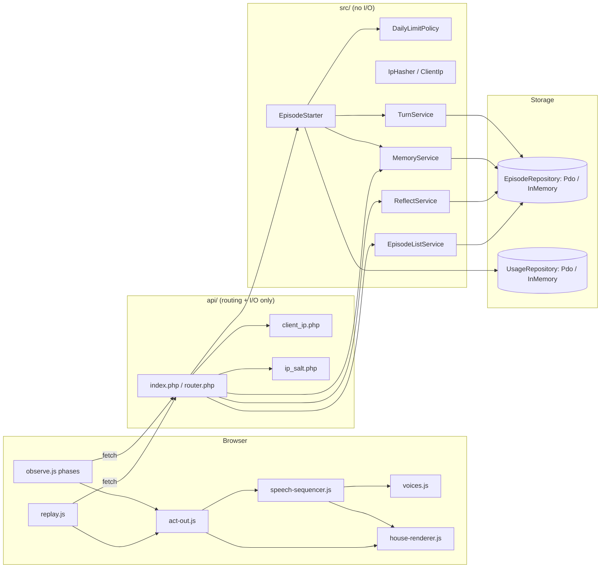
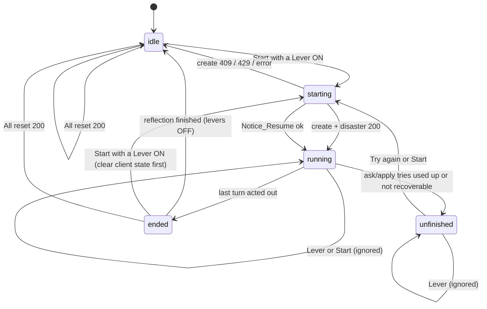
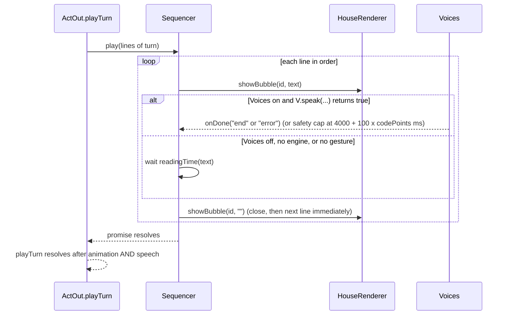

# Design Document

## Overview

Public-lab makes PoltergeistSwitch safe to link from the README, the YouTube description and Devpost. It changes four areas and leaves the engine alone:

1. **Memory belongs to a Device.** Every stored memory gets an owner (`memories.device_id`). A Device's "generation" is `1 + (number of its Reset_Points)`. A memory is visible to a Device only when it is owned by that Device, active, and in that Device's current generation. "All reset" appends one row to a new `device_resets` table. Nothing is deleted or updated.
2. **Two replay groups.** `GET /api/episodes?ended=1` returns `{ "featured": [...], "yours": [...] }`. Featured is a fixed, ordered id list in `Config`. Yours is the cookie Device's ended episodes created at or after its latest Reset_Point.
3. **Observe fixes.** A shared speech-bubble sequencer (`public/js/speech-sequencer.js`) used by Observe and Replay; Voices default on; Pause/Step/Resume/Heavy rain removed; an explicit client phase machine so levers work after an episode ends, after All reset, and after a failed turn ("Try again"); a heat sky that matches the pilot palette.
4. **Daily limits.** Starting a new episode is metered per Device, per IP and for the site, per UTC day, in one new table (`daily_usage`). The check is a reserve-before-create counter taken inside a single database transaction, after the existing 409 checks and before any episode row is written.

All server logic is plain PHP 8.2 in `src/` (no I/O in the services; PDO only in `Pdo*Repository`); `api/` stays routing and I/O (cookie, IP, salt file). All schema changes live in one additive file, `sql/2026-11-10_add_public_lab.sql`, that this spec never runs.

### Research findings that shaped the design

I read the actual code before designing. The points that matter:

- **The generation mechanism already does most of the work.** `episodes.memory_generation` is frozen at creation, `ReflectService` already writes a memory under the *episode's* stored generation, and snapshots/status already filter by generation. Making the generation per Device (instead of one global row) gives per-Device reset, and also solves "a running episode that reflects after a reset must not become active" (Req 4.8) with no race and no clock comparison.
- **The create path is not atomic and not a single transaction.** `ps_handle_create` calls `TurnService::createEpisode` and *then* `MemoryService::snapshotForNewEpisode`. `createEpisode` checks `findRunningEpisodeForDevice` (409 `device_already_running`) and `countRunningEpisodes` (409 `too_many_running`) first. The limiter must slot between those 409 checks and the first insert.
- **Datetimes in `episodes` are server-local (Asia/Tokyo; `EpisodeListService::createdDateIso` assumes it).** The daily limit must not use `created_at`. The UTC day key is computed in PHP and stored as a `DATE`.
- **PDO tests are gated by `PS_TEST_MYSQL_DSN` and skipped by default.** The in-memory fake (`tests/TurnLoop/InMemoryEpisodeRepository.php`) is the only SQL-free oracle, so every new repository method needs a fake twin, and the SQL has to be simple and reviewed by eye.
- **JS tests are plain Node scripts** (`node tests/js/<name>.test.js`) with a hand-made DOM shim, injectable `window.observeWait`, and no runner or `package.json`. The existing `observe.js` is an IIFE that exposes `window.observeController` / `module.exports`.
- **`voices.js` has no completion signal** (`speak(id, line)` is fire-and-forget, queued FIFO), defaults to OFF, ties "enabled" to the presence of a speech engine, and auto-unlocks on *any* click. `Act_Out.showSpoken` joins a character's lines into one bubble and starts all bubbles at once.
- **`replay.js` has no Voices button.** `replay.php` has none either.
- **The pilot** (`pilot/look.php`) is the source of the heat palette (lines 315, 350, 366, 367 confirm the sky, hills, ground and texture colours).

### Conflicts between the requirements and the code (all decisions resolved by the maintainer)

| # | Finding | Resolution in this design |
|---|---|---|
| C1 | **Bug in the PDO retire query.** `appendMemory` and `commitReflectionAnswer` retire with `ORDER BY id ASC ... OFFSET 6`, which skips the 6 *oldest* and retires the *newer* surplus. The in-memory fake retires the oldest, and the gated test `testPdoTwoPerTripleCommitsSerializeToExactlySix` expects the oldest to go. Evidence: `EpisodeRepositoryTest::testPdoTwoPerTripleCommitsSerializeToExactlySix` run against a real MariaDB 10.11 fails today (the six oldest stay active and the new memories are retired). | **Resolved (maintainer confirmed).** The per-Device rewrite retires the oldest surplus with `ORDER BY id DESC ... OFFSET 6`. No live Device has 7 memories, so no live data is affected. After the fix the gated test must pass on MariaDB. |
| C2 | Req 2.10/2.11 want the cap per Device. Today the cap triple is `(robot, disaster, generation)` with no owner. | Triple becomes `(device, robot, disaster, generation)`. Repository signatures gain a leading `string $deviceId` (a stale caller fails with `TypeError`, not silently). Existing `MemoryServiceTest`, `ReflectServiceTest`, `EpisodeRepositoryTest`, `Memory/Properties/*` and `InMemoryEpisodeRepository` must be updated. They assert the old global behaviour, which this spec replaces on purpose. |
| C3 | Req 4 vs the global `memory_generation` row and `MemoryService::reset()`. | The global row and `currentGeneration()/advanceGeneration()` stay (dormant, marked `@deprecated`, not called). Reset appends to `device_resets`. `ResetZeroPropertyTest` and friends are rewritten per Device. |
| C4 | Req 4.4 says reset is 409 while the Device has a "running episode". The server's definition of running (`ended = 0` and activity within 300 s) includes a **staged** episode (Start pressed, lever not flipped) and an **Unfinished_Episode** for up to 5 minutes. Req 8.2 only requires the button disabled "while turns are running". | **Resolved.** The server keeps its 409 for a staged or unfinished episode. Observe shows a plain message such as "All reset is available when no run is in progress. A stopped run is released within 5 minutes." (Req 8.3). There is no "abandon" concept. |
| C5 | Req 6 changes the shape of `GET /api/episodes?ended=1` from a bare array to two groups. Consumers: `replay.js` (`Array.isArray(result.body)`), `EpisodeListServiceTest`, `EpisodeListPropertyTest`, and the `live-records.md` steering URL (cookie-less fetch would now return only Featured). | **Resolved.** Same route, new shape `{featured, yours}`. `.kiro/steering/live-records.md` is updated in this spec so the evidence fetch still works: read the Featured group of the list, or fetch episodes by id. |
| C6 | Req 10.3/10.4 say Notice_Resume works after a page reload. It cannot today: the 409 `device_already_running` body is `{"error": ...}` only, and `state.episodeId` is null after a reload, so `resumeEpisode(null)` shows "could not be resumed". (`heat-wave-screens.test.js` fakes a 409 body that already contains `episodeId`, which the server never sends.) | The server adds `episodeId` (an episode id is public and is not the Device_Id) to that one 409 body. The client falls back to `localStorage ps:lastEpisodeId`. `TurnServiceCreateTest`/`ApiTest` expectations on that body are updated. |
| C7 | Req 10.5 vs `heat-wave-screens.test.js`, which asserts Heavy rain is disabled and says "coming later". | That test (heat-wave spec, not protected) is updated. `#sw-rain`, `.later` CSS and `el.swRain` are removed. |
| C8 | Req 9.9 vs `ask-apply-recovery.test.js`, which asserts the strings "A turn could not be asked. Paused." and "The lab could not be reached. Paused.". | Those assertions change to the Req 9.6 notice. The retry mechanics (5000 ms wait, 3 tries, log sequence) are unchanged and their assertions stay. |
| C9 | Req 11.1 (Voices on by default) vs `voices.js`, which deliberately defaults OFF and sets `enabled = wanted && hasEngine`. A browser with no speech engine would show "Voices: on" but be off. | Split the *setting* (`setOn/isOn`, drives the label) from the *ability* (`speak()` returns false when there is no engine, no gesture, or the setting is off). Lines that cannot be spoken use Reading_Time. |
| C10 | Req 11.3 defines First_Gesture as Lever/Start (Observe) and Play/step/list item (Replay). (a) After a reload, **Notice_Resume** and **Try again** start a run without any listed gesture, so the run would be silent until a lever is touched. (b) Replay list items **navigate** to `replay.php?episode=...`, which is a new page load, so the effective gesture there is Play/step. (c) `voices.js` unlocks on *any* click today. | Extend Observe's First_Gesture to include Notice_Resume and Try again (**resolved**: the glossary entry First_Gesture and Requirement 11.3 are updated to say so). (b) is documented, no change. (c) is replaced by an explicit `voices.gesture()` call in the listed handlers; the capture-phase listener is removed (`autoUnlock:false`). |
| C11 | Req 11.16 (Pause/Step/Play cancel reading and the bubble at once) vs `replay.js`, whose Pause deliberately lets the current turn finish ("no mid-turn cut"). | Replay's Pause/Step/Play call `actOut.cancel()`, which already snaps to the turn's recorded world. The picture still ends in the recorded world (Req 3.9 of the screens spec stays true). |
| C12 | Req 12 says "like the pilot v0.5 heat scene". Sky, hills, ground and texture colours match the pilot. **The yellow sun colours (`#ffc83a`, `#ffd84a`, `#ffe46a`) appear nowhere in the pilot or the repo**; the pilot draws the normal afternoon sun (or a red moon at night). Also the current `heatSky()` adds an orange wash and a white sun, which would alter the stated gradient end points. | **Resolved (maintainer approved a mock-up with these colours).** The sun uses the values in Req 12.3 as written. `heatSky()` drops the old orange wash and white sun; it draws only the new sun. |
| C13 | Req 13.14 defines IP_Hash as "SHA-256 of IP combined with salt". | Implemented as `hash_hmac('sha256', ip, salt)` (HMAC-SHA-256), the standard keyed construction. Same length and properties; tests check determinism and 64 hex characters. |
| C14 | `tech.md` puts an nginx cache in front of PHP. If PHP saw the proxy's address in `REMOTE_ADDR`, every visitor would share one IP hash and the 30/day IP limit would shut the whole site after 30 episodes. | `api/client_ip.php` reads `REMOTE_ADDR` or one configured header (`client_ip_header` in `config.local.php`), validates it, and **returns null for loopback/private/reserved addresses**. A null IP skips the IP scope (device and site limits still apply) and logs the code `ip_unresolvable`. **Resolved (maintainer checked the live host).** `REMOTE_ADDR` is the visitor's own public address: two different networks gave two different values, and it equals the `X-Real-IP` set by nginx; `X-Forwarded-For` is absent. The default `REMOTE_ADDR` is kept and no `client_ip_header` is needed. The option stays as an unused fallback, and the null-for-loopback/private/reserved safety stays (see "IP address source"). |
| C15 | `ps_device_id_from_cookies` accepts any non-empty string; `episodes.device_id` is `VARCHAR(64)`. A long cookie value is a 500 in strict SQL mode and lets a client invent unlimited Device keys. | Accept only `/^[0-9a-f]{32}$/` (what `ps_new_device_id()` mints); anything else is treated as absent. |
| C16 | Req 9.5 says a run is in progress "from the moment a run starts", but `state.running` is only set inside `runLoop`. Between a lever click and the create/flip responses, a second click starts a second request. | New `starting` phase set synchronously at click time (see Observe phases). |
| C17 | Req 4.1 says "exactly one Reset_Point" per accepted reset. A cookie holder can POST reset in a loop and grow `device_resets`. | **Resolved.** Every accepted reset is recorded (one row per accepted reset, per the literal Req 4.1). The row is tiny, cookie-bound, and costs no AI money. No dedupe. |
| C18 | The `ps_handle_create` comment says the snapshot is taken "in the same transaction"; it is a second, separate call. A failure between the two leaves an episode with NULL snapshots, which is non-reflectable. | Pre-existing and rare. Kept as is; `EpisodeStarter` keeps the order and the daily count is **not** released in that case (the episode exists). |

### Items that could touch the protected engine / Golden_Master

Nothing in this design edits `src/Engine/`, `EpisodeConfig`, the situation/reflection text builders or their version constants. The items closest to the line, and how each is guarded:

1. **`TurnService::createEpisode`** (plays the quiet turn 0 through the engine). The only edit is extracting its first two checks into `assertCanStart()` and calling it from the same place. The order of operations is unchanged. Guard: `TurnServiceCreateTest`, `HeatWaveTurnLoopTest`, `EarthquakeGoldenMasterTest`.
2. **`ReflectService`** (builds the reflection text via `ReflectionTextBuilder`). The only edits are passing the Device to repository calls and tagging the stored `MemoryRow`. Guard: a new `ProtectedVersionsTest` pins `SituationTextGenerator::VERSION`, the reflection text version constants and the recorder prompt version to the literal strings currently in the code (captured in task 1, never edited to make a test pass).
3. **`ps_episode_view_to_array` / `GET /api/episodes/{id}`.** Not touched. A new `EpisodeViewBytesTest` pins the exact JSON bytes for a seeded fake episode, captured before any change (Req 1.4).
4. **Which memories appear in a new episode's prompt** changes (that is the point of the spec), but only as *data* frozen into `robot_*_memory_snapshot`. Replay reads the stored snapshot (`ReplayEngineFactory` lines 238-239) and never recomputes it (Req 2.9).
5. **`house-renderer.js`** earthquake drawing. Guard: a render-call-log fixture of an earthquake world, captured from the current renderer *before* editing it.
6. **`Config`** (turn-loop, not `EpisodeConfig`). New promoted parameters with defaults at the end; `new Config()` callers are unaffected.

If any task would require changing a protected item, it stops and reports (Req 1.5).

## Architecture



### Create path: ordering, idempotency, and the 409-before-429 rule

`POST /api/episodes` is not idempotent today and stays that way: a repeat while the first episode runs gets 409 `device_already_running`, which Observe turns into Notice_Resume. The order below preserves that, and Requirement 13.8's reason for it (a retry of a create whose response was lost must reach Resume, not a "limit" message, even when that create was the Device's 10th).

```mermaid
sequenceDiagram
  participant B as Browser
  participant R as router (ps_handle_create)
  participant S as EpisodeStarter
  participant T as TurnService
  participant U as UsageRepository
  B->>R: POST /api/episodes (cookie, IP)
  R->>R: deviceId = valid cookie or mint; ipHash = HMAC(salt, normalized IP) or null
  R->>S: start(deviceId, ipHash, disaster)
  S->>T: assertCanStart(deviceId)
  alt Device already running or 5 running site-wide
    T-->>B: 409 device_already_running (with episodeId) / too_many_running
  end
  S->>U: tryReserve(utcDay, keys, policy)
  alt a limit is reached (nothing changed, tx rolled back)
    U-->>B: 429 daily_device_limit / daily_ip_limit / daily_site_limit
  end
  S->>T: createEpisode(deviceId, disaster)
  alt createEpisode throws (including a racing 409)
    S->>U: release(utcDay, keys)
    T-->>B: error (no count kept)
  end
  S->>S: snapshotForNewEpisode(episodeId, deviceId)
  S-->>B: 200 EpisodeView (+ Set-Cookie only when the cookie was minted)
```

Rules that follow from this order:

- **409 before 429.** `assertCanStart` runs first. It is read-only (two SELECTs).
- **A 429 creates and counts nothing.** `tryReserve` increments only if `DailyLimitPolicy::denial()` returns null, inside one transaction that rolls back on denial.
- **Every other failure after the reservation releases it.** `release` is `UPDATE ... SET starts = starts - 1 WHERE starts > 0`. If PHP dies between reserve and release the day is over-counted by one: the safe direction for a cost control.
- **`createEpisode` re-runs the same two checks** (via `assertCanStart`). Two concurrent creates from one Device can both pass the first check; the loser gets 409 from the second check and its reservation is released. The existing check-then-insert window inside `createEpisode` is unchanged (not made worse).
- **Counts are incremented only by this path.** `ask`, `apply`, `reflect`, `GET`, the list and `replay.php` never touch `daily_usage` (Req 13.1, 13.2).

### Concurrency of limit counting

The three counters are rows in `daily_usage` keyed `(usage_date, scope, key_hash)`; `scope` is `device`, `ip` or `site`. `tryReserve` does, in one transaction, always in primary-key order (`device`, `ip`, `site` sort alphabetically, so lock order is identical for every caller and cannot deadlock):

1. `INSERT ... ON DUPLICATE KEY UPDATE updated_at = VALUES(updated_at)` for each tracked scope. Using an upsert that writes (instead of `INSERT IGNORE`) takes the exclusive row lock immediately and avoids the shared-to-exclusive upgrade deadlock that `INSERT IGNORE` followed by `SELECT ... FOR UPDATE` can produce.
2. `SELECT scope, starts ... FOR UPDATE` for the same keys.
3. `DailyLimitPolicy::denial(counts)` in PHP. If non-null: `ROLLBACK` (this also removes any rows step 1 created, so a flood of invented Device keys that are denied leaves nothing behind) and return the code.
4. Otherwise `UPDATE ... SET starts = starts + 1` for each tracked row and `COMMIT`.

The `site` row is a hot row held for a few milliseconds per create. At this scale (cap 100 per day) that is fine. Because the check and the increment are under the same row locks, N concurrent requests at the boundary admit exactly `limit - current` and reject the rest.

Other races, and where they are closed:

| Race | Outcome |
|---|---|
| Two memory stores for one `(device, robot, disaster, generation)` | Serialised by the existing `SELECT ... FOR UPDATE` over that triple (now including `device_id`). |
| Reset while a reflection is in flight | The reflection stores under the episode's own (older) generation, so it is invisible after the reset. No lock needed. |
| Reset racing a create from the same Device | The create reads the Device generation first; if the reset lands after, that episode keeps the old generation and its memories never show. Acceptable and consistent with "created before the reset". |
| Double-click on All reset | Two Reset_Points; the Device still has zero memories (Req 4.7). Generation number jumps by 2. |
| Two tabs, same cookie | Same as one tab; the 409 rule serialises runs. |

### Ordering of the status line and "generation"

`GET /api/memory` keeps its JSON shape. `generation` now means `1 + number of this Device's Reset_Points` (1 with no cookie). `memory-ui.js` is unchanged.

### Observe phases (client)

Observe gets one explicit `state.phase`. It replaces the scattered checks on `state.running`, `state.episodeId`, `state.paused` and `stepOnce`.



The `staged` phase (an episode created by Start without a disaster, then flipped by a Lever) no longer exists: Levers choose the disaster before the run and Start is the only way to start (Requirement 15). `state.phase` therefore takes the values `idle`, `starting`, `running`, `unfinished`, `ended`. Because no episode is created without a disaster, "turn 0 drawn, waiting for a flip" is gone, and the C4 case of a staged episode blocking All reset can no longer arise from the UI.

| Phase | Meaning | Lever / Start | All reset button |
|---|---|---|---|
| `idle` | No run started | Lever: toggle ON/OFF, at most one ON, **no request**. Start: no Lever ON shows the Start_Hint and sends nothing; a Lever ON creates the episode for that disaster and starts the run (First_Gesture). | enabled |
| `starting` | A create, disaster, resume or Try again request is in flight | **ignored** | disabled |
| `running` | Run loop active (ask, apply, act out) | **ignored** (chosen Lever stays ON) | disabled |
| `unfinished` | Stopped after failed tries; turns stay on screen | Lever: ignored (locked). Start: runs Try again, never creates | enabled (server may answer 409, see C4) |
| `ended` | Last turn acted out; End_Card shown; reflection in flight, then levers OFF | Lever: toggle as in `idle`. Start with a Lever ON: clear client state, then start as from `idle`. | enabled |

`ended` does not wait for the reflection before allowing a new run (Req 9.2); the reflection completion handler is guarded by the episode id it was started for, so it never switches off a newer run's lever or draws into a newer End_Card.

Lever behaviour in detail (Requirements 15 and 16). `onLever(disaster)` calls `voices.gesture()` first (a Lever click is a First_Gesture), then: in `idle` and `ended` it toggles `el.swEarthquake` / `el.swHeat` (`.on`, `aria-pressed`, the `mark` text) with the other turned OFF, and calls the API not at all; in `starting`, `running` and `unfinished` it returns at once. `onStart()` calls `voices.gesture()` first, then: in `unfinished` it runs `tryAgain()`; in `starting` and `running` it returns; in `idle` and `ended` it reads the ON Lever (`earthquake` or `heat_wave`); with none it calls `showNotice('Turn on Earthquake or Heat wave, then press Start.')` and sends nothing; otherwise (after `startNewRun()` from `ended`) it sets `phase = 'starting'` and uses the existing create call with the disaster and the existing disaster call. `doFlip` / `doFlipHeat` failures and `isDisasterAlreadySet` no longer return to a `staged` phase; they fall back to `unfinished` with the Try again notice for the already-created episode. The chosen Lever stays ON until the end and the reflection (`finishClosing`) or All reset set both OFF; a 429 or a failed create sets both OFF.

Notice placement. In `public/index.php` the `<div class="message" id="notice" hidden>` moves inside the Switches_Panel `section.panel`, right after `div.switches`; `renderNoticePanel`, `showNotice` and `clearNotice` keep the same element id, so no other code changes. It keeps `aria-live="polite"` (added to the element, which today has none of its own). `screens.css` gives `#notice` a small top margin inside the panel (the same on narrow screens). After `showNotice` and `renderNoticePanel` set a non-empty notice, `revealNotice()` measures `el.notice.getBoundingClientRect()`; if the top is below 0 or the bottom is above `window.innerHeight` (or `document.documentElement.clientHeight`) it calls `el.notice.scrollIntoView({block:'nearest', behavior})` with `behavior = 'instant'` when `matchMedia('(prefers-reduced-motion: reduce)').matches` and `'smooth'` otherwise; a fully visible notice is not scrolled.

### Speech sequencer (shared by Observe and Replay)

`public/js/speech-sequencer.js` owns "one Spoken_Line at a time, in order, bubble visible while it is being read". `act-out.js` no longer shows speech itself; it asks the sequencer and resolves `playTurn()` only when both the animation and the line sequence are done.



State per line: `mode = 'voice' | 'timer'`, `startedAt`. Rules implemented there:

- `readingTime(text) = min(12000, 2000 + 60 * codePoints(text))`.
- Voice mode ends at the later of `onDone('end')` and `startedAt + readingTime` (a reading that ends early keeps the bubble for the rest of the Reading_Time; a long reading is never cut). `onDone('error')` switches the line to timer mode for the remaining Reading_Time, like Voices turned off. The per-line safety cap `4000 + 100 * codePoints` ms (always at least `readingTime`) applies only when the voice reports neither `'end'` nor `'error'`; it calls `voices.cancel()` so the next line is not queued behind a stuck utterance and closes the bubble.
- Voices turned off mid-line: `bindVoicesButton` calls `sequencer.voicesChanged(false)`, which calls `voices.cancel()` (stops within 200 ms; `onDone('cancelled')`), and the line switches to timer mode for `max(0, readingTime - elapsed)` from the **original start** (Req 11.14).
- Voices turned on mid-line: nothing changes for the current line; the next line may use voice (Req 11.15).
- `cancel()` (Replay Pause/Step/Play, Observe reset or new run): bumps a token, clears all timers, cancels voices, closes the open bubble, resolves the pending `play()` promise.
- A turn with no Spoken_Line: `play([])` resolves immediately (0 ms, Req 11.12).

## Components and Interfaces

### Server (PHP 8.2, `src/` has no I/O)

**`Config` additions** (`src/TurnLoop/Config.php`, appended promoted parameters with defaults):

```php
public int $dailyDeviceLimit = 10,
public int $dailyIpLimit = 30,
public int $dailySiteLimit = 100,
/** @var list<string> */
public array $featuredEpisodeIds = [
    'b9931223-fc11-4162-8a4d-a8cf55886e1e',
    '450e9249-94db-4744-987d-ec6774bf5057',
    '4113e82c-2f09-49e4-b647-a1481d794807',
    '2a3800d5-4029-448c-8152-fd622693a775',
    '3ef560a5-c35c-4632-869f-d01fb2dd2e2b',
    'bae88cfc-7eea-4cb6-a742-a49c0ccc401c',
    '36e82c3e-03bc-4396-bfdc-e3fc33ffe671',
    '186823c0-3ff4-4289-ad30-ca98ef97708e',
],
```

`assertInvariants()` also requires each limit `>= 1` and each featured id to match the UUID pattern. These are non-secret and live in the repository (Req 6.1, 13.3).

**`DailyLimitPolicy`** (`src/TurnLoop/DailyLimitPolicy.php`, pure):

```php
final class DailyLimitPolicy
{
    public function __construct(public readonly int $device, public readonly int $ip, public readonly int $site) {}
    public static function fromConfig(Config $c): self;
    /** @param array{device:int, ip:?int, site:int} $counts starts so far today; ip null = scope not tracked
     *  @return 'daily_device_limit'|'daily_ip_limit'|'daily_site_limit'|null  first reached, in that order */
    public function denial(array $counts): ?string;
    public static function utcDay(int $unixTime): string;   // gmdate('Y-m-d', $t)
}
```

**`ClientIp`** (`src/TurnLoop/ClientIp.php`, pure): `normalize(?string $raw): ?string`. Returns null for empty, malformed, loopback, private, link-local or reserved addresses (`FILTER_VALIDATE_IP` with `NO_PRIV_RANGE | NO_RES_RANGE`). IPv4 is returned in canonical dotted form. IPv6 is reduced to its `/64` prefix (the interface half rotates with privacy extensions and would otherwise defeat a per-IP limit). IPv4-mapped IPv6 is unwrapped to IPv4.

**`IpHasher`** (`src/TurnLoop/IpHasher.php`, pure): `__construct(string $salt)`; `ipHash(string $normalizedIp): string` and `deviceKey(string $deviceId): string`, both `hash_hmac('sha256', "<scope>:" . $value, $salt)` (64 hex). The Device key is hashed too, so `daily_usage` stores no raw Device_Id or IP.

**`UsageKeys`** value object: `deviceKey`, `?ipKey`, and the constant `SITE_KEY` (64 zeros).

**`UsageRepository`** (`src/TurnLoop/Repository/UsageRepository.php`) implemented by `PdoUsageRepository` and the test fake `InMemoryUsageRepository`:

```php
interface UsageRepository
{
    /** Atomic: null and +1 on every tracked scope, or the denial code and no change. */
    public function tryReserve(string $utcDay, UsageKeys $keys, DailyLimitPolicy $policy, string $nowUtc): ?string;
    public function release(string $utcDay, UsageKeys $keys, string $nowUtc): void;
    /** @return array{device:int, ip:?int, site:int} */
    public function counts(string $utcDay, UsageKeys $keys): array;
}
```

**`EpisodeStarter`** (`src/TurnLoop/EpisodeStarter.php`, orchestrates; no I/O of its own):

```php
public function __construct(TurnService $turns, MemoryService $memory, UsageRepository $usage,
                            DailyLimitPolicy $policy, ?callable $clock = null /* fn(): int unix seconds */);
public function start(string $deviceId, ?UsageKeys $keys, string $disaster = 'earthquake'): EpisodeView;
// 1 assertCanStart  2 tryReserve (429)  3 createEpisode  (catch: release, rethrow)  4 snapshotForNewEpisode
```

**`TurnService`**: new public `assertCanStart(string $deviceId): void` containing the two existing checks verbatim (`device_already_running`, `too_many_running`); `createEpisode` calls it where the inline checks were. `device_already_running` now also carries the running episode's id (see `ApiError`).

**`ApiError`**: `tooManyRequests(string $code): self` (status 429, body `{"error": code}` only). `conflict()` gains an optional `?string $episodeId` that `toArray()` emits as `episodeId` when set; only `device_already_running` sets it.

**`MemoryService`** (Device-scoped):

```php
public function snapshotForNewEpisode(string $episodeId, string $deviceId): void;
public function status(?string $deviceId): MemoryStatus;   // null => generation 1, zero memories
public function reset(?string $deviceId): MemoryStatus;    // null => no-op; running episode => ApiError::conflict('episode_running')
```

`snapshotForNewEpisode` reads `deviceGeneration($deviceId)`, then each robot's `activeMemories($deviceId, $robot, $generation, 18)`, then `storeEpisodeMemory($episodeId, $generation, ...)`. `reset` checks `findRunningEpisodeForDevice` first, then `recordDeviceReset`.

**`ReflectService`**: reads `$episode->deviceId` once, passes it to every `activeCount(...)` and sets it on the `MemoryRow`. The generation is still `episodeGeneration($episodeId)`. No text builder change.

**`MemoryRow`**: new trailing `public ?string $deviceId = null`.

**`EpisodeRepository` changes** (Pdo and InMemory kept identical in behaviour, Req 5.5):

```php
public function deviceGeneration(string $deviceId): int;                         // 1 + resets
public function recordDeviceReset(string $deviceId, string $now): int;           // appends one row, returns new generation
public function latestDeviceResetAt(string $deviceId): ?string;
public function activeMemories(string $deviceId, string $robotId, int $generation, int $cap): MemorySnapshot;
public function activeCount(string $deviceId, string $robotId, int $generation, string $disaster): int;
// appendMemory / commitReflectionAnswer: MemoryRow now carries deviceId; cap triple includes it.
/** @param list<string> $ids  @return EpisodeRow[] ended episodes among $ids, in $ids order */
public function listEndedEpisodesByIds(array $ids): array;
/** @param list<string> $excludeIds  @return EpisodeRow[] newest first */
public function listEndedEpisodesForDevice(string $deviceId, ?string $sinceCreatedAt, array $excludeIds, int $limit): array;
```

Reads exclude `device_id IS NULL` rows by construction (`device_id = :device`). A `MemoryRow` stored with a null device (not produced by any new code path) is ignored by every read (Req 5.2).

The per-Device retire statement (also the C1 fix):

```sql
UPDATE memories SET status = 'retired', retired_at = :retired_at
WHERE id IN (SELECT id FROM (
  SELECT id FROM memories
  WHERE device_id = :device_id AND robot_id = :robot_id AND disaster = :disaster
    AND generation = :generation AND status = 'active'
  ORDER BY id DESC LIMIT 1000 OFFSET 6      -- skip the 6 newest, retire the older surplus
) AS surplus)
```

**`EpisodeListService`**: constructor adds `Config`; `list(mixed $rawLimit, ?string $deviceId): array` returns `['featured' => [...], 'yours' => [...]]`. Item building moves into a private `buildItem(EpisodeRow)` (same four fields and the heat-only `disaster` key, so each item is byte-identical to today's). Featured: `listEndedEpisodesByIds($config->featuredEpisodeIds)`, in full, missing or unended ids simply absent. Yours: `[]` without a Device; otherwise `listEndedEpisodesForDevice($deviceId, latestDeviceResetAt($deviceId), $config->featuredEpisodeIds, $limit)` where `$limit` is validated exactly as today (integer 1-100, default 20). Excluding Featured ids in SQL (not afterwards) means a Featured episode never uses up a "Your runs" slot (Req 6.5).

### API layer (`api/`, thin)

| File | Change |
|---|---|
| `bootstrap.php` | `ps_device_id_from_cookies` validates `/^[0-9a-f]{32}$/` (C15). Builders share one memoized `ps_build_pdo()` (today each service builder opens its own connection: up to 4 per request). New `ps_build_episode_starter()` and `ps_build_usage_repository()`. |
| `client_ip.php` (new) | `ps_client_ip(array $server, array $config): ?string`: picks `REMOTE_ADDR` or the configured header (rightmost entry of a comma list, the one the trusted proxy appended) and returns `ClientIp::normalize()`. |
| `ip_salt.php` (new) | `ps_load_ip_salt(string $secretsDir): ?string` (see "IP salt"). |
| `router.php` | `ps_dispatch(...)` gains trailing optional `?EpisodeStarter $starter = null, ?string $clientIp = null, ?IpHasher $hasher = null`. Reads the Device once and hands it to the memory, list and create handlers. |
| `episodes_create.php` | Builds `UsageKeys` from Device + IP, calls `EpisodeStarter::start`, sets the cookie only when it minted one. |
| `episodes_list.php` | Passes the Device to `EpisodeListService::list`. |
| `memory_get.php` / `memory_reset.php` | Pass the Device (nullable). Reset 409 is raised by the service as `ApiError` and mapped by the router's existing catch. |

Response contracts (all `Cache-Control: no-store`, none contains a Device_Id, raw IP or IP hash):

| Route | Success | Errors |
|---|---|---|
| `POST /api/episodes[?disaster=heat_wave]` | 200 EpisodeView (unchanged shape) | 409 `device_already_running` (+`episodeId`), 409 `too_many_running`, **429** `daily_device_limit` / `daily_ip_limit` / `daily_site_limit` (body `{"error": code}` only) |
| `GET /api/episodes?ended=1[&limit=n]` | 200 `{"featured":[item...], "yours":[item...]}` | 400 `limit_out_of_range` (unchanged) |
| `GET /api/episodes/{id}` | unchanged bytes, no Device check | 404 (unchanged) |
| `GET /api/memory` | 200 `{generation, robots:{amber:{activeCount,lengths}, jade:{...}}}` for the cookie Device; no cookie: generation 1, zeros, **no cookie minted** | none |
| `POST /api/memory/reset` | 200 `{generation}` (no cookie: 200 `{generation:1}`, nothing recorded, no cookie) | 409 `episode_running` |

### IP salt (decision: `<secrets_dir>/ip_salt.key`, created once on first use)

- **Where.** The directory already named by `secrets_dir` in `api/config.local.php`. It is outside the web root and the repository, PHP already reads `db.php` and the `*.key` files from it, and `*.key` is already in `.gitignore`. File name `ip_salt.key`, content `bin2hex(random_bytes(32))` plus a newline, mode 0600.
- **No hand-edited secret.** `ps_load_ip_salt` reads the file; if it does not exist it creates it. The maintainer edits nothing.
- **Race-safe create.** Write a temporary file in the same directory, then `link()` it to `ip_salt.key`. `link()` fails if the target exists, so two simultaneous first requests cannot overwrite each other's salt; the loser reads the winner's file. If `link()` is not permitted on the host, fall back to `rename()` only when `!file_exists()`. This leaves a very small window in which two requests could use different salts for one day, which only causes slightly lower counts. The temporary file is removed.
- **Never clobber.** An existing file that is unreadable or not 64 hex characters is **not** overwritten (that would silently change every hash). It is treated as "salt unavailable".
- **Shared-hosting caveat (cannot be verified from here).** This needs PHP to be able to write into `secrets_dir`. On onamae.com RS, PHP runs as the account owner and I expect it to be writable, but I have not seen the server. If it is not writable the IP scope is skipped (device and site limits still apply) and `error_log` receives the fixed code `ip_salt_unavailable` (never an IP or path). The maintainer can then upload any 64-hex `ip_salt.key` by hand over FTPS and it will be reused.
- **Rejected alternatives.** (a) Store the salt in the database: a database leak would then expose the salt and the hashes together, and IPv4 is brute-forceable. (b) Derive the salt from an API key with HMAC: no write needed, but it contradicts Req 13.15 ("random bytes, created once") and couples a hash to key rotation.

### IP address source (confirmed)

The maintainer checked the live host: `$_SERVER['REMOTE_ADDR']` is the visitor's own public address (two different networks gave two different values). It equals the `X-Real-IP` header set by nginx, and `X-Forwarded-For` is absent. So the default `REMOTE_ADDR` is used and `client_ip_header` is not needed. The optional `client_ip_header` key (for example `'HTTP_X_REAL_IP'`) stays in the design as an unused fallback if the host setup changes, and `ClientIp::normalize` still returns null for loopback/private/reserved addresses, so a proxy address would skip the IP scope rather than throttle everyone as one address.

### Browser (plain JS, no build step)

**`public/js/speech-sequencer.js`** (new; same UMD shape as `voices.js`, attaches to `window` and `module.exports`):

```js
readingTime(text)                       // min(12000, 2000 + 60 * codePoints)
linesOfTurn(turn)                       // [{id:'amber',text},..., {id:'jade',text},..., {id:'man',text}]; thoughts never included
createSpeechSequencer({ house, voices, timers, now })   // timers/now injectable for tests
  .play(lines) -> Promise               // resolves when the last line has closed, or on cancel()
  .cancel()                             // close bubble, stop voices, clear timers, resolve
  .voicesChanged(on)                    // toggle handler hook (Req 11.14, 11.15)
bindVoicesButton(button, voices, sequencer)   // label "Voices: on|off", aria-pressed, 100 ms update
```

`linesOfTurn` takes each element of `reading.words` as one line (not the joined string used today), in order: `robot_a`, `robot_b`, then `residentLine`. Blank strings are dropped.

**`public/js/voices.js`** (backward compatible additions):

```js
speak(id, line, onDone) -> boolean   // true if reading started; onDone(reason) exactly once: 'end' | 'error' | 'cancelled'
setOn(bool) / isOn()                 // the visitor's setting; drives the button label; does not need an engine
gesture()                            // call synchronously inside the First_Gesture click handler; primes the engine
cancel()                             // stops reading; pending onDone('cancelled')
```

`speak()` returns false (and calls nothing on `speechSynthesis`) when the setting is off, there is no engine, `gesture()` has not run, or the line is blank. The existing `setEnabled/isEnabled/on/off/unlock/stop` remain as aliases. Controllers construct with `{ autoUnlock: false, enabled: true }` so the capture-phase "any click" listener is gone.

**Chunked speaking (Requirement 17; `voices.js` only).** The interface above does not change: one `speak(id, line, onDone)` per Spoken_Line, `onDone` exactly once. Inside, `splitForSpeech(text)` (exported for tests as `Voices.splitForSpeech` / `createVoices.splitForSpeech`) returns the Spoken_Chunks: (1) cut after `.`, `!`, `?` or `…`/`...` when followed by whitespace or the end; (2) any chunk over 180 characters is cut after `, ` or `; ` (the separator stays with the left part, parts are packed greedily up to 180), and a part still over 180 with no separator is cut at the last space before 180 (a hard cut at 180 if there is no space); (3) blanks are dropped and concatenating the chunks (ignoring cut whitespace) gives back the line. The queue is per chunk: an entry is `{line, chunks, index}` and each chunk becomes one `SpeechSynthesisUtterance` with the line's voice, `lang`, pitch and rate. The line reports `'end'` after the last chunk ends, `'error'` if a chunk errors (remaining chunks are dropped), `'cancelled'` on `cancel()`. The bubble is untouched: `speech-sequencer.js` still sees one line and one `onDone`.

Keep-alive rules inside `voices.js` (Chrome stalls long or backgrounded speech):

| Rule | Behaviour |
|---|---|
| Resume before speak | Before each `synth.speak(utterance)`: `if (synth.paused) synth.resume()`. |
| 150 ms after cancel | `cancel()` records `lastCancelAt = now()`. Before a `speak`, if `now() - lastCancelAt < 150` the speak is deferred with a timer for the remainder, then done (still in order, and abandoned if a newer `cancel()` ran meanwhile). |
| Keep-alive tick | While a chunk is being read, an interval of 5000 ms calls `synth.resume()` if `synth.paused`. It is cleared when the chunk ends, errors or is cancelled. |
| Visibility and focus | One listener each for `document` `visibilitychange` (when `document.visibilityState === 'visible'`) and `window` `focus` calls `synth.resume()`. Installed once per `createVoices`, only when an engine exists. |
| Chunk_Watchdog | Per chunk, a timer of `T = 2000 + 120 * chars / rate` ms (the chunk's characters, the line's rate). At `T`, if the chunk has not ended or errored and `synth.speaking === false`, the chunk is treated as ended and the next chunk goes on. If `synth.speaking` is still true, the watchdog waits until `2T` from the chunk's start; then it cancels that chunk (`synth.cancel()`, which starts a new 150 ms gap and drops queued utterances, so the entry re-issues the remaining chunks itself) and goes on with the next chunk. The line continues; it is not reported as an error. |

`timers`, `now`, and the `document`/`window` listeners are injectable through `createVoices` options (defaults: `setTimeout`, `setInterval`, `Date.now`, the real globals), so tests drive them with `fake-clock.js` and a fake `speechSynthesis`.

**`public/js/act-out.js`**: `createActOut(house, voices, sequencer)`. `emitSpeech/showSpoken/speakAloud` are removed. `playTurn` starts the animation timers as today, calls `sequencer.play(linesOfTurn(turn))`, snaps to the recorded world when the animation window ends, and resolves after `Promise.all([animationDone, speechDone])`. `cancel()` also calls `sequencer.cancel()`. Reduced motion still jumps to the world within 100 ms; speech is unaffected.

**`public/js/house-renderer.js`**: heat palette in `sky()`, `ground()` and the hills loop when `S.heat`; `heatSky()` reduced to the sun; new `reset()` that restores the mount-time state, clears bubbles, caption and thinking flags (Req 8.1 "first-load state").

```js
// sky(): if (S.heat) { top = [58,14,30]; bot = [196,78,40]; }  (no generic sun, no stars, no bats)
// hills: S.heat ? '#3a1622' : existing
// ground(): base S.heat ? '#2a1a10' : existing; texture S.heat ? '#3c2614' : '#2b3824'
function heatSky() {                      // sun only; the orange wash and white sun are removed
  alpha('#ffc83a', 0.16); disc(330, 34, 32, '#ffc83a');
  alpha('#ffd84a', 0.32); disc(330, 34, 21, '#ffd84a'); ctx.globalAlpha = 1;
  disc(330, 34, 13, '#ffe46a');
}
```

An earthquake world has `S.heat === null`, so every new branch is skipped and the call sequence is byte-identical. `setWorld` of an earthquake world after a heat world sets `S.heat = null`, which already restores the earthquake look (Req 12.6).

**`public/js/observe.js`**: remove `pause/step/resume`, `state.paused`, `stepOnce`, the three `el.btn*` lookups, `wireControls` handlers for them, the `sw-rain` lookup, and their exports. Add `state.phase` and the following behaviour:

- `onLever(disaster)` / `onStart()` call `voices.gesture()` first, then dispatch on phase per the table. `starting` is set synchronously before any request.
- `startNewRun()` (from `ended`): `actOut.cancel()`, `pendingAsk = null`, `looping = false`, clear episode id and expected turn, meters, log, notice, End_Card (`dismissEndCard`), drop `reflectHost`; keep `lastEpisode` in `localStorage` for the catch-up.
- Create error handling: 409 `device_already_running` -> Device_Busy_Notice with Notice_Resume bound to `body.episodeId || readLastEpisode()`; 409 `too_many_running` -> existing lab-busy panel; **429** -> `phase = idle`, both levers OFF, stage untouched, `showNotice(...)` with the Req 13.12/13.13 text chosen by `body.error`.
- Failure exhaustion (`recoverTurn` at `MAX_TURN_TRIES`, or a non-recoverable ask/apply status): `phase = unfinished`, `renderNoticePanel('A turn could not be completed.', [{label:'Try again', primary:true, onClick: tryAgain}])`. The three old "Paused." strings are removed.
- `tryAgain()`: `phase = starting`; `api.getEpisode(state.episodeId)`; 200 and `ended` -> `onEpisodeEnded(view)`; 200 and not ended -> `adoptEpisode(view)` (resyncs `expectedTurn`), clear notice, `phase = running`, `runOneTurn()` with a fresh failure count; failure -> back to `unfinished` with the same notice. It never calls `createEpisode`.
- `onEpisodeEnded(view)` returns after the reflection settles: `runEndCardReflection()` returns a Promise (also when there is nothing to reflect); a `.then(finishClosing(episodeId))` switches both levers OFF only if `state.episodeId === episodeId && phase === 'ended'`.
- All reset: `confirmResetMemory` -> on 200 `clientResetToFirstLoad()` (levers OFF, `house.reset()`, meters, log, End_Card and notice cleared, `phase = idle`, status line from the response) then `refreshMemoryStatus()`; on 409 `showNotice('All reset is available when no run is in progress. A stopped run is released within 5 minutes.')` and nothing else changes; the button is `disabled` in `starting` and `running`.
- Voices: `createVoices({enabled:true, autoUnlock:false})`, `createSpeechSequencer({house, voices})`, `createActOut(house, voices, sequencer)`, `bindVoicesButton(el.btnVoices, voices, sequencer)`; initial label "Voices: on".

**`public/js/replay.js`**: `renderList(body)` reads `body.featured` / `body.yours` and builds two sections with headings "Featured" and "Your runs" (empty state line under "Your runs"); the `Array.isArray` check becomes an object check. The sequencer/Voices wiring matches Observe, with `voices.gesture()` in the Play, Pause, Step back and Step forward handlers. `play`, `pausePlayback`, `stepBack`, `stepForward` and `chooseAnother` each call `actOut.cancel()` first (Req 11.16).

**`public/index.php`**: delete `#btn-pause`, `#btn-step`, `#btn-resume`, `#sw-rain` and the "coming later" text; the Voices button starts as "Voices: on" with `aria-pressed="true"`; update the stale comments that mention three switches and Pause/Step/Resume.

**`public/replay.php`**: add `<button type="button" class="btn" id="btn-voices" aria-pressed="true">Voices: on</button>` in the header (outside the `hidden` controls, so it exists in list and playback modes); add `js/speech-sequencer.js` to the script list before `act-out.js`. `index.php` loads it in the same position.

## Data Models

### The additive SQL file `sql/2026-11-10_add_public_lab.sql`

```sql
-- Migration: public lab (per-device memory, per-device reset points, daily start counters).
--
-- This file is schema only. It is NEVER run against a database by any task.
-- The maintainer applies it on the server over FTPS BEFORE deploying the matching
-- code: the new code reads memories.device_id, device_resets and daily_usage and
-- is not required to work until this file has been applied.
--
-- MySQL, InnoDB, utf8mb4. Purely additive: one nullable column and two indexes on
-- `memories`, and two new tables. Every existing row and column keeps its meaning.
-- Existing memories keep device_id NULL and are therefore "legacy": no Device is
-- ever shown one. No secret, credential, key or provider name appears here.

ALTER TABLE memories
  ADD COLUMN device_id VARCHAR(64) NULL,
  ADD KEY idx_device_snapshot (device_id, robot_id, generation, status, id),
  ADD KEY idx_device_pick (device_id, robot_id, disaster, generation, status, id);

-- One row per accepted "All reset", append-only. A Device's generation is
-- 1 + COUNT(rows for it). reset_at gates the "Your runs" list.
CREATE TABLE device_resets (
  id        BIGINT      NOT NULL AUTO_INCREMENT,
  device_id VARCHAR(64) NOT NULL,
  reset_at  DATETIME    NOT NULL,
  PRIMARY KEY (id),
  KEY idx_device (device_id, id)
) ENGINE=InnoDB DEFAULT CHARSET=utf8mb4 COLLATE=utf8mb4_unicode_ci;

-- Episode starts per UTC day. usage_date is computed in PHP (UTC), never from
-- created_at (which is server-local time). key_hash is an HMAC-SHA-256 hex
-- string; no raw Device_Id or IP address is stored. The 'site' scope uses 64 zeros.
CREATE TABLE daily_usage (
  usage_date DATE         NOT NULL,
  scope      VARCHAR(8)   NOT NULL,
  key_hash   CHAR(64)     NOT NULL,
  starts     INT UNSIGNED NOT NULL DEFAULT 0,
  updated_at DATETIME     NOT NULL,
  PRIMARY KEY (usage_date, scope, key_hash)
) ENGINE=InnoDB DEFAULT CHARSET=utf8mb4 COLLATE=utf8mb4_unicode_ci;
```

Notes on the choices:

- **Owner on the memory row, not a join.** `memories.device_id` makes `activeMemories`/`activeCount` and the retire statement single-table and index-served. The owner is the `device_id` of the source episode, read at reflection time (Req 2.1).
- **Reset point = append-only row, generation = count + 1.** A reset inserts one row and modifies nothing else (Req 4.3). No memory row is updated or deleted by a reset; per-Device retirement still updates only that Device's own surplus rows, as before.
- **Why generation (not time) gates memories, but time gates the list.** Memory visibility uses the generation frozen on the episode, so a late reflection from a pre-reset episode is invisible with no race. The list needs "episodes created after the reset" for episodes that pre-date this spec, whose `memory_generation` is the old global number and cannot be compared, so it compares `episodes.created_at >= device_resets.reset_at` (both written by PHP `date()` in the same server timezone).
- **Dormant objects.** `memory_generation` (global row) and `episodes.memory_generation` for old episodes stay as they are. New episodes store the Device generation in `episodes.memory_generation`.
- **No cleanup of `daily_usage`.** It gains at most one row per Device, per IP and one site row per day. Purging old days is out of scope (deleting nothing is the safe default).

### Value objects and payloads

| Name | Fields |
|---|---|
| `UsageKeys` | `deviceKey: string`, `ipKey: ?string`, `siteKey: string` (constant 64 zeros) |
| `MemoryRow` (extended) | existing fields + `deviceId: ?string = null` |
| `MemoryStatus` | unchanged fields; `generation` now `1 + resets` |
| Episode list item | unchanged: `id`, `createdDate`, `turns`, `startingSituation`, optional heat-only `disaster` |
| 429 body | `{"error": "daily_device_limit" \| "daily_ip_limit" \| "daily_site_limit"}` |
| 409 reset body | `{"error": "episode_running"}` |
| 409 create body | `{"error": "device_already_running", "episodeId": "<uuid>"}` (the second key is new) |

### Client state

`state.phase` (`idle`, `starting`, `running`, `unfinished`, `ended`; `staged` was removed by Requirement 15) plus the existing `episodeId`, `expectedTurn`, `ended`, `disaster`. `state.paused` is deleted. `localStorage ps:lastEpisodeId` is unchanged (still holds only an episode id). Sequencer line state is internal to `speech-sequencer.js`.

### Config in `api/config.local.php` (uncommitted)

Existing `secrets_dir`. New optional `client_ip_header` (a `$_SERVER` key, default `REMOTE_ADDR`). `api/config.example.php` gets the placeholder and a comment. No secret value is ever written to the repository.

### Security hardening (Requirements 18, 19, 20; source: security review 2026-11-10)

These three changes touch `src/`, `api/` and `public/` (intended). They add no table or column and do not change `sql/`, the engine, the robot-facing texts, the Golden_Master (SHA-256 starting with `c2aba50f87c22fe6`) or any protection pin.

#### Findings from reading the current code

- `TurnService::ask()` (src/TurnLoop/TurnService.php) reads the turn, skips a robot that has a stored success or `attemptsFor($turn, $robotId) >= 2`, runs the provider calls through `ParallelHttp`, and only then calls `incrementAttempt()` inside the result loop. Concurrent asks all pass the check. `apply()` has the same shape around `recorder->prepare/finish`; it ends with `storeAppliedTurn` (idempotent), `setTurnState`, then `markEpisodeEnded` or `setCurrentExpectedTurn`.
- `EpisodeRepository` has `incrementAttempt(): int` (returns the new count) and no lock methods. `PdoEpisodeRepository` holds one `PDO` for its lifetime, so a named lock taken through it lives on the connection every other call of that request uses. `InMemoryEpisodeRepository` (tests/TurnLoop/) is the fake.
- `ps_dispatch()` (api/router.php) has no origin parameter and no security headers. Every response is built by `ps_json_response()` (api/bootstrap.php), which is the single place that sets `Content-Type` and `Cache-Control`; `api/index.php` copies `$response->headers` to the output. So API headers are added in `ps_json_response`.
- `findRunningEpisodeForDevice` and `countRunningEpisodes` (PDO and fake) both use one rule: `ended = 0 AND last_activity_at >= now - idleSlotReleaseSeconds`. `createEpisode` writes the quiet turn 0 as an applied turn, so every episode has a turn row 0; `ask` calls `touchActivity` and then `createTurn` for the first real turn, which is turn 1 or more.
- `api/` has an `index.php` (the only front controller). `api/.htaccess` rewrites unknown paths to it, but its rule "leave real files alone" lets a request for `api/episodes_ask.php` or `api/bootstrap.php` run that file directly.
- `public/index.php`, `public/replay.php`, `public/css/screens.css` and `public/js/*.js` contain no `<style>`, no `style="`, no inline `<script>` body and no inline event handler (grep found none). The JS sets styles only through `element.style.*` (CSSOM, allowed by `style-src 'self'`). `screens.css` uses `@import url('https://fonts.googleapis.com/...')` and the pages link the same Google Fonts stylesheet, both covered by `style-src ... https://fonts.googleapis.com` and `font-src https://fonts.gstatic.com`. So no inline style has to be moved. **`public/debug.php` is different**: it has an inline `<style>` and an inline `<script>`, so it would break under this policy. It is out of scope (Requirement 20 names only the two pages and the API) and is listed under "What cannot be verified here" for the maintainer.
- The pages have no `require` of `src/`, and the deployed folder layout is not known from the repository (on the server `public/` is the web root and `api/` sits inside it, while `api/bootstrap.php` loads `../src/`). So the page headers must not depend on a path into `src/`.

#### Task 21: Turn_Lock (Requirement 18)

Interface additions on `EpisodeRepository`:

```php
/** Try to take the per-turn lock without waiting. $kind is 'ask' or 'apply'. */
public function acquireTurnLock(string $kind, string $episodeId, int $turnNumber): bool;
/** Release it. Releasing a lock that is not held is a no-op. */
public function releaseTurnLock(string $kind, string $episodeId, int $turnNumber): void;
```

- **Name.** `'ps_' . $kind . ':' . sha1($episodeId . ':' . $turnNumber)`: at most 4 + 5 + 40 = 49 characters, so it is always within MySQL's 64-character limit whatever the id length, and `ask` and `apply` names differ. The name is built in PHP (one private helper in `PdoEpisodeRepository`) and bound as a parameter: `SELECT GET_LOCK(:name, 0)` and `SELECT RELEASE_LOCK(:name)`. This is the `GET_LOCK(CONCAT('ps_ask:', episode_id, ':', turn), 0)` of the review with a hash added for the length limit. MySQL 5.7-compatible; no `SKIP LOCKED`.
- **Result.** `GET_LOCK` returns 1 (obtained), 0 (busy) or NULL (error). Only 1 returns true; 0 and NULL both return false, so an error fails closed as Turn_Busy and never lets a call through.
- **Connection.** The lock is taken on the repository's own `PDO`, the connection used by every other query of the request. Named locks are per connection and are released when the connection closes, so a request that dies releases the lock. The repository remembers the names it holds so `releaseTurnLock` only releases its own. `storeAppliedTurn` runs a transaction on the same connection; named locks are not affected by commit or rollback.
- **Fake.** `InMemoryEpisodeRepository` keeps a set of held names plus a test hook `holdTurnLock($kind, $id, $turn)` that marks a lock as held by "someone else", so `acquireTurnLock` returns false for it. It also exposes acquire and release counters so a test can prove the release.

`TurnService::ask()` becomes:

1. `findEpisode` (404 if missing), as today.
2. `acquireTurnLock('ask', ...)`. If false: throw `ApiError::conflict('turn_busy', $episode->currentExpectedTurn, $this->currentTurnState(...))` (the existing 409 shape, so Observe can read `currentExpectedTurn` and the state). Nothing else runs: no `touchActivity`, no engine, no client.
3. `try { ... } finally { releaseTurnLock('ask', ...); }` around the rest. Inside, **re-read** the episode and turn (the ended, turn-mismatch and already-applied gates move inside the try and run on fresh values), then the existing `touchActivity`, `createTurn`, `prepareTurn` and staging.
4. **Reserve before the call.** For each robot with no stored success and `attemptsFor(...) < 2`: `$reserved = $this->repo->incrementAttempt(...)`; stage the call only if `$reserved <= 2`; keep `$reserved` per robot. After the call, `savePromptAndReply` uses that `$reserved` (today it uses the value `incrementAttempt` returned after the call, so the stored attempt numbers are unchanged). The pre-check stays, so the counters never go above 2; the reservation is the second guard. A request that dies after reserving costs one attempt and leaves no reply, which the existing rule already treats as a failed attempt.
5. The post-call decision logic (reload the turn, `markNoReply`, `replies_complete`) is unchanged.

`TurnService::apply()` follows the same shape with `'apply'`: lock after `findEpisode`; the "already applied: return the stored view" check, the ended and turn gates and the `replies_complete` check all run inside the try on fresh values, so a repeat `apply` of an applied turn that gets the lock still returns the stored state, and one that does not get it receives Turn_Busy. `storeAppliedTurn` was already idempotent; the lock stops the second recorder spend. The two lock kinds are independent, so an `ask` for the same turn is not blocked by an `apply`.

Why lock first and re-read: a check made before the lock can be stale by the time the lock is taken (another request may have reserved attempts or applied the turn in between). The lock does not wait, so locking first costs one cheap query on a request that is about to spend money anyway.

**Observe** (`public/js/observe.js`). `askAndApply` and `applyOnly` call `handleTurn409` first, and that function resyncs from `currentExpectedTurn` and re-runs the loop immediately, which would busy-loop on Turn_Busy. So a new check runs **before** `handleTurn409`: when the response is 409 with `body.error === 'turn_busy'`, call `waitBusy(turnNumber, failures)`: `recoveryWait(2000)`, then `api.getEpisode`, then the same branch as `recoverTurn` (`applied` → `onApplied`, `replies_complete` → `applyOnly`, otherwise `askAndApply`) **with the same `failures` value**, so it is not counted as a failed try. A per-turn counter `busyCount` (reset when a turn is applied) makes the 16th consecutive Turn_Busy for one turn go through `recoverTurn(turnNumber, failures + 1)` instead, so a lock that never frees ends in the existing "Try again" notice. `recoveryWait` is the existing injectable wait, so tests need no real time. No notice is shown for Turn_Busy.

#### Task 22: cross-site POST and slot release (Requirement 19)

**Origin check.** `ps_dispatch()` gets two trailing parameters, `?string $origin = null` and `array $allowedOrigins = []`. At the top, for `POST` only: if `$origin !== null` and `!in_array($origin, $allowedOrigins, true)`, return `ps_json_response(403, ['error' => 'cross_site'])`. It runs before routing, before the cookie is read and before any service is called, so nothing is created, counted, minted or recorded. Strict `in_array` gives exact string comparison, so `https://kiro.pyol.net/`, `HTTP://KIRO.PYOL.NET` and the literal `null` are all rejected. A missing or empty list rejects any request that has an `Origin` header (fail closed); the maintainer must add `allowed_origins` to `config.local.php` when deploying, and the local origin (for example `http://localhost:8000`) for local `php -S` runs. `api/index.php` passes `$_SERVER['HTTP_ORIGIN'] ?? null` (an empty string counts as present and is rejected) and `$localConfig['allowed_origins']` (kept only if it is a list of strings). `api/config.example.php` gets `'allowed_origins' => ['https://kiro.pyol.net']` with a comment. Requests without `Origin` (curl, older tools) are unchanged, as the review asks.

**Accepted ask, defined precisely.** An ask is accepted at the moment `ask()` passes its gates under the Turn_Lock; the same code path calls `touchActivity` and `createTurn`. The durable evidence is a `turns` row with `turn_number >= 1`, because turn 0 is the quiet turn written by `createEpisode`. So "has had an Accepted_Ask" is a query on existing data, with no new column. (A request that dies between `touchActivity` and `createTurn` leaves the episode unasked, which only shortens its slot to 60 s; the next ask repairs it.)

**Running rule.** `Config` gets `public int $unaskedReleaseSeconds = 60`. An episode is running when `ended = 0` and `last_activity_at >= now - 300` and (`last_activity_at >= now - 60` or the episode has a turn row with `turn_number >= 1`). In `PdoEpisodeRepository`, `countRunningEpisodes` and `findRunningEpisodeForDevice` add to their `WHERE`: `AND (last_activity_at >= :unasked_threshold OR EXISTS (SELECT 1 FROM turns t WHERE t.episode_id = episodes.id AND t.turn_number >= 1))`, with both thresholds computed in PHP like the existing `idleThreshold()`. `turns` is keyed `(episode_id, turn_number)`, so the `EXISTS` is a primary-key range lookup. `InMemoryEpisodeRepository::isRunning` applies the same rule using its turn map.

Behaviour around it:
- Create, then `disaster`, then the first ask normally happen within a few seconds, far inside 60 s.
- An unasked episode inside its 60 s still answers `device_already_running` with its id, so Resume works. After 60 s it no longer blocks; the Device may start a new one. The old episode is not ended or changed, `GET /api/episodes/{id}` still returns it, and an ask on it is accepted and gives it the 300 s rule again.
- `too_many_running` uses the same rule, so unasked episodes free the five site slots after 60 s.
- Daily limits are not refunded for an unasked episode (the count happened at create time). The 30-per-IP and 10-per-Device limits still bound how many empty episodes one source can make per day; with the Origin check, another website can no longer cause the creates.

#### Task 23: Security_Headers and direct access (Requirement 20)

- **One definition for the API.** A final class `PoltergeistSwitch\TurnLoop\Http\SecurityHeaders` in `src/TurnLoop/Http/SecurityHeaders.php` with `public static function all(): array` returning the four name/value pairs (exact strings from Requirement 20.1). `ps_json_response()` merges them into every response, so the 403, 404, 409, 429 and 500 bodies carry them, and so does the early 500 in `api/index.php` (it also uses `ps_json_response`).
- **Pages.** `public/security_headers.php` is a small file with one function `ps_send_security_headers()` that calls `header()` for the same four pairs; `public/index.php` and `public/replay.php` `require_once __DIR__ . '/security_headers.php'` and call it right after their existing `header('Cache-Control: no-store')`, before any output. It lives beside the pages because their deployed relationship to `src/` is not known. A PHPUnit test includes both definitions and asserts they are identical, so they cannot drift (Requirement 20.7). The file prints nothing and defines only the function, so a direct request for it is harmless.
- **CSP and the existing pages.** No inline script or style exists today (see the findings), so the policy is applied as given with no `unsafe-inline`. A source-scan test (PHPUnit, reading the files) fails if `index.php`, `replay.php`, `screens.css` or any `public/js/*.js` gains a `<style` element, a `style="` attribute (in markup or in a JS string), an `on<event>=` attribute, a `javascript:` URL or an inline `<script>` with a body. The JS keeps using `element.style.*`, which is CSSOM and allowed. `font-src` allows only `https://fonts.gstatic.com`; `connect-src 'self'` covers the relative `fetch` calls to `api/`; `img-src 'self' data:` covers any data URL. If the implementer finds an inline style after all, it moves to a class in `screens.css` and the policy stays as given.
- **Direct access.** `api/.htaccess` gets, above the rewrite block:

```apache
# Only index.php may be requested directly; every other .php in api/ is a library file.
<IfModule mod_authz_core.c>
    <FilesMatch "^(?!index\.php$).+\.php$">
        Require all denied
    </FilesMatch>
</IfModule>
<IfModule !mod_authz_core.c>
    <FilesMatch "^(?!index\.php$).+\.php$">
        Order allow,deny
        Deny from all
    </FilesMatch>
</IfModule>
```

  A request for `bootstrap.php` or `episodes_ask.php` gets 403. `index.php`, `index.php?route=...` and the rewrite of clean paths (which end in `index.php`) still work. The `require`s inside `index.php` are filesystem reads, not HTTP requests, so they are not blocked. A static PHPUnit test checks the `.htaccess` text (denies `.php` except `index.php`, keeps `RewriteRule` and `Cache-Control`).
- **Does the host honour `.htaccess`?** The repository already depends on `api/.htaccess` for `Cache-Control` and the rewrite, and its comments treat the rewrite as best-effort. The repository cannot show whether the onamae.com RS host, which has nginx in front, passes `.htaccess` to an Apache behind it. This cannot be verified here; it is a maintainer check after deployment (request `/api/bootstrap.php` and expect 403). If the host ignores `.htaccess`, the helper files stay reachable by URL; this is defense in depth, and the Origin check and the Turn_Lock do not depend on it.

## Correctness Properties

Each item below states a characteristic that should hold true across all valid executions of the system: a formal statement of what the system should do. These statements are the bridge between the human-readable requirements and machine-verifiable correctness guarantees.

Reflection step (done before writing the list): the prework found about 60 testable criteria. Several are the same statement seen from two sides and were merged: 2.2/2.5/2.6/2.12/3.1/3.5/5.2 into one isolation property; 2.3/2.4/2.7/2.13 into one snapshot property; 2.10/2.11 into one cap property; 4.4/4.5 into one reset-gate property; 6.2 to 6.8 into one grouping property; 13.4 to 13.7 and 13.10 into one counting property; 11.5 to 11.10 and 11.12 into one sequencer property. Pure examples (static file checks, exact strings, header checks) are covered under the Testing Strategy instead of as properties.

PHP properties use Eris (`giorgiosironi/eris ^1.3`, `limitTo(100)`) against the in-memory fakes. The JavaScript properties run in Node with a seeded generator (`mulberry32`, fixed seeds, at least 100 cases each); there is no npm in this project, so no JS property library is used and none is written from scratch beyond that tiny generator.

### Property 1: Memory ownership and isolation

*For any* set of Devices and any interleaving of create, finish-and-reflect and reset operations, each Device's Memory_Snapshot, `GET /api/memory` status (counts and lengths) and reflection `activeCount` are computed only from memories owned by that Device (the `device_id` of the source episode), are identical to what the same Device would see if it were the only Device, and never include a memory with no owner.

**Validates: Requirements 2.1, 2.2, 2.5, 2.6, 2.12, 3.1, 3.5, 5.2**

### Property 2: Snapshot order and cap

*For any* Device with any sequence of stored memories across robots, disasters and its current generation, each robot's Memory_Snapshot is the newest at most 18 of that Device's active memories for that robot in the current generation, ordered oldest first across all disasters; surplus memories beyond 18 stay stored and unchanged; and a Device with no active memories gets an empty snapshot (0 memories) for both robots.

**Validates: Requirements 2.3, 2.4, 2.7, 2.13**

### Property 3: Per-Device cap and retirement

*For any* sequence of memory stores from any number of Devices, after every store the active count of each `(device, robot, disaster, generation)` is at most 6; the memories retired by a store are only the storing Device's oldest surplus memories for that same key; and every other Device's memories and every Legacy_Memory are unchanged (status and `retired_at` included).

**Validates: Requirements 2.10, 2.11**

### Property 4: Reset hides the caller's own memory and changes nothing else

*For any* history of operations by any Devices, after Device D's accepted reset: D's next Memory_Snapshot and status are empty and D's generation is one higher; every other Device's snapshot, status and episode lists are identical to before; exactly one `device_resets` row was added; and no other table gained, lost or modified a row. A second reset by D with no new memory in between returns success and leaves D with zero memories.

**Validates: Requirements 4.1, 4.2, 4.3, 4.7**

### Property 5: A reflection that finishes after a reset never becomes visible

*For any* episode created by Device D before D's reset, and a reflection that is stored after that reset, the stored memory does not appear in any Memory_Snapshot created after the reset nor in D's `GET /api/memory` status, and does not change the other Devices' views.

**Validates: Requirements 4.8**

### Property 6: Reset is refused exactly while the caller's own episode is running

*For any* system state, `POST /api/memory/reset` by Device D answers 409 `episode_running` and records no Reset_Point and changes no memory if and only if D has a running episode; it succeeds when only other Devices have running episodes.

**Validates: Requirements 4.4, 4.5**

### Property 7: No operation deletes a row

*For any* sequence of create, reflect, reset, list and read operations, the number of episode rows and memory rows never decreases, and no memory row changes except by retirement (`status` to `retired`, `retired_at` set) of an old surplus row.

**Validates: Requirements 2.8**

### Property 8: A recorded episode's snapshot is frozen

*For any* episode and any later changes to the `memories` table (new memories, retirements, resets by any Device), reading that episode's snapshot and rebuilding it for replay returns exactly the bodies stored at creation.

**Validates: Requirements 1.3, 2.9**

### Property 9: Episode list grouping

*For any* set of episodes across Devices (ended and not ended), any Reset_Points and any Featured_List (including ids that do not exist or have not ended), the list response has a Featured group equal to the configured ids that exist and have ended, in configured order, for any caller with or without a cookie; a "Your runs" group equal to the caller's own ended episodes created at or after its latest Reset_Point, newest first, capped at the validated limit, excluding every Featured id; no other Device's non-featured episode in any group; and no episode id in both groups. An episode removed from "Your runs" by a reset is still returned by `GET /api/episodes/{id}`.

**Validates: Requirements 6.2, 6.3, 6.4, 6.5, 6.6, 6.7, 6.8**

### Property 10: Direct access does not depend on the caller

*For any* existing episode and any caller (no cookie, the owner's cookie, another Device's cookie), `GET /api/episodes/{id}` returns the same status and bytes.

**Validates: Requirements 7.3**

### Property 11: Daily counting matches a simple model

*For any* sequence of start attempts, each with a Device, an optional IP key and a UTC timestamp, and any positive limits, the repository admits an attempt if and only if the Device, IP and site counts for that attempt's UTC day are all below their limits; a denial returns the first reached of `daily_device_limit`, `daily_ip_limit`, `daily_site_limit` in that order and changes no count; an admission increments exactly the tracked scopes by one; and the first attempt on a new UTC day sees every count as zero. The (limit)th attempt is admitted and the (limit+1)th is denied for each scope.

**Validates: Requirements 13.3, 13.4, 13.5, 13.6, 13.7, 13.10**

### Property 12: A running episode is reported before any limit

*For any* state in which the Device (or the site) already has a running episode and *any* usage counts, including counts at or above every limit, `EpisodeStarter::start` fails with the existing 409 and leaves every usage count unchanged and creates no episode.

**Validates: Requirements 13.8**

### Property 13: Denied or failed starts count nothing

*For any* start attempt that ends in 429 or in any error raised after the reservation (including a racing 409 from `createEpisode`), all usage counts equal their values before the attempt and no episode exists for it.

**Validates: Requirements 13.9**

### Property 14: Only starting an episode is counted or limited

*For any* usage state, including Device, IP and site at their limits, `ask`, `apply`, `reflect`, `GET /api/episodes/{id}`, the episode list and `GET /api/memory` behave as if no limit existed and leave every usage count unchanged.

**Validates: Requirements 13.1, 13.2**

### Property 15: IP privacy and hash stability

*For any* IP address string and salt, `ClientIp::normalize` is idempotent, collapses every IPv6 address in one /64 to one value, unwraps IPv4-mapped IPv6, and returns null for loopback, private, reserved or malformed input; `IpHasher::ipHash` is deterministic for the same input and salt, is 64 lowercase hex characters, and differs for a different salt; and the raw IP string (and the Device_Id) appears in no `daily_usage` row, no response body, and no `error_log` message produced by the create path.

**Validates: Requirements 13.14, 13.18, 1.7, 3.3, 6.10**

### Property 16: Reading time

*For any* non-empty text, `readingTime(text)` equals `min(12000, 2000 + 60 * codePointCount(text))`, is at least 2000, at most 12000, and non-decreasing as the text grows.

**Validates: Requirements 11.8**

### Property 17: Spoken lines never include a thought

*For any* turn view, `linesOfTurn` returns only the elements of `robot_a.reading.words`, then of `robot_b.reading.words`, then `residentLine`, in that order, with blanks dropped, and never any text from `reply` that is not one of those quotes.

**Validates: Requirements 11.13, 11.5**

### Property 18: The sequencer shows one line at a time, in order, for the right time

*For any* list of lines, any Voices on/off setting, and any behaviour of the Voices module per line (ends after d ms, errors, never ends, or refuses to start): at most one bubble is open at any instant; lines open in list order; with Voices on a bubble stays open until the later of the voice's end and `readingTime(text)` from the line's start (a voice that errors keeps it for `readingTime`; a voice that never reports end or error is cancelled and the bubble closes at `4000 + 100 * codePoints` ms), and the next line opens within 100 ms of the close; with Voices off (or a refusal) a bubble stays open exactly `readingTime(text)`; an empty list adds 0 ms; and `playTurn` resolves only after the last bubble has closed and the animation window has ended.

**Validates: Requirements 11.5, 11.6, 11.7, 11.8, 11.9, 11.10, 11.12**

### Property 19: Toggling Voices mid-line

*For any* line and any toggle time t inside it: turning Voices off stops reading within 200 ms and the bubble closes at `startedAt + readingTime`; turning Voices on starts no reading for the current line and the bubble closes at `startedAt + readingTime`; the next line may use voice.

**Validates: Requirements 11.14, 11.15**

### Property 20: No speech before the First_Gesture

*For any* sequence of `speak` attempts made before `gesture()` has been called, with Voices on, the speech engine receives no utterance; after `gesture()` it may.

**Validates: Requirements 11.3**

### Property 21: Observe phase invariants

*For any* sequence of events (Lever click, Start click, create 200/409/429/error, flip 200/error, turn success, transient failure, tries exhausted, episode end, reflection done, Try again, All reset 200/409, Notice_Resume) driven against a fake API:

- a Lever click sends no request, and at most one Lever is ON at any time;
- no more than one `createEpisode` call is in flight or unanswered at a time, none is made by a Lever click, and none is made while the phase is `starting`, `running` or `unfinished`; every `createEpisode` is followed by a disaster call for the ON Lever, and the phase `staged` is never reached;
- Start with no Lever ON sends nothing and shows the Start_Hint;
- while the phase is `starting` or `running`, Lever and Start clicks change nothing (the chosen Lever stays ON); while it is `unfinished`, Levers are ignored and Start makes no `createEpisode` call and behaves as Try again;
- after an episode ends and its reflection settles, both Levers are OFF, and a later Lever ON plus Start creates a new episode and starts with empty client state and no End_Card;
- after an accepted All reset, both Levers are OFF, the stage, meters, log, notice and End_Card are in their first-load state, and the next Lever or Start starts normally;
- the All reset button is disabled in `starting` and `running`;
- no notice text ever contains the word "Paused";
- a 429 leaves both Levers OFF and the stage unchanged.

**Validates: Requirements 8.1, 8.2, 8.4, 9.2, 9.3, 9.5, 9.7, 9.8, 9.9, 13.11, 15.1, 15.2, 15.3, 15.4, 15.5, 15.6, 15.7, 15.8**

### Property 22: Heat palette only in heat worlds

*For any* earthquake world, the sequence of drawing calls the renderer makes is identical to the sequence recorded from the current renderer before this change and contains none of the Heat_Palette colours or the sun discs; *for any* heat-wave world, the sky gradient runs from rgb(58,14,30) to rgb(196,78,40), hills, ground and ground texture use `#3a1622`, `#2a1a10` and `#3c2614`, and the sun is drawn at (330, 34) with the three discs of Requirement 12.3; and drawing a heat world then an earthquake world gives the same calls as drawing the earthquake world alone.

**Validates: Requirements 12.1, 12.2, 12.3, 12.5, 12.6**

### Property 23: Speech splitting preserves the line and respects the limits

*For any* text, `splitForSpeech(text)` returns non-blank chunks in order whose concatenation, with the whitespace at cut points ignored, equals the trimmed text; no chunk is longer than 180 characters unless it is a single word longer than 180 characters; a cut after a sentence end (`.`, `!`, `?`, ellipsis followed by a space or the end) never leaves a sentence end inside a chunk except at its end; and a text of at most 180 characters with no sentence end inside it gives exactly one chunk.

**Validates: Requirements 17.1, 17.2, 17.3**

### Property 24: Provider calls and attempts stay within the Attempt_Limit

*For any* sequence of `ask` requests for one turn, where each request finds the Turn_Lock free or busy and each provider call for each robot succeeds or fails, a robot's client is called at most twice in total, `attempts_a` and `attempts_b` never exceed 2, an `ask` that finds the lock busy calls no client and leaves every attempt count unchanged, a robot with a stored success is never called again, the attempt is reserved (the count already incremented) at the moment the client is called, and the lock is released after every `ask` that obtained it, whether it returned or threw.

**Validates: Requirements 18.1, 18.2, 18.4, 18.5, 18.6, 18.7, 18.14**

### Property 25: Cross-site POST is refused and changes nothing

*For any* `Origin` string (including the empty string, `null`, a trailing slash, a different case and a different port) and *for any* list of allowed origins (including the empty list), a `POST` request with that `Origin` is answered with 403 `cross_site` and leaves the repository, the usage counts and the cookies unchanged exactly when the string is not equal to a list member, and is otherwise answered as it would be with no `Origin` header; a `POST` with no `Origin` header and any `GET` are never refused for this reason.

**Validates: Requirements 19.1, 19.2, 19.3, 19.5, 19.6**

### Property 26: The running-slot rule matches a simple model

*For any* episode (ended or not, with or without a turn row of 1 or more, with any age of its last activity) and *for any* clock value, the episode counts as running (in `countRunningEpisodes` and in `findRunningEpisodeForDevice`) exactly when it has not ended and its last activity is at most 300 seconds old and, unless it has had an Accepted_Ask, at most 60 seconds old; and an accepted `ask` on a released episode makes it count as running again.

**Validates: Requirements 19.8, 19.9, 19.10, 19.11, 19.12, 19.13**

## Error Handling

| Situation | Where | Result |
|---|---|---|
| Daily limit reached | `EpisodeStarter` | 429 `{"error": code}`, `no-store`, nothing created, nothing counted. Observe: levers OFF, message from Req 13.12/13.13. |
| Device or site already running | `TurnService::assertCanStart` | 409 as today; `device_already_running` now carries `episodeId`. Raised before any limit check. |
| Race: second create passes the first check | `createEpisode` re-runs `assertCanStart` | 409; `EpisodeStarter` releases its reservation and re-throws. |
| `createEpisode` throws for any other reason | `EpisodeStarter` | reservation released; error mapped by the router exactly as today (500 `internal_error`). |
| Snapshot step fails after the episode exists | `EpisodeStarter` | Not released (the episode exists). Surfaces as 500. Same exposure as today (C18). |
| Usage transaction deadlock or SQL error | `PdoUsageRepository` | rollback, `RuntimeException`, router returns 500 `internal_error`. The create is **not** performed (fail closed on the money path). |
| IP unresolvable (proxy/private/invalid) | `ps_client_ip` returns null | IP scope skipped; device and site limits still apply; `error_log('ip_unresolvable')` at most once per request. |
| IP salt missing and not creatable, or file invalid | `ps_load_ip_salt` returns null | IP scope skipped; `error_log('ip_salt_unavailable')`. Device key hashing also needs a salt: with no salt the Device key falls back to `hash('sha256', 'device:' . $deviceId)` so the device and site limits keep working. An invalid file is never overwritten. |
| Reset while the Device has a running episode | `MemoryService::reset` | 409 `episode_running`; nothing recorded. |
| Reset or `GET /api/memory` without a valid cookie | handlers | 200, empty status, nothing recorded, no cookie minted. |
| Malformed or oversized `ps_device` cookie | `ps_device_id_from_cookies` | treated as absent (a new id is minted only on create). |
| Featured id missing or not ended | `listEndedEpisodesByIds` | silently absent. |
| `limit` out of range | `EpisodeListService` | 400 `limit_out_of_range`, as today. |
| SQL file not yet applied | any new query | 500 `internal_error`. Accepted by Req 5.3; the header comment tells the maintainer to apply it first. |
| Voices module missing, throws, or never reports the end | `speech-sequencer.js` | a failed reading falls back to the remaining Reading_Time; per-line safety cap 4000 ms + 100 ms per code point; errors swallowed (speech is best effort). |
| Start pressed with no Lever ON | `onStart` | Start_Hint in the Notice_Area, no request, phase stays `idle`. |
| Notice outside the viewport | `revealNotice` | scrolled into view (instant with reduced motion); a missing `scrollIntoView` or `matchMedia` is ignored. |
| `ask` or `apply` cannot take the Turn_Lock (busy, or `GET_LOCK` returns 0 or NULL) | `TurnService` | 409 `turn_busy` with `currentExpectedTurn` and `turnState`; no client call, no activity, no attempt change. Observe waits 2 s, reads the episode and continues; no notice. |
| A request dies while holding a Turn_Lock | MySQL | the lock is freed when the connection closes; a reserved attempt stays counted (one attempt lost, never an extra call). |
| `POST` with an `Origin` that is not an Allowed_Origin, or any `Origin` when `allowed_origins` is missing | `ps_dispatch` | 403 `cross_site`, `no-store`, nothing created or counted, no cookie minted. |
| An episode that never had an accepted ask is idle for 60 s | repository running rule | it stops counting as running; the Device can start a new episode; the old one stays readable and can be asked again. |
| Direct request for an `api/*.php` file other than `index.php` | `api/.htaccess` | 403 from the web server, if the host honours `.htaccess`. |
| A speech chunk never ends | `voices.js` Chunk_Watchdog | passed over (or cancelled after twice the time); the line continues with the next chunk. |
| A speech chunk errors | `voices.js` | the line reports `'error'`; the sequencer keeps the bubble for the remaining Reading_Time as today. |
| Engine paused (Chrome) | `voices.js` | `resume()` before speak, every 5000 ms while reading, and on `visibilitychange` / focus. |
| `getEpisode` fails during Try again | `tryAgain` | stays `unfinished` with the same notice and button. |
| Stale reflection result after a new run began | `finishClosing` guard | ignored (episode id mismatch). |
| `localStorage` unavailable | `rememberLastEpisode` / `readLastEpisode` | ignored; Notice_Resume still works from the 409 body. |

Nothing in any error body or log line contains a Device_Id, raw IP, IP hash, key, path, or provider name.

## Testing Strategy

### Approach

Dual approach. Eris property tests (Properties 1-15) and Node seeded property loops (Properties 16-22) cover universal behaviour. Example tests cover exact strings, headers, static file contents, fixed config values and the few integration seams. Nothing calls a real AI, a real network, or a real database; the MySQL-only tests are gated by `PS_TEST_MYSQL_DSN` and skipped without it, like the existing PDO tests.

Each property test carries a tag comment: `Feature: public-lab, Property N: <text>`, uses `limitTo(100)` (Eris) or at least 100 seeded cases (JS), and is one test per property.

### PHP (PHPUnit 11 + Eris, in `tests/`)

| Area | File (new unless noted) | Covers |
|---|---|---|
| Memory isolation, snapshot, cap, reset, late reflection, deletion, frozen snapshot | `tests/Memory/Properties/DeviceIsolationPropertyTest.php`, `DeviceSnapshotPropertyTest.php`, `DeviceCapPropertyTest.php`, `DeviceResetPropertyTest.php`, `LateReflectionPropertyTest.php`, `NoDeletePropertyTest.php`, `FrozenSnapshotPropertyTest.php` | P1-P8; Req 14.2-14.5, 14.14 |
| Memory service and reflect | update `MemoryServiceTest`, `ReflectServiceTest` | Device argument, legacy exclusion (14.4), empty snapshot, reflect `activeCount` per Device |
| Routing | update `tests/Memory/ApiRoutingTest.php` | `GET /api/memory` and `POST /api/memory/reset` with and without cookie, 409, no-store, no cookie minted (14.6) |
| Episode list | update `EpisodeListServiceTest`, `EpisodeListPropertyTest`; new `EpisodeListGroupsPropertyTest` | P9, 14.7; item bytes unchanged |
| Direct access | new `DirectAccessTest` (also `replay.php` source check) | P10, 14.8 |
| Daily limits | `tests/TurnLoop/Properties/DailyLimitCountingPropertyTest.php`, `StartOrderingPropertyTest.php`, `StartReleasePropertyTest.php`, `OnlyStartIsLimitedPropertyTest.php`; `DailyLimitPolicyTest`; `EpisodeStarterTest` | P11-P14; 14.17, 14.18 (boundaries 10/30/100, error order, midnight with an injected clock) |
| IP and salt | `IpPrivacyPropertyTest`, `ClientIpTest`, `IpSaltFileTest` (temp dir) | P15; 14.19; salt created once and reused; invalid file not overwritten; fallback when the directory is not writable |
| Protected items | `ProtectedVersionsTest`, `EpisodeViewBytesTest`, existing `EarthquakeGoldenMasterTest` | 1.1-1.4 |
| Migration file | `PublicLabMigrationFileTest` (same style as `MigrationFileTest`) | 1.6, 5.1, 5.3, 13.17: file exists, header says apply before deploying, only `CREATE TABLE` / `ADD COLUMN ... NULL` / `ADD KEY`, no `DROP`/`UPDATE`/`DELETE`/`TRUNCATE`, utf8mb4 |
| Config | `ConfigPublicLabTest` | 6.1 order and ids, 13.3 defaults, invariants |
| PDO (gated) | `tests/Memory/Repository/DeviceRepositoryPdoTest.php`, `UsageRepositoryPdoTest.php` | same cases as the fake; **retire-oldest regression for C1**; two-connection reserve at the boundary admits exactly `limit - current` |
| Turn_Lock (task 21) | `tests/TurnLoop/Properties/AttemptLimitPropertyTest.php` (Property 24); `TurnLockTest.php`; update `TurnServiceAskTest`, `TurnServiceApplyTest` (only for the reserve-first order and the lock calls, never an expected value); gated `tests/TurnLoop/Repository/TurnLockPdoTest.php` | 14.25, 14.26, 14.27; fake `holdTurnLock` makes the lock busy; a fake client records the attempt count at call time; two PDO connections for the gated test, name length for long ids, release on `releaseTurnLock` and on connection close |
| Origin check and slot release (task 22) | `tests/TurnLoop/Properties/CrossSitePropertyTest.php` (Property 25), `RunningSlotPropertyTest.php` (Property 26); `CrossSiteRouteTest.php`; update `ConfigPublicLabTest`; gated `RunningSlotPdoTest.php` | 14.29, 14.30; every POST route with the fake service; boundaries 59/61 s and 299/301 s with the injected clock; PDO and fake give the same answers |
| Headers and direct access (task 23) | `tests/TurnLoop/SecurityHeadersTest.php`, `PageSecurityHeadersTest.php`, `NoInlineAssetsTest.php`, `ApiHtaccessTest.php` | 14.31; API headers on 200/403/404/409/429/500 responses via `ps_dispatch`; each page is run with `php` as a child process from the project folder (`php-cgi` or the CLI, whichever the project's tests already use) and its emitted headers are read, or, if the CLI cannot report headers, the test checks that the page source calls `ps_send_security_headers()` before any output and that the function emits the expected strings; the two definitions are equal; source scan for inline script/style; `.htaccess` text checks |
| No-store and leaks | extend `NoStorePropertyTest`, `NoLeakPropertyTest` | 3.4, 4.9, 6.10, 13.18, 13.19: all new routes and the 429/409 bodies |

Fakes: `InMemoryEpisodeRepository` gains the device methods with the same semantics as the SQL (including `ORDER BY id DESC OFFSET 6` retirement). `InMemoryUsageRepository` implements `tryReserve/release/counts` with the same all-or-nothing rule. Both take an injectable clock.

### JavaScript (Node, no dependencies, in `tests/js/`)

The JS suite is the existing style: plain Node scripts with a DOM shim. This spec adds a runner, `tests/js/run-all.js` (about 20 lines: it spawns `node` on each `*.test.js` in sorted order and exits non-zero on the first failure), so Requirement 1.8 has one command: `node tests/js/run-all.js`.

New helpers in `tests/js/helpers/`:

- `fake-clock.js`: `setTimeout/clearTimeout/now` driven by `advance(ms)`, injected into `createSpeechSequencer({ timers, now })`, so Reading_Time and the per-line safety cap run in virtual time with no real waiting.
- `fake-voices.js` (the "fake Voices_Module"): same interface as `voices.js` (`speak(id, line, onDone) -> boolean`, `setOn/isOn`, `gesture`, `cancel`, `available`). It records every call with the virtual time, and `finish('end'|'error')` completes the current line on demand. Options make it refuse to start (`startsReading:false`) or never finish.
- `fake-house.js`: records `showBubble(id, text, seconds)` with virtual time and exposes the set of currently open bubbles so "never two at once" is a direct assertion.
- `fake-canvas.js`: a 2D context stub that records `fillStyle`, `globalAlpha`, `fillRect`, `arc/fill` calls for the renderer tests (with `Math.random` stubbed so the renderer's star/bat setup is deterministic).
- `fake-api.js`: a scripted API client for the Observe flow property (returns scripted `{status, body}` per call, records calls).
- `rng.js`: `mulberry32(seed)` and small generators.

New or changed JS tests:

| File | Covers |
|---|---|
| `speech-sequencer.test.js` | P16, P17, P18, P19; 11.2, 11.11 (caption uses the same `showBubble` close), 11.16 (Replay controls cancel) |
| `voices-gesture.test.js` | P20 against the **real** `voices.js` with a fake `speechSynthesis` global: `synth.speak` is never called before `gesture()`; `speak` returns false with the setting off or without an engine; `onDone` fires exactly once; label/setting independent of the engine (11.1, 11.4) |
| `observe-levers.test.js` (task 18) | 14.21: Lever toggling without requests, one Lever ON, Start hint, Start with each Lever, lock during a run, both OFF after the end and All reset, Start as Try again |
| `observe-notice-placement.test.js` (task 19) | 14.22: the notice inside the Switches_Panel right after the Levers (static check of `index.php`, DOM shim check), `scrollIntoView` calls and the reduced-motion `instant` behaviour |
| `voices-chunks.test.js`, `voices-keepalive.test.js` (task 20) | P23, 14.23: splitting rules, chunk order, `resume` rules, 150 ms gap, watchdog, with a fake `speechSynthesis` and `fake-clock.js` |
| `observe-flow.test.js` | P21, 14.9, 14.15, 14.16, 14.20: random event sequences against `fake-api.js`, plus fixed examples for each exact notice text ("A turn could not be completed." with a Try again button, the two 429 messages, the Device_Busy_Notice with Notice_Resume and its `episodeId` and `localStorage` fallback, the All reset 409 message) |
| `observe-turn-busy.test.js` (task 21) | 14.28: `fake-api.js` returns 409 `turn_busy` for ask and for apply; `observeWait` shows exactly 2000 ms, one `getEpisode`, continuation by stored state, no notice, no failed try; the 16th consecutive Turn_Busy counts one failed try; `ask-apply-recovery.test.js` stays unchanged |
| `observe-static.test.js` | 14.10: `index.php` and `observe.js` contain no `btn-pause`, `btn-step`, `btn-resume`, `sw-rain`, `Heavy rain`, `coming later`, `paused`, `stepOnce`; Start and Voices exist; two levers only |
| `heat-sky.test.js` | P22, 14.12; the earthquake call log is compared with `tests/fixtures/renderer_earthquake_calls.json`, **generated from the current renderer in task 1 before the renderer is edited** and never regenerated |
| `replay-groups.test.js` | 6.9: headings "Featured" and "Your runs", empty-state line, object (not array) response |
| updated | `ask-apply-recovery.test.js` (the notice assertions only; the call/wait logs stay), `heat-wave-screens.test.js` (Heavy rain assertions removed; everything else stays), `end-card-reflection.test.js` and `memory-ui.test.js` (only if they reference removed controls) |

The Observe flow property is the hardest to write against the existing IIFE. Two small seams keep it simple: `observe.js` already reads `window.observeWait` for the 5000 ms recovery wait and exposes `_state()` and `_modules()`; `state.phase` is added to `_state()` so the property can assert phases directly.

### What cannot be verified here

- The MySQL SQL (reserve transaction, per-Device retire, list queries). Only the gated PDO tests would exercise it, and no MySQL was available to me for the new statements. The statements are kept simple and the fake mirrors them. For C1 the maintainer ran the existing gated test against MariaDB 10.11 and saw it fail; after the fix `testPdoTwoPerTripleCommitsSerializeToExactlySix` and the new per-Device retire test must pass on MariaDB (the maintainer runs them with `PS_TEST_MYSQL_DSN`).
- Whether PHP can write into `secrets_dir`. It has a safe fallback (above) but should be checked once after deployment.
- Whether the live host honours `api/.htaccess` behind nginx, and whether `config.local.php` has `allowed_origins`. Both are maintainer checks after deployment (requests to `/api/bootstrap.php` and a cross-origin POST).
- Whether browsers accept the Content-Security-Policy on the live pages with Google Fonts. The policy is applied as given; the maintainer opens both pages once in a browser with the console open and confirms there are no CSP violations. `public/debug.php` (inline style and script) would be blocked if the same headers were ever added to it.
- Real speech in real browsers (autoplay policy, `onend` reliability). The sequencer's safety cap exists because some engines never fire `onend`; only manual checking on Chrome, Safari and Firefox confirms the experience.

### Implementation order and protection gates

1. Capture the protected pins **first**, on unmodified code: `ProtectedVersionsTest`, `EpisodeViewBytesTest`, `renderer_earthquake_calls.json`; run the full suite and `EarthquakeGoldenMasterTest` green.
2. SQL file and its static test; `Config` additions; `ApiError`.
3. Repository (interface, PDO, fake) and the Device-scoped `MemoryService`/`ReflectService`, with the old memory tests rewritten in the same change.
4. List groups; then the usage repository, `DailyLimitPolicy`, IP and salt, `EpisodeStarter`, router wiring.
5. `voices.js` and `speech-sequencer.js`, then `act-out.js`, then the Voices button on both pages.
6. Observe phases and removals; Replay groups and cancel-on-control.
7. Heat sky and `house-renderer.reset()`.
8. Before each commit: `php -l` on changed PHP, the full PHPUnit suite, `node tests/js/run-all.js`.

### Decisions (resolved by the maintainer)

1. C1: the retire-order fix is accepted; the gated MariaDB test must pass after it.
2. C4: "All reset" keeps answering 409 for a staged or unfinished run; Observe shows a plain message; no abandon concept.
3. C5: the `{featured, yours}` shape is accepted; `live-records.md` is updated in this spec.
4. C10: Notice_Resume and Try again count as the First_Gesture on Observe.
5. C17: every accepted reset is recorded.

### Maintainer steps after implementation (not tasks for the agent)

Apply `sql/2026-11-10_add_public_lab.sql` over FTPS before deploying the code, confirm `ip_salt.key` appears in `secrets_dir`. For tasks 21 to 23: add `'allowed_origins' => ['https://kiro.pyol.net']` to the server's `config.local.php` before deploying the code (without it every POST that carries an `Origin` header is refused), upload `public/security_headers.php` with the pages, then check `/api/bootstrap.php` answers 403 and both pages show no CSP errors in the browser console.
