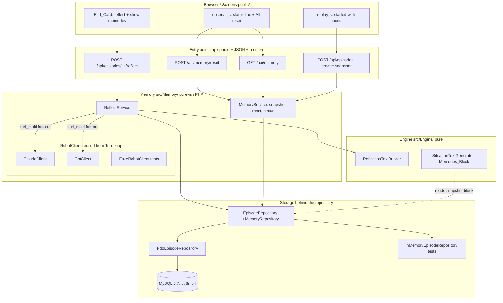

# Design Document — Robot Memory

## Overview

Robot-memory is the fourth spec of PoltergeistSwitch, layered on `house-rules-engine`, `turn-loop`, and `screens`. It gives each robot a memory that accumulates across every episode it lives through. After an ended episode each robot is asked once, in its own words, what it wants to remember; a non-empty answer becomes a `Memory`. At the start of every later episode the robot receives all its retained memories of the current generation, oldest first, in a fixed block inside each turn's situation text, so a robot that lived through one disaster may draw on it in another.

The design covers six things, mapping to the eight functional requirements:

- **The Reflection_Text builder** (Requirement 1): a new *pure* engine method that builds, for one robot and one ended episode, the fact-only text the robot reads before the reflection question — the fixed body and house sections, the robot's memories block (if any), a fixed lead-in line, one event block per turn from the first to the last (oldest first) headed by elapsed time since the shaking began, a trailing "Right now:" paragraph, a blank line, and the question. It makes no AI, HTTP, or database call, shows the robot only the facts of what happened (never its own replies), and stays subject to the banned-word rule. It carries its own `Reflection_Text_Version` string, stored with the prompt.
- **The Reflect service and endpoint** (Requirement 2): `POST /api/episodes/{id}/reflect`, ended episodes only, asking both robots in parallel through the turn-loop `RobotClient`s with the same call settings and failure handling as a turn, storing the full prompt and response like a turn's, and appending any non-empty answer as one `Memory`. Idempotent per robot per episode under repeated and concurrent calls, with a failed robot retriable.
- **The memory store, cap, and retirement** (Requirement 3): a `memories` table with at most 6 `Active_Memory` rows per robot, disaster, and generation; the 7th retires the oldest active one (never deletes it); memories appended in reflection-finish order.
- **Generations and All reset** (Requirement 4): a current-generation record and `POST /api/memory/reset` that advances it without deleting anything; a running episode keeps its own generation and snapshot.
- **The memory status endpoint** (Requirement 5): `GET /api/memory` reporting the current generation and, per robot (Amber / Jade), the active memory count and each active memory's length.
- **Passing memories into turns** (Requirement 6): a per-episode `Memory_Snapshot` taken at episode creation and stored with the episode, threaded into `Engine::situationTextFor` so every turn — live and rebuilt by `ReplayEngineFactory` — inserts the same `Memories_Block` in the Appendix A form; the memory bodies are verbatim and exempt from the banned-word check, while every engine-authored part stays checked, and the empty-snapshot case leaves the S0–S5 golden texts byte-for-byte unchanged.
- **Screen additions** (Requirement 7): a generation/count status line and an in-page-confirmed All reset on Observe, a reflect-and-show flow on the End card, and a started-with count on Replay.

Scope is earthquake only, one episode per device, no change to the turn rules or the recorder. The tech constraints from steering apply throughout: PHP 8.2 plain classes with no I/O for the builder and store logic, thin `api/` entry points, SQL migrations in `sql/`, PHPUnit with Eris property tests, no real provider calls in tests, every response `Cache-Control: no-store`, and no secret, credential, or AI provider name ever written into code, SQL, docs, or `.kiro/`. The server runs a MySQL 5.7-class engine, so the idempotency design uses InnoDB row locks (`SELECT … FOR UPDATE`) and never `SKIP LOCKED`.

### Key design decisions

- **The reflection text is built by the engine, from the recorded episode, not from replies.** In the pilot one robot wrote imagined objects into its memory and reused them as facts (Requirement 1.11, decided 2026-11-08). So the Reflection_Text is a pure engine render of the stored `TurnRecord`s — what the robot did, said, heard, and saw — and never includes the robot's own reply text, thoughts, judgement data, or meter values.
- **Reflection walks the episode forwards and counts time up; turn texts count a 15-second window backwards.** The turn-text recent-events headings are a backward countdown (`In the last 15 seconds:`, `15 to 30 seconds ago:`, …; `house-rules-engine` Requirement 9.17). The reflection recap is a chronological record of the whole episode, so it uses its own forward heading form that counts up from the start of the shaking, in the same *style* as the turn texts' countdown (`0 to 15 seconds after the shaking began:`, `15 to 30 seconds after the shaking began:`, …). This is the reflection's own form, distinct from the turn texts' countdown, and it reuses the exact *line* forms of Requirement 9.16 within each block. The recap covers every played turn: in the implemented turn loop turn 0 is the quiet turn applied at create time with no AI call, flipping the earthquake sets `earthquakeStartTurn = 0`, and turn 1 (offset 1) is the first shaking turn and the first turn the robots play, so the recap runs from turn 1 to the last played turn.
- **The snapshot is stored with the episode so a rebuild needs no memory query.** `ReplayEngineFactory` must produce turn text byte-identical to the live run. A live memory query at rebuild time would drift if a reset or a new reflection happened in between, so the ordered verbatim memory bodies are frozen into the episode row at creation and read from there on every rebuild (Requirement 6.6).
- **The long AI call never sits inside a held row lock.** A reflection call can take tens of seconds, which is too long to hold an InnoDB row lock. So reflect uses a short *claim* transaction to mark a per-episode-per-robot reflection slot in-progress, makes the AI call outside any lock, then uses a short *commit* transaction to store the answer and any retirement atomically. A second concurrent call sees the in-progress or answered slot and does not double-ask (Requirements 2.8, 2.9, 2.10).
- **Secrets and provider names never leak.** The reflect, reset, and status endpoints return only memory data and robot-facing names (Amber / Jade); no response body carries a key, a credential, a device id, or an AI provider or model name.

---

## Architecture



**Request-to-component flow.** Three new `api/` entry points and one change to the existing create endpoint. Each entry point parses the request, calls one service method, and writes JSON with `Cache-Control: no-store` — no logic in `api/`. `ReflectService` owns the reflect orchestration (build text through the engine, claim slots, fan out the AI calls with `curl_multi`, store answers and retirements). `MemoryService` owns snapshot-at-creation, reset, and status. Both read and write only through the extended `EpisodeRepository`.

**Where the engine is touched.** Two engine additions, both pure: a new `ReflectionTextBuilder` that renders a Reflection_Text from a robot id and the episode's stored `TurnRecord`s plus its memory snapshot; and a change to `SituationTextGenerator` so its section-3 memories placeholder is filled from a per-robot memories list threaded through `Engine::situationTextFor`. The turn rules, the recorder, and `applyTurn` are unchanged.

---

## Components and Interfaces

### Namespace and file layout

Memory service and store classes live under the `PoltergeistSwitch\Memory` namespace in `src/Memory/`, mirroring `src/TurnLoop/`. The two engine additions live under the existing `PoltergeistSwitch\Engine` namespace in `src/Engine/`. Tests live in `tests/Memory/` and `tests/Engine/`.

```
public/
  index.php                 Observe page (status line + All reset; existing page, extended)
  replay.php                Replay page (started-with counts; existing page, extended)
  js/
    observe.js              + generation/count status line, + in-page All reset confirm
    replay.js               + per-robot started-with memory counts
    memory-ui.js            small shared helper: render status line, reflect result, confirm panel
  css/
    screens.css             + styles for the status line, the confirm panel, the collapsible memory
api/
  episodes_reflect.php      POST /api/episodes/{id}/reflect
  memory_reset.php          POST /api/memory/reset
  memory_get.php            GET  /api/memory
  episodes_create.php       POST /api/episodes (extended: take and store the snapshot)
  router.php                + the three new routes (existing)
src/
  Memory/
    ReflectService.php
    MemoryService.php
    ReflectionPrompt.php        (builds the prompt text + version for one robot)
    Values/
      MemoryRow.php             (one stored memory)
      MemorySnapshot.php        (ordered verbatim bodies for one robot)
      ReflectionResult.php      (per-robot: answered | failed, body, count, reason)
      MemoryStatus.php          (generation + per-robot counts and lengths)
  Engine/
    ReflectionTextBuilder.php   (pure; renders the Reflection_Text)
    SituationTextGenerator.php  (changed: fill the section-3 Memories_Block)
    Engine.php                  (changed: thread per-robot memories into situationTextFor; bump version)
sql/
  2026-11-09_add_memory.sql     memories + memory_generation + episode snapshot/generation columns
tests/
  Memory/
    ReflectServiceTest.php
    MemoryServiceTest.php
    Properties/
      CapRetirementPropertyTest.php
      MemoryRoundTripPropertyTest.php
      ResetZeroPropertyTest.php
      SnapshotEqualityPropertyTest.php
      ReflectIdempotencyPropertyTest.php
      StatusPropertyTest.php
      NoLeakPropertyTest.php
      NoStorePropertyTest.php
  Engine/
    ReflectionTextBuilderTest.php
    Properties/
      ReflectionTextStructurePropertyTest.php
      ReflectionBannedWordPropertyTest.php
    SituationTextMemoriesBlockTest.php      (Appendix A form; S0–S5 golden with no memories)
```

### The Reflection_Text builder (Requirement 1)

`ReflectionTextBuilder` is a pure engine class. It takes a robot id, the episode's ordered `TurnRecord`s (from the first played turn to the last), the earthquake start turn, the post-episode `WorldModel` state (for the trailing "Right now:" paragraph), and the robot's `Memory_Snapshot`; it returns the Reflection_Text string. It calls no AI, no HTTP, and no database or external memory (Requirement 1.1).

```php
final class ReflectionTextBuilder
{
    /** Bump whenever the fixed body/house text, the lead-in, the event-block forms,
     *  or the question wording changes (Req 1.9). Stored with the reflection prompt (Req 1.8).
     *  Follows the project's dated version scheme and fits the 32-character version column. */
    const REFLECTION_TEXT_VERSION = 'reflection-text-2026-11-09';

    public function __construct(
        private SituationTextGenerator $textGen,  // reuse the fixed body/house, shake and resident wording
    ) {}

    /**
     * Build the fact-only Reflection_Text for one robot and one ended episode.
     *
     * @param string        $robotId    'robot_a' or 'robot_b'
     * @param TurnRecord[]   $records    the episode's played turns, turn 1 to the last (oldest first)
     * @param int            $earthquakeStartTurn  always 0 in the implemented loop; the first played/shaking
     *                                             turn is turn 1 = offset 1, so headings count up from turn 1
     * @param WorldModel     $finalWorld the world after the last turn, for the "Right now:" paragraph
     * @param MemorySnapshot $snapshot   this robot's memories in this episode (may be empty)
     */
    public function build(
        string $robotId,
        array $records,
        int $earthquakeStartTurn,
        WorldModel $finalWorld,
        MemorySnapshot $snapshot,
    ): string;

    public function version(): string; // returns self::REFLECTION_TEXT_VERSION
}
```

**Section order (Requirement 1.2).** The builder assembles, in exactly this order, separated by blank lines:

```
{fixedBody}

{fixedHouse}

[{memoriesBlock}            ← only when the snapshot is non-empty (Req 1.7)

]{leadIn}

{eventBlock for turn 1}

{eventBlock for turn 2}
...
{eventBlock for the last turn}

{rightNowParagraph}         ← the world after the last turn (e.g. "Right now: ... The shaking has stopped.")

{question}
```

The fixed body and fixed house sections are the same constants `SituationTextGenerator` uses in turn texts (so they stay in one place). The memories block, when present, is the same Appendix A form used in turns (see Requirement 6 below). The text ends with the exact question of Requirement 1.10.

**The fixed lead-in line (Requirement 1.2).** The single English sentence that introduces the turn-by-turn recap, placed after the memories block (or after the house section when there is no block) and before the first event block, is literally:

```
Here is what happened after the shaking began:
```

("until it was over" would be false when an episode ends at the 40-turn limit while the shaking is still described, so the lead-in makes no claim that the shaking stopped.)

This is engine-authored, fact-only, and contains no banned word.

**The event-block headings (Requirements 1.4, 1.3).** Each turn's event block is headed by the elapsed-time window since the shaking began, counting **up** from the first shaking turn in 15-second steps (the earthquake's 15 s per turn, `house-rules-engine` §4). Because `earthquakeStartTurn = 0`, the first played/shaking turn is turn 1 = offset 1 (k = 0); the heading form is in the same *style* as the turn texts' countdown but counts forward. The literal heading for the k-th shaking turn (k = 0 for the first played turn) is:

```
{15 * k} to {15 * (k + 1)} seconds after the shaking began:
```

so turn 1 is headed `0 to 15 seconds after the shaking began:`, turn 2 `15 to 30 seconds after the shaking began:`, turn 3 `30 to 45 seconds after the shaking began:`, and so on. This forward, count-up form is the reflection's own heading, deliberately distinct from the turn texts' backward countdown (`In the last 15 seconds:` / `15 to 30 seconds ago:`), because the reflection is a chronological record of the whole episode read after it ended, not a 15-second rolling window read mid-turn. Turn 0 is the quiet turn applied at create time with no AI call and is not a played turn, so the recap begins at turn 1 (the first played/shaking turn, k = 0) and covers every played turn to the last.

**Within each event block (Requirement 1.3).** A robot perceives first and acts second: the man's line and the house events in a turn's record are what the robot *heard and saw at the start of that turn* (they were in that turn's situation text), and its own action and words came after. So within each event block the perceived items come first, then the acted items. The lines reuse the exact wording of `house-rules-engine` Requirement 9.16 (for the actions and speech) and Requirements 9.10–9.11 and 9.14 (for the man's line and the house events). For robot R in the turn whose record is `rec`, in this order:

*Perceived at the start of the turn:*

1. The house events R perceived that turn, rendered as in the shaking paragraph of `house-rules-engine` Requirement 9.14: `Suddenly the floor begins to shake hard.` on the first shaking turn; the room shake text for R's room (e.g. `Dishes are rattling in the cupboard.`); `The lights go out.` on the lights-out turn; `The shaking has stopped.` on the stop turn; and any object falling or breaking **where R could see it** (R's room, not dark), rendered in the same wording the turn texts use.
2. The man's line R heard that turn — `rec.residentLine` — rendered as in `house-rules-engine` Requirements 9.10–9.11: `The man shouts, "{line}"` when the man was in R's room, `You hear the man shout, "{line}"` otherwise. Omitted when there was no line that turn. (Order changed on 2026-11-09 after the first live reflection: the house events come first and the man's line second, as in the turn texts, where the shaking paragraph ends with the man's shout; `REFLECTION_TEXT_VERSION` bumped to `reflection-text-2026-11-09b`.)

*Acted during the turn:*

3. The result of R's own action — `rec.outcomes[R].whatHappenedText` — on its own line; omitted when R's action that turn was `unknown` (empty text).
4. One line per line R spoke: `You said, "{line}"` (each `rec.robotActions[R].words[i]`, verbatim).
5. One line per own reported-speech item: `You {ownForm}.` (each `rec.robotActions[R].reported[i].ownForm`).
6. The other robot's action — `rec.outcomes[other].seenByOtherText` — on its own line, **only when rule A says the two robots shared a room at the start or the end of that turn** (`rec.roomsAtStart[a] === rec.roomsAtStart[b]` or their rooms in `rec.snapshot` are equal); omitted when they did not share a room or when the other's action was `unknown`.
7. One line per line the other robot spoke: `The other robot said, "{line}"` when they shared a room, otherwise `You heard the other robot say, "{line}"` (each `rec.robotActions[other].words[i]`).
8. One line per other reported-speech item, in every room: `You heard the other robot {heardAs}.` (each `rec.robotActions[other].reported[i].heardAs`).

The block does **not** repeat the static list of the room's objects for each turn (Requirement 1.3) — that list appears only in the "Right now:" paragraph and, implicitly, in the body/house sections. A turn whose block would have no lines (nothing done, said, heard, or seen) is still headed and shows a single neutral fact line `Nothing happened that you noticed.` so the chronological count-up stays unbroken; this neutral line is engine-authored and banned-word clean. (Design choice: keeping every shaking turn's heading makes the elapsed-time count-up readable; the alternative of skipping empty turns would make the headings jump.)

**The trailing "Right now:" paragraph (Requirement 1.2).** After the last event block, a blank line, then the "Right now:" paragraph for the world after the last turn, built with the same `SituationTextGenerator` machinery used in turns (time, room, objects, man, other robot, and the post-shaking sentence such as `The shaking has stopped.`). Then a blank line and the question.

**The question (Requirement 1.10).** The text ends with exactly:

```
Is there anything from what happened this time that you want to remember?
```

(Decided by the maintainer on 2026-11-01.)

**Exclusions (Requirements 1.5, 1.11).** The Reflection_Text never includes R's own reply text, R's thoughts, any judgement data (possible/impossible reasons, danger codes), any resident meter value, or any AI company or model name. It is built only from the recorded outcomes, spoken words, reported speech, resident line, and house events — the facts — never from the stored reply strings.

**Banned-word rule (Requirement 1.6).** The engine-authored parts of the Reflection_Text are checked against the `house-rules-engine` Requirement 9.15 word set (`Claude`, `ChatGPT`, `GPT`, `Anthropic`, `OpenAI`, `dangerous`, `danger`, `safe`, `careful`, `should`, `must`, `warning`). The memory bodies in the memories block are the robot's own words, passed verbatim, and are exempt (Requirement 6.7); the robots' quoted speech (`You said, "…"`, `The other robot said, "…"`), reported speech (`heardAs` / `ownForm`), and the man's quoted line are exempt as quoted content — only the engine's wrapper wording is checked. This reuses `SituationTextGenerator::bannedWordCheck`'s exclusion rules.

**The version string (Requirements 1.8, 1.9).** `REFLECTION_TEXT_VERSION = 'reflection-text-2026-11-09'` is a plain class constant on `ReflectionTextBuilder` (PHP 8.2 plain constant, not a typed class constant), mirroring the way `SituationTextGenerator` holds the situation-text version (`situation-text-2026-11-08c`). It follows the project's dated version scheme and fits within the 32-character version column. It is returned by `version()` and stored with the reflection prompt (separate from the situation-text version). The maintainer bumps it — to the next dated string — whenever the fixed body/house text, the lead-in, any event-block form, or the question wording changes; a golden test on the literal guards against silent drift.

### Threading memories into turn texts (Requirement 6)

The `SituationTextGenerator::generate` signature already accepts an optional `?string $memoriesBlock = null` (see the house-rules-engine design, §i). Robot-memory fills it. The change is in how the block reaches the generator:

- **Engine carries a per-robot memories list.** `Engine::situationTextFor(string $robotId)` is extended to look up that robot's memory list and build the `$memoriesBlock` before delegating to `SituationTextGenerator::generate`. The memory list is given to the engine when it is built for an episode, through a new setter `Engine::setMemories(array $memoriesByRobot)` where `$memoriesByRobot = ['robot_a' => string[], 'robot_b' => string[]]` holds each robot's ordered verbatim memory bodies. The turn-loop currently calls `situationTextFor` with no memories (turn-loop Requirement 4.7); after this change the turn loop and `ReplayEngineFactory` set the memories from the episode's stored snapshot before building any text. When `setMemories` is never called (or an empty list is set), `situationTextFor` passes `null` and no block appears, so existing behaviour is unchanged.

  This is the minimal engine API change: a setter plus the fill logic inside `situationTextFor`. `generate` itself is unchanged apart from already accepting the block.

- **The Memories_Block form (Requirements 6.3, 6.4).** When a robot's list is non-empty, the block is inserted as section 3, between the fixed house section and the recent-events section (the existing placeholder position). It uses the Appendix A form exactly:

  ```
  Your memories (what you wrote down after an earlier disaster in this house):

  """
  {memory 1, oldest}
  """

  """
  {memory 2}
  """
  ...
  """
  {memory k, newest of the snapshot}
  """
  ```

  Each memory body is wrapped in its own `"""` block, oldest first, verbatim. The exact separators (a blank line between the heading and the first block and between successive blocks) are pinned by the block-format example test.

- **Empty snapshot — no block, golden texts unchanged (Requirement 6.5).** When a robot's list is empty, `situationTextFor` passes `null` for the block and `SituationTextGenerator` emits no section 3, so the S0–S5 golden situation texts stay byte-for-byte unchanged.

- **Verbatim and exempt (Requirement 6.7).** The memory bodies are the robot's own words, passed through unchanged, and are exempt from the banned-word check; every engine-authored part of the situation text (body, house, "Right now:", shaking paragraph) stays checked, as today.

- **Situation-text version bump (Requirement 6.8).** Because adding the block changes the generator's output format, the situation-text version exposed by `Engine::situationTextVersion()` is bumped (its constant on `SituationTextGenerator` moves to the next dated value, from `situation-text-2026-11-08c` to `situation-text-2026-11-09`, which fits the 32-character version column); a golden test on the literal records the bump.

### ReflectService — asking (Requirement 2)

`ReflectService` orchestrates one reflect request. It reuses the turn-loop `RobotClient` interface and its `ParallelHttp` fan-out; it holds no rules logic.

```php
final class ReflectService
{
    public function __construct(
        private RobotClient $robotA,              // ClaudeClient in production
        private RobotClient $robotB,              // GptClient in production
        private ReflectionTextBuilder $builder,
        private EngineFactory $engineFactory,     // to rebuild the episode's TurnRecords and final world
        private EpisodeRepository $repo,          // extended with memory + reflection methods
        private Config $config,                   // reuse the turn-loop Config (timeouts, cost rates)
    ) {}

    /** POST /api/episodes/{id}/reflect — ask both robots once, append non-empty answers. */
    public function reflect(string $episodeId): ReflectionResult;
}
```

**Flow for `reflect($episodeId)`:**

1. **Guard: ended, reflectable episodes only (Requirements 2.2, 2.11).** Load the episode. If it does not exist, 404. If it has not ended (including an episode released after 5 idle minutes — it is not marked ended), reject with 409 and code `not_ended`, change no stored state, and make no `RobotClient` call. If the episode predates this feature — its `memory_generation` / snapshot columns are NULL because it was created before the migration ran (today's six existing episodes) — reject with 409 and code `not_reflectable`, so robots' memories start only from episodes run after this feature ships; change no stored state and make no `RobotClient` call.
2. **Rebuild the episode.** Use `EngineFactory::forEpisode($episodeId)` (the turn-loop replay factory, which now also sets the memories from the stored snapshot) to obtain the episode's ordered `TurnRecord`s, its `earthquakeStartTurn`, and its final `WorldModel`.
3. **Per robot, claim a slot (short transaction).** For each of `robot_a`, `robot_b`, attempt to claim its reflection slot (the locking design below). A robot already **answered** for this episode is skipped and its stored answer reused (Requirement 2.8). A robot currently **in progress** (claimed by a concurrent call) is skipped so it is not double-asked (Requirement 2.9). A robot **unclaimed** or whose earlier attempt **failed** is claimed now (Requirement 2.10).
4. **Build text and fan out (outside any lock).** For each newly claimed robot, build its Reflection_Text with `ReflectionTextBuilder::build(...)`. Send the texts as-is to the claimed robots in parallel through one `curl_multi` handle, with one user message, no system prompt, provider default parameters, max output 4000 tokens, and the same per-call timeout and failure handling as a turn (Requirements 2.3, 2.4). The Reflection_Text already ends with the question, so the question is not appended again (Requirement 2.3).
5. **Store the prompt and response (like a turn) (Requirement 2.5).** For each called robot, store the full prompt text with `REFLECTION_TEXT_VERSION` and the full response text with its usage metadata (tokens, seconds, cost, truncated, unanswered), using the same `prompts`/`responses` storage shape as a turn but tagged `kind = 'reflection'` so no turn read ever picks it up (see Data Models, "Storing reflection prompts and responses").
6. **Commit the answer or the failure (short transaction) (Requirements 2.6, 2.7).** For each called robot: if the answer is non-empty, store it verbatim as one `Memory` tagged with the robot, the episode's generation, the episode's disaster, the source episode id, and a created time, applying the cap/retirement in the same transaction (Requirement 8.4), and mark the slot answered. If the answer is empty, or the call failed or was abandoned under the per-call timeout, add no memory, record the reason on the slot, and release the slot to `failed` so a later call may retry (Requirements 2.7, 2.10).
7. **Return** a `ReflectionResult` per robot: answered (with the body and the robot's new active count) or failed (with a short reason). The response carries no device id, key, credential, or AI company/model name (Requirement 2.12).

`ReflectionResult`:

```php
readonly class ReflectionResult
{
    /** @param RobotReflection[] $robots keyed 'robot_a','robot_b' */
    public function __construct(public array $robots) {}
}
readonly class RobotReflection
{
    public function __construct(
        public bool $answered,     // true when a non-empty memory was stored (new or reused)
        public ?string $memory,    // the stored body when answered; null on failure
        public int $activeCount,   // this robot's active count in the episode's generation after the call
        public ?string $reason,    // short failure reason when !answered; null otherwise
    ) {}
}
```

### MemoryService — snapshot, reset, status (Requirements 4, 5, 6)

```php
final class MemoryService
{
    public function __construct(private EpisodeRepository $repo) {}

    /** Called from createEpisode: take and store the per-robot snapshot and the episode's generation (Req 6.1). */
    public function snapshotForNewEpisode(string $episodeId): void;

    /** POST /api/memory/reset — advance the current generation, delete nothing (Req 4.2). */
    public function reset(): MemoryStatus;

    /** GET /api/memory — current generation and per-robot active counts and lengths (Req 5.2). */
    public function status(): MemoryStatus;
}
```

- **`snapshotForNewEpisode` (Requirement 6.1).** Reads the `Current_Generation`, then for each robot reads its `Active_Memory` bodies of that generation across all disasters, oldest first, capped at 18, and stores the two ordered lists and the generation with the episode. The snapshot is the verbatim bodies only, so a rebuild needs no join back to `memories`. This is called inside `createEpisode` (so an episode is always created with a snapshot and a generation), reusing the same transaction that inserts the episode row.
- **`reset` (Requirements 4.2, 4.3).** Advances the `Current_Generation` to a new generation (a new, higher integer) and deletes no memory row. Episodes created after the reset snapshot the new generation's active memories, which is empty until a reflection happens in the new generation — so a freshly reset generation's robots start with zero memories.
- **Running episode keeps its generation (Requirement 4.4).** Because the generation and snapshot are frozen on the episode row at creation, a reset that happens mid-run does not touch a running episode: its turns keep using its stored snapshot, and its reflections (when it ends) are stored under its own stored generation, so a reset during a run carries no old memory into the new generation.
- **`status` (Requirements 5.2, 5.3).** Returns the `Current_Generation` and, per robot, the count of `Active_Memory` rows of the current generation and the character length of each, excluding retired rows and rows of other generations. The service reports the robots by their screen names Amber (robot_a) and Jade (robot_b); it returns no device id, key, credential, or company/model name (Requirement 5.4).

```php
readonly class MemoryStatus
{
    public function __construct(
        public int $generation,
        public int $amberActiveCount,
        public array $amberLengths,   // int[] length of each active memory, oldest first
        public int $jadeActiveCount,
        public array $jadeLengths,    // int[]
    ) {}
}
```

### EpisodeRepository additions (Requirement 8)

All memory storage goes through the turn-loop `EpisodeRepository` interface, extended with the methods below, so `ReflectService` and `MemoryService` can be tested against the in-memory fake without a database (Requirement 8.1). `PdoEpisodeRepository` implements them over PDO for MySQL; `InMemoryEpisodeRepository` (the turn-loop test fake) implements the same logic in memory.

```php
interface EpisodeRepository // … existing turn-loop methods …
{
    // --- Generations ---
    public function currentGeneration(): int;                 // Req 4.1
    public function advanceGeneration(): int;                 // Req 4.2; returns the new generation

    // --- Per-episode snapshot + generation (stored with the episode) ---
    public function storeEpisodeMemory(string $episodeId, int $generation,
        MemorySnapshot $robotA, MemorySnapshot $robotB): void; // Req 6.1
    public function episodeGeneration(string $episodeId): int;
    public function episodeSnapshot(string $episodeId, string $robotId): MemorySnapshot; // Req 6.6

    // --- Memories: read ---
    /** Active memories of ($robotId,$generation) across all disasters, oldest first, capped (Req 3.8, 6.1). */
    public function activeMemories(string $robotId, int $generation, int $cap): MemorySnapshot;
    public function activeCount(string $robotId, int $generation, string $disaster): int; // Req 3.3

    // --- Memories: write with cap + retirement, atomic (Req 8.4) ---
    /**
     * Store one memory and retire oldest-active rows for ($robotId,$disaster,$generation)
     * until at most 6 remain active (Req 3.3, 3.4, 8.4). The whole operation runs in a single
     * transaction that FIRST takes a locking read (SELECT ... FOR UPDATE) over that triple's
     * active rows, so two interleaved commits for the same triple — even from two different
     * episodes — serialize and never leave more than 6 active (see "Reflection idempotency and
     * the MySQL 5.7 locking design" below). Idempotent per ($sourceEpisodeId,$robotId): a second
     * store for the same source episode + robot leaves records unchanged and creates no
     * duplicate (Req 8.5).
     */
    public function appendMemory(MemoryRow $memory): void;

    // --- Reflection slot claim/commit (idempotency; Req 2.8–2.10) ---
    public function claimReflectionSlot(string $episodeId, string $robotId): ReflectionClaim; // short tx
    public function commitReflectionAnswer(string $episodeId, string $robotId, MemoryRow $memory): void; // short tx
    public function commitReflectionFailure(string $episodeId, string $robotId, string $reason): void;   // short tx
    public function reflectionAnswer(string $episodeId, string $robotId): ?MemoryRow; // reuse stored answer
}
```

`MemoryRow` carries the memory and its tags:

```php
readonly class MemoryRow
{
    public function __construct(
        public string $robotId,        // 'robot_a' | 'robot_b'
        public int $generation,
        public string $disaster,       // 'earthquake' (column supports all three)
        public string $sourceEpisodeId,
        public string $body,           // the verbatim answer
        public string $status,         // 'active' | 'retired'
        public string $createdAt,      // ISO-8601
        public ?int $seq = null,       // finish-order sequence; set by the store (Req 3.6)
        public ?string $retiredAt = null,
    ) {}
}

readonly class MemorySnapshot
{
    /** @param string[] $bodies verbatim memory bodies, oldest first */
    public function __construct(public array $bodies) {}
    public function isEmpty(): bool { return $this->bodies === []; }
}
```

### Reflection idempotency and the MySQL 5.7 locking design (Requirements 2.8, 2.9, 2.10)

A reflection AI call can take tens of seconds (the per-call timeout is the same as a turn, draft 75 s). That is far too long to hold an InnoDB row lock. So the slot is claimed and committed in two short transactions, with the AI call in between, outside any lock. The chosen mechanism is a **per-episode-per-robot `reflections` row claimed with `SELECT … FOR UPDATE`** inside a short transaction — recommended over `GET_LOCK()` (a named lock would have to be held across the whole call, which we are avoiding) and over a bare `INSERT … ON DUPLICATE KEY` (which cannot by itself express the three states claimed/answered/failed cleanly). MySQL 5.7 supports InnoDB row locks and `SELECT … FOR UPDATE`; it does **not** support `SKIP LOCKED`, which this design never uses.

The `reflections` table has a unique key on `(episode_id, robot_id)` and a `status` column with values `in_progress`, `answered`, `failed`, plus `claimed_at` so a dead claim can be recovered.

**Claim (short transaction):**

```sql
START TRANSACTION;
-- make sure the row exists so the lock has something to hold:
INSERT INTO reflections (episode_id, robot_id, status, claimed_at)
  VALUES (:eid, :rid, 'in_progress', NOW())
  ON DUPLICATE KEY UPDATE episode_id = episode_id;   -- no-op if it already exists
-- now lock and read the authoritative state, including how old any in-progress claim is:
SELECT status, claimed_at, (claimed_at < NOW() - INTERVAL 120 SECOND) AS stale
  FROM reflections
  WHERE episode_id = :eid AND robot_id = :rid
  FOR UPDATE;
```

Decision on the locked status:

- `answered` → do **not** claim; the caller reuses the stored answer (`reflectionAnswer`) and makes no AI call (Requirement 2.8).
- `in_progress` whose row was just inserted by *this* transaction (the `INSERT` created it) → this caller owns the claim; set nothing further, `COMMIT`, proceed to the AI call.
- `in_progress` that already existed and is **fresh** (`claimed_at` within the last 120 seconds) → a concurrent caller owns it; do **not** claim; skip this robot so it is not double-asked (Requirement 2.9). `COMMIT`.
- `in_progress` that already existed and is **stale** (`claimed_at < NOW() - INTERVAL 120 SECOND`) → the owning request died (the per-request limit is ~85 s, so a claim older than 120 s cannot still be running); re-claim it: `UPDATE reflections SET status = 'in_progress', claimed_at = NOW(), reason = NULL WHERE …`; `COMMIT`; proceed to the AI call. This keeps a crashed reflection from stranding a robot forever (Requirement 2.10).
- `failed` → re-claim: `UPDATE reflections SET status = 'in_progress', claimed_at = NOW(), reason = NULL WHERE …`; `COMMIT`; proceed to the AI call (Requirement 2.10).

`claimReflectionSlot` returns a `ReflectionClaim` telling the service one of: `claimed` (call this robot — new, failed, or stale re-claim), `reuse` (answered already — reuse the stored body), or `skip` (a fresh in-progress claim exists — do nothing).

Because the `INSERT … ON DUPLICATE KEY` plus `SELECT … FOR UPDATE` happen in one short transaction, two concurrent claim attempts serialize on the row lock: exactly one sees the row as newly `in_progress` with itself as owner (or flips `failed`/stale `in_progress`→fresh `in_progress`), and the other sees a fresh `in_progress`/`answered` and skips. The lock is released at `COMMIT`, long before the AI call.

**The AI call** then runs entirely outside any held lock, in parallel for the robots this caller claimed.

**Commit the answer (short transaction) (Requirements 2.6, 8.4).** Two reflections for the *same* `(robot, disaster, generation)` can come from two *different* episodes and commit at nearly the same time. Under REPEATABLE READ each would count from its own snapshot, see 7, and retire the same single oldest row — leaving 7 active. To close that hole the commit **serializes per `(robot, disaster, generation)`**: it FIRST takes a locking read over that triple's active rows (`SELECT … FOR UPDATE`), so a second commit for the same triple blocks until the first commits and then reads the first's committed state. It THEN inserts the new memory, and THEN retires oldest-active rows *while the active count still exceeds 6* (a loop / repeated delete-down, not a single-row retire), so the committed active count lands at exactly 6 no matter how the two interleave.

```sql
START TRANSACTION;
-- 1. SERIALIZE: lock this triple's active rows so concurrent commits for the same
--    (robot, disaster, generation) cannot both count from a stale snapshot.
SELECT id FROM memories
  WHERE robot_id = :rid AND disaster = :dis AND generation = :gen AND status = 'active'
  FOR UPDATE;
-- 2. append the new memory with its finish-order seq (auto-increment id doubles as seq):
INSERT INTO memories (robot_id, generation, disaster, source_episode_id, body, status, created_at)
  VALUES (:rid, :gen, :dis, :eid, :body, 'active', NOW());
-- 3. retire oldest-active rows down to at most 6. Repeat this statement while it affects a row
--    (equivalently: retire the oldest active rows whose active-rank from the newest is > 6).
--    The oldest-active predicate is in the outer WHERE (ORDER BY id ASC = oldest first):
UPDATE memories SET status = 'retired', retired_at = NOW()
  WHERE id IN (
    SELECT id FROM (
      SELECT id FROM memories
       WHERE robot_id = :rid AND disaster = :dis AND generation = :gen AND status = 'active'
       ORDER BY id ASC
       LIMIT 100 OFFSET 6              -- every active row older than the 6 newest
    ) AS surplus
  );
-- 4. mark the slot answered so repeat/concurrent calls reuse it:
UPDATE reflections SET status = 'answered', answered_memory_id = LAST_INSERT_ID() WHERE episode_id = :eid AND robot_id = :rid;
COMMIT;
```

The step-1 locking read serializes commits for the same triple: the second waits on those row locks, so when it runs step 3 it sees the first's committed insert and retirement and retires its own surplus correctly — two interleaved commits for the same `(robot, disaster, generation)` never leave more than 6 active (Requirement 8.4). Step 3 retires *all* surplus oldest-active rows (`OFFSET 6`, i.e. everything past the 6 newest active), so even if two inserts raced the count returns to 6; the derived-table wrapping (`SELECT id FROM (SELECT … ORDER BY id ASC LIMIT … OFFSET 6) AS surplus`) is the 5.7-compatible idiom for updating a table you also select from. In the normal one-at-a-time case the surplus is exactly the single oldest active row, matching Requirement 3.4. Storing an answer when the slot is already `answered` is prevented by the claim step (`reuse`), so no duplicate memory is created for the same episode+robot (Requirement 8.5); `appendMemory` additionally guards on `(source_episode_id, robot_id)` so a direct repeat is a no-op.

**Commit a failure (short transaction) (Requirement 2.7):**

```sql
UPDATE reflections SET status = 'failed', reason = :reason WHERE episode_id = :eid AND robot_id = :rid;
```

This adds no memory and records the reason. A later `reflect` call for the same episode re-claims the `failed` slot and asks that robot again (Requirement 2.10).

**Finish order (Requirement 3.6).** Memories are appended in the order their reflection commits finish. The `memories.id` auto-increment is the finish-order sequence: a memory committed later has a higher id, so ordering reads by `id ASC` yields oldest-first by finish order, and retirement retires the active rows past the 6 newest via `ORDER BY id ASC … OFFSET 6`, which in the ordinary one-at-a-time case is exactly the single oldest active row.

---

## Data Models

### Migration — `sql/2026-11-09_add_memory.sql` (Requirements 3.1, 4.6, 6.1, 8.2)

MySQL 5.7-compatible, InnoDB, utf8mb4 everywhere so multibyte memory bodies round-trip without loss. No `CHECK` constraints are relied on (5.7 parses but does not enforce them). No secret, credential, or provider name appears anywhere (Requirement 8.3).

```sql
-- Robot memory: store, generations, per-episode snapshot, reflection slots,
-- and a `kind` column on prompts/responses to separate reflection rows from turn rows.
-- MySQL 5.7, InnoDB, utf8mb4. Schema only; no secrets.

-- One stored memory. The auto-increment id doubles as the finish-order sequence
-- (Req 3.6): a later-committed memory has a higher id, so oldest-first = id ASC
-- and retirement retires the active rows past the 6 newest (id ASC, OFFSET 6),
-- which in the one-at-a-time case is the single oldest active row (Req 3.4).
CREATE TABLE memories (
  id                BIGINT       NOT NULL AUTO_INCREMENT,
  robot_id          VARCHAR(16)  NOT NULL,              -- 'robot_a' | 'robot_b'
  generation        INT          NOT NULL,              -- the memory's generation (Req 3.7)
  disaster          VARCHAR(16)  NOT NULL,              -- 'earthquake' now; column supports all three
  source_episode_id CHAR(36)     NOT NULL,              -- the episode the memory came from (Req 2.6)
  body              MEDIUMTEXT   NOT NULL,              -- the verbatim answer (Req 2.6)
  status            VARCHAR(10)  NOT NULL DEFAULT 'active', -- 'active' | 'retired' (Req 3.7)
  created_at        DATETIME     NOT NULL,
  retired_at        DATETIME     NULL,
  PRIMARY KEY (id),
  -- active-count and oldest-active-pick per (robot, disaster, generation, status), ordered by id (Req 3.3, 3.4):
  KEY idx_active_pick (robot_id, disaster, generation, status, id),
  -- snapshot read: active of (robot, generation) across all disasters, oldest first (Req 3.8, 6.1):
  KEY idx_snapshot (robot_id, generation, status, id),
  -- idempotent store guard per source episode + robot (Req 8.5):
  UNIQUE KEY uq_source (source_episode_id, robot_id)
) ENGINE=InnoDB DEFAULT CHARSET=utf8mb4 COLLATE=utf8mb4_unicode_ci;

-- The current generation. A single row (id = 1). Reset advances `generation`
-- (Req 4.2) and deletes nothing; no memory row is ever removed.
CREATE TABLE memory_generation (
  id          TINYINT      NOT NULL,
  generation  INT          NOT NULL DEFAULT 1,
  updated_at  DATETIME     NOT NULL,
  PRIMARY KEY (id)
) ENGINE=InnoDB DEFAULT CHARSET=utf8mb4 COLLATE=utf8mb4_unicode_ci;
INSERT INTO memory_generation (id, generation, updated_at) VALUES (1, 1, NOW());

-- Per-episode reflection slots: one row per (episode, robot). The claim locks
-- this row with SELECT ... FOR UPDATE in a short transaction (Req 2.8–2.10).
CREATE TABLE reflections (
  episode_id          CHAR(36)     NOT NULL,
  robot_id            VARCHAR(16)  NOT NULL,            -- 'robot_a' | 'robot_b'
  status              VARCHAR(12)  NOT NULL,            -- 'in_progress' | 'answered' | 'failed'
  answered_memory_id  BIGINT       NULL,                -- the memory stored, when answered
  reason              VARCHAR(64)  NULL,                -- short failure reason (Req 2.7)
  claimed_at          DATETIME     NULL,
  PRIMARY KEY (episode_id, robot_id)
) ENGINE=InnoDB DEFAULT CHARSET=utf8mb4 COLLATE=utf8mb4_unicode_ci;

-- Per-episode generation + the frozen verbatim snapshot (ordered bodies), so a
-- ReplayEngineFactory rebuild needs no join back to `memories` (Req 6.1, 6.6).
-- Stored as JSON text (a JSON array of strings, oldest first) in utf8mb4.
ALTER TABLE episodes
  ADD COLUMN memory_generation       INT        NOT NULL DEFAULT 1 AFTER earthquake_start_turn,
  ADD COLUMN robot_a_memory_snapshot MEDIUMTEXT NULL                AFTER memory_generation,
  ADD COLUMN robot_b_memory_snapshot MEDIUMTEXT NULL                AFTER robot_a_memory_snapshot;

-- A `kind` column on the turn-loop prompt/response tables separates reflection rows
-- from turn rows (Req 2.5). Existing turn rows default to 'turn'; reflection rows are
-- written with kind = 'reflection'. EVERY existing turn read is filtered on kind = 'turn'
-- (ReplayEngineFactory, the episode view, the debug page), so no turn read ever picks up
-- a reflection row, and no reflection read ever picks up a turn row.
ALTER TABLE prompts
  ADD COLUMN kind VARCHAR(12) NOT NULL DEFAULT 'turn' AFTER robot_id;
ALTER TABLE responses
  ADD COLUMN kind VARCHAR(12) NOT NULL DEFAULT 'turn' AFTER robot_id;
```

**Pre-feature episodes (Requirement 2.2).** `memory_generation` is `NOT NULL DEFAULT 1`, but the six episodes created before this migration ran get the default only when the column is added; to distinguish them the reflect guard treats an episode whose snapshot columns (`robot_a_memory_snapshot` / `robot_b_memory_snapshot`) are still NULL as pre-feature and not reflectable (code `not_reflectable`). A new episode created after the migration always writes both snapshot columns (even as an empty JSON array `[]`), so a NULL snapshot unambiguously marks a pre-feature episode.

### Storing reflection prompts and responses (Requirement 2.5)

A reflection's prompt and response are stored in the same `prompts` and `responses` tables the turn loop uses, so the usage metadata (tokens, seconds, cost, truncated, unanswered) is recorded in exactly one place and read by the same cost tooling. The `kind` column keeps the two apart:

- **A turn row** keeps `kind = 'turn'` (the default) and is keyed as today by `(episode_id, turn_number, robot_id)` for a prompt and `(episode_id, turn_number, robot_id, attempt)` for a response.
- **A reflection row** is written with `kind = 'reflection'`. A reflection has no turn number, so the primary key's `turn_number` is set to a single reserved sentinel value `-1` for every reflection of an episode (one reflection per robot per episode; `attempt` stays `0`). The row is therefore addressed by `(episode_id, turn_number = -1, robot_id, kind = 'reflection')` — unique because there is at most one reflection per `(episode, robot)`. Reflection reads (the End_Card result and any cost reporting of reflections) filter on `kind = 'reflection'`; every existing turn read filters on `kind = 'turn'` and additionally never queries `turn_number = -1`, so the two never collide.

Using the sentinel turn number `-1` (rather than widening the key) means no schema change to the composite primary keys and no risk of a reflection row ever sorting into or being fetched by a turn read, which always iterates the real turn numbers `0 … n`.

**Why the snapshot lives on the `episodes` row as JSON text, not as a join table.** The snapshot must be read on every turn and every engine rebuild to produce byte-identical text (Requirement 6.6). Freezing the ordered verbatim bodies as a JSON-array string on the episode row means a rebuild reads the exact bodies with one row fetch and no dependence on the mutable `memories` table — a later reset or reflection cannot change what a running or replayed episode sees (Requirement 4.4). A separate `episode_memory_snapshots` table would work but needs a join and an ordering column on every read for no benefit here; the body list is small (≤18 short strings). The column is JSON *text* (`MEDIUMTEXT`), not the MySQL `JSON` type, so it behaves identically on the 5.7-class server and in the in-memory fake, and is decoded with `json_decode(..., flags: JSON_THROW_ON_ERROR)` (PHP 8.2 has no `json_validate()`).

**How reflect-finish order maps to memory order (Requirement 3.6).** Each successful reflection commit inserts one `memories` row; the auto-increment `id` is assigned in commit order, so "oldest first" is `id ASC` and the memory order reflects when each reflection completed. The snapshot's JSON array is built with the same `id ASC` order at episode creation.

**How retirement marks the oldest active rows (Requirement 3.4).** The commit transaction first takes a locking read over the `(robot, disaster, generation)` triple's active rows, inserts the new active memory, then retires every active row older than the 6 newest (`ORDER BY id ASC … OFFSET 6`) by setting `status = 'retired', retired_at = NOW()`. In the ordinary one-at-a-time case the surplus is the single oldest active row; the locking read plus retire-down-to-6 also covers two interleaved commits for the same triple, so the committed active count is always exactly 6 and never 7. Retired rows are never deleted and are excluded from every snapshot and status read by the `status = 'active'` predicate in `idx_snapshot` / `idx_active_pick`.

### How the snapshot is used by `ReplayEngineFactory` (Requirement 6.6)

`ReplayEngineFactory::forEpisode` (turn-loop) rebuilds an episode's `Engine` by replaying from stored state (seed → `WorldModel::reset` → replay the applied turns' decoded actions). Robot-memory adds one step: after constructing the `Engine`, the factory reads the episode's stored snapshots (`episodeSnapshot(id, 'robot_a')` and `('robot_b')`) and calls `Engine::setMemories(['robot_a' => $a->bodies, 'robot_b' => $b->bodies])` before any `situationTextFor` call. Because the snapshot is the frozen verbatim bodies on the episode row — not a live `activeMemories` query — every rebuilt turn's `Memories_Block` is byte-identical to the live run, regardless of resets or new reflections since. The live run sets the same memories from the same stored snapshot (the turn-loop `TurnService::ask` path reads `episodeSnapshot` and calls `setMemories` too), so live and rebuilt texts match.

With an empty snapshot, `setMemories` is given empty lists, `situationTextFor` passes `null`, and the S0–S5 golden texts are unchanged (Requirement 6.5).

---

## API Design

Three new endpoints plus the extended create endpoint. All send `Cache-Control: no-store` and a JSON body; `api/` entry points only parse, call the service, and write JSON. No response body carries a device id, API key, database credential, or AI company/model name (Requirements 2.12, 4.5, 5.4). An unknown episode id is 404; a not-ended or pre-feature episode on reflect is 409 with a short code.

| Endpoint | Success | Error |
|---|---|---|
| `POST /api/episodes/{id}/reflect` | 200 per-robot reflection result | 404 unknown; 409 `not_ended` (Req 2.2, 2.11); 409 `not_reflectable` for a pre-feature episode (Req 2.2) |
| `POST /api/memory/reset` | 200 `{ "generation": N }` | — |
| `GET /api/memory` | 200 generation + per-robot counts/lengths | — |

**`POST /api/episodes/{id}/reflect` response:**

```json
{
  "episodeId": "…",
  "robots": {
    "amber": { "answered": true,  "memory": "I will turn off the gas before…", "activeCount": 4, "reason": null },
    "jade":  { "answered": false, "memory": null, "activeCount": 2, "reason": "empty_answer" }
  }
}
```

A robot that was reused (already answered) reports `answered: true` with its stored body. The reasons are short machine codes, never a provider name, and they distinguish two different "no memory" cases:

- `empty_answer` — the call succeeded but the robot answered that it wants to keep nothing. This is a normal outcome, not a failure.
- `no_reply` / `timeout` — the call itself failed or was abandoned under the per-call timeout, so no answer came back.

The End_Card phrases these two cases differently (see Screen Changes).

**`POST /api/memory/reset` response** (the page drives it after an in-page confirmation):

```json
{ "generation": 3 }
```

**`GET /api/memory` response:**

```json
{
  "generation": 3,
  "robots": {
    "amber": { "activeCount": 2, "lengths": [184, 97] },
    "jade":  { "activeCount": 1, "lengths": [60] }
  }
}
```

Lengths are the character lengths of each active memory of the current generation, oldest first; counts and lengths exclude retired and older-generation rows (Requirement 5.3).

**Thin `api/` wrappers** (no logic):

```php
// api/episodes_reflect.php
require __DIR__ . '/bootstrap.php';           // builds the services, sends no-store header
header('Cache-Control: no-store');
$episodeId = Router::pathParam('episodeId');
$result = $reflectService->reflect($episodeId); // ReflectionResult
echo json_encode(ReflectionResultJson::encode($episodeId, $result), JSON_UNESCAPED_UNICODE);

// api/memory_reset.php
require __DIR__ . '/bootstrap.php';
header('Cache-Control: no-store');
echo json_encode(['generation' => $memoryService->reset()->generation], JSON_UNESCAPED_UNICODE);

// api/memory_get.php
require __DIR__ . '/bootstrap.php';
header('Cache-Control: no-store');
echo json_encode(MemoryStatusJson::encode($memoryService->status()), JSON_UNESCAPED_UNICODE);
```

The create endpoint `api/episodes_create.php` is extended to call `MemoryService::snapshotForNewEpisode($episodeId)` inside the same create flow (so every new episode carries a snapshot and a generation). `router.php` gains the three new routes.

---

## Screen Changes (Requirement 7)

All three screens send `Cache-Control: no-store` for their page response (Requirement 7.8) and name the robots only as Amber and Jade, never a company or model in robot-facing text (Requirement 7.7). The screens reuse the relative-URL API client (`public/js/api.js`) from the screens spec.

### Observe (`public/index.php`, `public/js/observe.js`, `public/js/memory-ui.js`, `public/css/screens.css`)

- **Status line (Requirement 7.1).** On load and after each reset, `observe.js` calls `GET /api/memory` and renders a line of the form `Generation N · Amber remembers k · Jade remembers k`, using the `activeCount`s from the status payload. Rendered by a small `memory-ui.js` helper so the Replay screen and the End card can reuse the formatting.
- **All reset with in-page confirmation (Requirement 7.2).** An "All reset" button reveals an in-page confirmation panel (a div in `index.php`, styled in `screens.css`) with "Confirm" / "Cancel" — no browser `alert`/`confirm`. On Confirm, `observe.js` calls `POST /api/memory/reset` and refreshes the status line with the returned generation.
- **Missed-reflection catch-up.** On load, if this device's last episode has ended but has not yet been reflected (for example the viewer closed the page before the End_Card ran), `observe.js` calls `POST /api/episodes/{id}/reflect` once so the memory is not lost. This relies on reflect's idempotency (Requirements 2.8, 2.9): it is safe even if the End_Card also fired, because a robot already answered is reused and never asked twice. A pre-feature episode that returns `not_reflectable` is simply ignored by the catch-up.

### End card (the Observe End_Card, in `public/js/observe.js` + `memory-ui.js`)

- **Reflect on end (Requirement 7.3).** When `apply` reports the episode ended, the End_Card calls `POST /api/episodes/{id}/reflect` and shows `Writing down what to remember…` while the call is awaited.
- **Show the new memories (Requirement 7.4).** When the reflect response returns, for each robot that `answered` the End_Card shows that robot's new memory in full inside a collapsible element (a `<details>`), with the robot's new active count from `activeCount`.
- **Empty answer vs failed call are phrased differently (Requirement 7.5).** For a robot whose result is `answered: false`, the End_Card distinguishes the two reason cases, with no provider name in either:
  - `empty_answer` — the robot chose to keep nothing. Phrased as a normal outcome, e.g. "Jade chose not to write anything down."
  - `no_reply` / `timeout` — the call itself failed. Phrased plainly as a failure, e.g. "Jade's reflection did not come back."

### Replay (`public/replay.php`, `public/js/replay.js`)

- **Started-with counts (Requirement 7.6).** When a stored episode is loaded, `replay.js` shows, for each robot, how many memories it started the episode with — the length of that robot's stored `Memory_Snapshot` for the episode, read from the episode view. "What it was told this turn" already shows the `Memories_Block` because it is part of the stored situation text, so no extra work is needed there.

---

## Error Handling

- **Reflect on a not-ended episode (Requirements 2.2, 2.11).** Returns 409 with code `not_ended`, changes no stored state, makes no `RobotClient` call. An episode released after 5 idle minutes is not marked ended, so it is treated the same way.
- **Reflect on a pre-feature episode (Requirement 2.2).** An episode created before this migration (its snapshot columns are NULL) returns 409 with code `not_reflectable`, changes no stored state, and makes no `RobotClient` call, so robots' memories start only from episodes run after the feature ships. The Observe catch-up ignores this code.
- **Robot call failure / timeout vs empty answer (Requirement 2.7).** A failed or abandoned call commits the slot as `failed` with a short reason (`no_reply`, `timeout`); an empty answer commits `failed` with reason `empty_answer` (the call succeeded, the robot kept nothing). Either way no memory is added; a later `reflect` re-claims the `failed` slot and retries that robot (Requirement 2.10). No provider exception propagates to `api/`.
- **Stale claim recovery.** If the PHP request dies during the AI call (the per-request limit is ~85 s), its slot would stay `in_progress` forever and the robot could never be asked again. The claim step treats an `in_progress` slot whose `claimed_at` is older than 120 seconds as re-claimable, so the next `reflect` re-claims the stale slot and asks that robot; a fresh `in_progress` (within 120 s) is still a concurrent owner and is skipped (Requirement 2.10).
- **Concurrent reflect (Requirement 2.9).** The second caller's claim sees a fresh `in_progress` or `answered` and skips that robot, so it is never asked twice. The row lock is released at `COMMIT` before the AI call, so the long call never blocks a second request from reading the slot.
- **Store atomicity and the cap under concurrency (Requirement 8.4).** The commit transaction first takes a locking read over the `(robot, disaster, generation)` triple's active rows, then inserts, then retires every active row past the 6 newest — all in one transaction; on any exception it rolls back. The locking read serializes two commits for the same triple from different episodes, so neither can count from a stale snapshot and leave 7 active: the committed active count is always at most 6 and no partial state persists.
- **Duplicate store (Requirement 8.5).** The `uq_source (source_episode_id, robot_id)` unique key plus the `answered` slot check make a repeated store a no-op; no duplicate memory is created.
- **Invalid stored snapshot JSON.** `json_decode(..., flags: JSON_THROW_ON_ERROR)` wrapped in try/catch; a malformed snapshot is treated as empty (no block) rather than failing the turn, and the failure is logged server-side without leaking content.
- **No secret / provider leak (Requirements 2.12, 4.5, 5.4, 7.7).** Reflect, reset, and status bodies, and the screen text, carry only memory data and the names Amber / Jade; error bodies carry only a short machine code.

---

## Correctness Properties

*A property is a characteristic or behavior that should hold true across all valid executions of a system — essentially, a formal statement about what the system should do. Properties serve as the bridge between human-readable specifications and machine-verifiable correctness guarantees.*

The memory store and the reflection text are a good fit for property-based testing: the store is pure logic behind the in-memory repository fake, the Reflection_Text builder is a pure function of the episode and snapshot, and reflect is driven through fake clients (no network), so these behave as input-varying functions. The properties below are the consolidated set from the prework. Each is implemented by a single Eris property test configured with `limitTo(100)`.

### Property 1: Cap, retirement, and read-ordering

*For any* sequence of memory appends across robots, disasters, and generations — including two interleaved commits for the same `(robot, disaster, generation)` from two different episodes — the number of `Active_Memory` rows for every `(robot, disaster, generation)` triple is at most 6 at every committed state; when a 7th active memory for a triple is added the oldest active of that triple becomes retired while its row remains in the store and no memory of any other generation is retired; a retired memory never appears in any snapshot or read; and reading the active memories of a `(robot, generation)` returns them oldest first across all disasters with every retired and other-generation memory excluded.

**Validates: Requirements 3.3, 3.4, 3.5, 3.8, 8.4**

### Property 2: Memories round-trip verbatim with their tags in finish order

*For any* non-empty answer string and source episode, storing it appends exactly one `Memory` whose body equals the answer byte-for-byte and whose robot, generation, disaster, source episode, and created time match the source, and memories read back are ordered by reflection-finish order.

**Validates: Requirements 2.6, 3.6, 3.7**

### Property 3: Reset starts a fresh generation with zero memories and deletes nothing

*For any* state of the memory store, calling reset advances the current generation and removes no memory row, and an episode created immediately after the reset receives an empty `Memory_Snapshot` for both robots.

**Validates: Requirements 4.2, 4.3**

### Property 4: The snapshot is the generation's active memories, and every turn — live and rebuilt — uses the same block

*For any* memory store and a new episode, each robot's stored `Memory_Snapshot` equals that robot's `Active_Memory` bodies of the current generation across all disasters, oldest first, capped at 18; every turn of the episode renders the same `Memories_Block` from that snapshot; and an `Engine` rebuilt by `ReplayEngineFactory` from the stored snapshot produces turn text byte-identical to the live run for both robots.

**Validates: Requirements 6.1, 6.2, 6.6**

### Property 5: Reflect is idempotent per robot per episode

*For any* sequence of reflect calls on an ended episode — repeated or interleaved to simulate concurrency — each robot is asked at most once once it has a stored answer, a robot whose earlier call failed may be asked again, and storing an answer that is already stored for the same episode and robot creates no duplicate memory.

**Validates: Requirements 2.8, 2.9, 2.10, 8.5**

### Property 6: Engine-authored reflection and turn text is banned-word clean and never contains the robot's reply, while memory bodies are exempt

*For any* ended episode with arbitrary reply strings and arbitrary memory bodies, the engine-authored parts of the Reflection_Text and of each turn's situation text contain no word from the `house-rules-engine` Requirement 9.15 banned-word set and no AI company or model name, and never contain the robot's own reply text; a banned word placed inside a memory body does not fail the check, while a banned word placed in an engine-authored part does.

**Validates: Requirements 1.5, 1.6, 1.11, 6.7**

### Property 7: Reflection_Text structure, count-up headings, and memories-block presence

*For any* ended episode, the Reflection_Text presents its sections in order — body, house, the memories block when and only when the robot had memories this episode, the fixed lead-in `Here is what happened after the shaking began:`, one event block per played turn oldest first (turn 1 first, k = 0) each headed `{15·k} to {15·(k+1)} seconds after the shaking began:`, the "Right now:" paragraph, a blank line, then the exact question; within each event block the perceived items (the house events, then the man's line) come before the acted items (own action result, own spoken lines, own reported speech, then the other robot's action under rule A, its spoken lines, its reported speech); and the memories block, when present, uses the Appendix A heading with each body in its own `"""` block oldest first.

**Validates: Requirements 1.2, 1.3, 1.4, 1.7, 1.10**

### Property 8: Status reports exactly the current generation's active counts and lengths

*For any* memory store, `GET /api/memory` reports the current generation and, per robot, the count and the character lengths of that robot's `Active_Memory` of the current generation, oldest first, excluding every retired and older-generation memory.

**Validates: Requirements 5.2, 5.3**

### Property 9: No memory response leaks a secret, device id, or provider name

*For any* reflect, reset, or status response the system can produce, the serialized body contains none of the configured API keys, database credentials, the secrets path, or any device id, and names neither AI provider nor model.

**Validates: Requirements 2.12, 4.5, 5.4**

### Property 10: Every memory response is JSON and uncacheable

*For any* request to the reflect, reset, or status endpoint, the response body parses as JSON and the response carries the `Cache-Control: no-store` header.

**Validates: Requirements 2.12, 4.5, 5.5**

---

## Testing Strategy

### Dual approach

- **Property tests (Eris, `limitTo(100)`).** The ten properties above cover the cap and retirement, the verbatim round-trip and finish order, reset-to-zero, snapshot correctness including rebuild equality, reflect idempotency, the banned-word / no-reply-text invariant with the memory exemption, the reflection-text structure and count-up headings, the status counts, and the non-leak / no-store invariants.
- **Unit and example tests.** Cases that are not universal: the exact heard/saw wording in a reflection event block, the perceived-first/acted-second line order, and the absence of a per-turn object list (Requirements 1.3, 1.2); the forward count-up heading form (`0 to 15 seconds after the shaking began:`, `15 to 30 seconds after the shaking began:`, …) with turn 1 as the k = 0 block (Requirement 1.4); the exact lead-in literal `Here is what happened after the shaking began:` and the exact question literal (Requirements 1.2, 1.10); the Memories_Block Appendix A format and its position between the house and recent-events sections (Requirements 6.3, 6.4); a reset during a running episode keeping the running episode's generation and snapshot while its later reflection is stored under its own generation (Requirement 4.4); the retry path after a failed robot (Requirement 2.10); the stale-claim re-claim path (an `in_progress` slot older than 120 s is re-claimable and the robot is asked again, while a fresh `in_progress` is skipped) (Requirement 2.10); the empty-answer vs failed-call reason paths and their distinct End_Card phrasing — `empty_answer` → "chose not to write anything down", `no_reply`/`timeout` → "reflection did not come back" (Requirements 2.7, 7.5); the not-ended / idle-released guard and the pre-feature `not_reflectable` guard, including that a pre-feature episode makes no `RobotClient` call (Requirements 2.2, 2.11); the Observe missed-reflection catch-up calling reflect once on load and being safe under idempotency (Requirements 2.8, 7); and the other screen renderings (the Observe status line and in-page confirm, the End_Card reflect-and-show, the Replay started-with counts) (Requirement 7).
- **Golden tests.** With no memories the S0–S5 situation texts are byte-for-byte unchanged (Requirement 6.5); `Engine::situationTextVersion()` equals its new expected literal `'situation-text-2026-11-09'` so adding the block forces a conscious bump (Requirement 6.8); `ReflectionTextBuilder::REFLECTION_TEXT_VERSION` equals `'reflection-text-2026-11-09'` so any change to the fixed text, lead-in, event-block forms, or question forces a conscious bump (Requirement 1.9). Both literals fit the 32-character version column.
- **Smoke / integration.** The three routes resolve to their service methods (Requirements 2.1, 4.1, 5.1); the migration file exists, declares utf8mb4, and adds the `kind` column to `prompts` and `responses` (Requirements 3.1, 8.2); a reflection prompt/response is stored with `kind = 'reflection'` and turn number `-1`, and every existing turn read (`kind = 'turn'`, turn numbers `0 … n`) never returns it (Requirement 2.5); the reflect client is invoked with one user message, no system prompt, and max 4000 tokens under the turn-loop timeout (Requirement 2.4); a repository scan finds no secret literal in the files this spec changes (Requirement 8.3). These do not vary meaningfully with input and are not property tests.

### No real network (Requirement 9.1)

All reflect tests use `FakeRobotClient` from the turn-loop spec, which returns a configured answer for a given prompt deterministically and opens no network connection; it counts invocations so Property 5 can assert "at most once per robot per episode". The store is exercised through the in-memory `InMemoryEpisodeRepository` fake for the logic properties and through `PdoEpisodeRepository` against a test schema for the atomicity and claim/commit locking tests; the PDO path may be skipped where no MySQL is available, with the fake carrying the logic coverage.

### Simulating concurrency (Property 5, Requirement 9.5)

True parallelism is not run in a unit test. The concurrency of Requirement 2.9 is modelled by interleaving two reflect flows against the repository fake: both call `claimReflectionSlot` before either commits, and the fake enforces the same claim semantics as the `SELECT … FOR UPDATE` design (the first claim wins `in_progress`, the second sees a fresh `in_progress` and returns `skip`; a slot whose `claimed_at` is older than 120 s is re-claimable). The property asserts the fake `RobotClient` is invoked at most once per robot across the interleaving. The cap-under-concurrency case of Property 1 is modelled by interleaving two commits for the same `(robot, disaster, generation)` from two different episodes and asserting the committed active count never exceeds 6. The `PdoEpisodeRepository` locking test (where MySQL is available) adds a real two-connection check that a second `claimReflectionSlot` blocks and then reads the committed state, and that two concurrent per-triple commits serialize on the locking read and leave exactly 6 active.

### Property-test configuration

- Each correctness property is implemented by a **single** Eris property test configured with `limitTo(100)` (at least 100 cases — Requirements 9.2–9.6).
- Each property test is tagged with a comment referencing its design property, in the form **Feature: robot-memory, Property {number}: {property text}**.
- The properties named explicitly in Requirement 9 map to: Property 1 (9.2, cap/retirement), Property 3 (9.3, reset→zero), Property 4 (9.4, snapshot equality including rebuild), Property 5 (9.5, reflect idempotency), and Property 6 (9.6, banned-word / no-reply-text). The example and golden tests of Requirements 9.7–9.9 are the heard/saw content and no-object-list example, the S0–S5 golden, and the block-format and reset-during-run examples. The remaining properties (2, 7, 8, 9, 10) are additional Eris tests that strengthen coverage.

### Tooling and language level (Requirement 9.10)

`php -l` is run on every PHP file changed by this spec and must report no error. Only PHP 8.2 language features are used — no typed class constants, `json_validate()`, `#[\Override]`, property hooks, asymmetric visibility, or the pipe operator. JSON is decoded with `json_decode(..., flags: JSON_THROW_ON_ERROR)`. Composer's `config.platform.php` stays pinned to `8.2.0` for local dev; `vendor/` is never deployed.

---

## Dependencies and unchanged surfaces

- **house-rules-engine.** Robot-memory adds `ReflectionTextBuilder` and fills the `SituationTextGenerator` section-3 placeholder; it adds `Engine::setMemories(array)` and bumps `situationTextVersion()`. It changes **no** turn rule, no `applyTurn` behaviour, and no recorder behaviour. The fixed body/house text and the Requirement 9.16 line forms are reused, not duplicated.
- **turn-loop.** Robot-memory reuses the `RobotClient` interface and `ParallelHttp`, the `EngineFactory` / `ReplayEngineFactory` (now also calling `setMemories` from the stored snapshot), the `EpisodeRepository` interface (extended) with its `PdoEpisodeRepository` and in-memory fake, and the `prompts`/`responses` storage shape for the reflection prompt and response. The turn rules, the recorder, and the turn state machine are unchanged.
- **screens.** Robot-memory extends `observe.js`, `replay.js`, the End_Card flow, and `screens.css`, and adds a small `memory-ui.js` helper; it changes no existing replay/observe playback behaviour beyond adding the memory status line, the All reset control, and the started-with counts.
