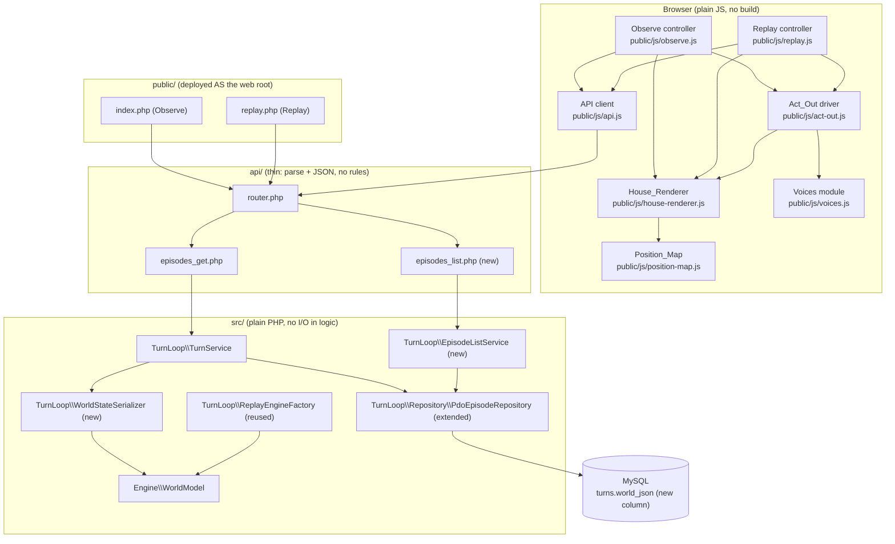

# Design Document

## Overview

The screens spec delivers the two public screens of PoltergeistSwitch and the two small turn-loop API additions that feed them. It is the fourth spec; it builds on the already-finished turn-loop API and house-rules-engine and changes neither the engine nor the turn flow.

- **Observe_Screen** (`public/index.php`, served as `https://kiro.pyol.net/`): the site's top page. It creates one live earthquake episode and runs it turn by turn (`ask` → `apply` → act out), showing the house, resident meters, a "What happened" log, and an end card.
- **Replay_Screen** (`public/replay.php`): lists ended episodes and plays a chosen stored episode back turn by turn, with each reply shown and its evidence quotes lit up. It makes no AI call at any time.

Both screens share one **House_Renderer**, a plain-JavaScript module in `public/js/` ported from the drawing, animation and voice code of `pilot/look.php` (reference only; its code is copied into the product, never linked). The renderer draws the approved Halloween cross-section of the house (480×236 logical pixels) with the three pixel-art characters — **Amber** (Robot_A, amber, round head, antenna; runs on Anthropic's `claude-haiku-5-5`) and **Jade** (Robot_B, jade, square head, scanning eye; runs on OpenAI's `gpt-6-luna`) and the elderly man.

Both screens are driven by two kinds of stored data produced by the turn-loop:

1. The **Four_Layers** of each turn (the robot's text, the recorder's Reading, the rules' judgement, and the outcome), already carried in `EpisodeView` / `TurnView` / `RobotFourLayers`.
2. A per-turn **World_State** that this spec adds: a `world_json` value stored on the `turns` table after every applied turn and for turn 0, so that playback and live acting-out can place characters without re-running the engine.

The two API additions are:

- **Stored world per turn** (Requirement 10): a `world_json` column on `turns`, serialised from the engine's `WorldModel`, included per turn in `GET /api/episodes/{id}`, round-tripping exactly, and backfilled once for pre-existing episodes by replaying the engine (never re-running AI).
- **Ended-episode list endpoint** (Requirement 11): `GET /api/episodes?ended=1&limit=20`, returning only ended episodes newest first, with no device id, key, credential, or AI provider name.

The design honours the steering rules throughout: PHP 8.2 only (no language features added after 8.2), plain HTML/CSS/JavaScript with Canvas and no build step on the server, DotGothic16 font, `Cache-Control: no-store` on every page and API response, English for all UI/code/docs, the robots named only Amber and Jade with no AI company named in the robots' text, logic kept in `src/` as plain PHP with no I/O, `api/` parsing and writing JSON only, and the schema change written as a dated migration in `sql/`.

## Architecture

### Component diagram



### File layout

Honouring the structure steering (`public/` pages + js + css, `api/` entry points, `src/` logic, `sql/` schema):

```
public/
  index.php            Observe screen page (served as https://kiro.pyol.net/)
  replay.php           Replay screen page (served as /replay.php)
  css/
    screens.css        shared styles (ported look), DotGothic16, focus, reduced-motion
  js/
    house-renderer.js  shared renderer (ported from pilot/look.php)
    position-map.js    the Position_Map pure function
    act-out.js         Act_Out driver (Reading -> animation; ends in recorded world)
    voices.js          Web Speech API module
    api.js             relative-URL API client
    observe.js         Observe screen controller
    replay.js          Replay screen controller
api/
  router.php           extended with the list route and the id route (existing)
  episodes_get.php     extended to include world_json per turn (existing handler)
  episodes_list.php    new thin handler for GET /api/episodes?ended=1&limit=20
src/
  TurnLoop/
    WorldStateSerializer.php   WorldModel <-> World_State array (new, plain PHP, no I/O)
    EpisodeListService.php     list ended episodes, newest first (new)
    TurnService.php            extended: store/return/backfill world_json (existing)
    ReplayEngineFactory.php    reused unchanged for the backfill replay
    Repository/PdoEpisodeRepository.php  extended: read/write world_json, list ended
sql/
  2026-11-08_add_world_json.sql   dated migration: ALTER TABLE turns ADD world_json
```

### Deployment and relative URLs (Requirement 12.9, 12.10)

On the server the web root is the site folder itself, so `public/` is deployed **as** the web root: `public/index.php` becomes `https://kiro.pyol.net/` and `public/replay.php` becomes `/replay.php`, with `api/` and `src/` sitting beside the web root. On a local dev server the same files are served under `/public/`.

So that one set of files works in both places, every in-page URL — scripts, styles, and API calls — is **relative**, with no leading `/` and no absolute origin:

- scripts: `<script src="js/observe.js">`, styles: `<link href="css/screens.css">`
- API calls: `api/index.php?route=episodes/{id}` and `api/index.php?route=episodes&ended=1&limit=20` (the API client builds every request from a relative base so the same call resolves to `/api/...` at the web root and `/public/../api/...` style paths locally, depending on how the dev server exposes the folders). No page ever references its own resources by an absolute path or origin.

Both PHP pages send `Cache-Control: no-store` as their first action, matching the nginx-cache steering rule (Requirement 12.7).

## Components and Interfaces

### 1. House_Renderer (`public/js/house-renderer.js`)

Ported from `pilot/look.php`. It owns the `<canvas width="480" height="236">`, drawn with `ctx.imageSmoothingEnabled = false` and displayed scaled to its container with CSS `image-rendering: pixelated` (Requirement 1.1, 12.3).

**Canvas geometry (ported):** fixed ground/floor/ceiling y-lines (`GY=216`, `FY=196`, `CY=106`), a left margin `HX=24`, a seeded PRNG `rnd()`, pixel-rect helper `R()`, and `disc()` for circles. Rooms are laid out left-to-right as bands, each with an `x0`/`x1` computed from a fixed width list. Furniture, decorations and outdoor scenery (jack-o'-lantern lantern, persimmon tree, bats, pampas grass, will-o'-the-wisp) are ported from the approved look (Requirement 1.2). The renderer draws a small window in each of the five rooms that have a `window` fixture — `living_room`, `kitchen`, `bathroom`, `bedroom`, and `entrance` — and **not** in the `storeroom`, which has no window.

**Room-band mapping (engine keys → canvas bands).** The pilot's room names (`veranda/bedroom/living/kitchen/bath/store`) differ from the engine's six keys. The product renderer maps the engine's six keys onto the ported left-to-right cross-section, left to right, each with an `x0`/`x1` band. The widths are the pilot's widths; the pilot drawing for `veranda` is reused for the engine's `entrance`:

| Engine Room_Key | Pilot band reused | Band width (px) | x0 → x1 (left-to-right) |
|---|---|---|---|
| `entrance`    | veranda  | 56 | 27 → 83 |
| `bedroom`     | bedroom  | 72 | 86 → 158 |
| `living_room` | living   | 96 | 161 → 257 |
| `kitchen`     | kitchen  | 84 | 260 → 344 |
| `bathroom`    | bath     | 52 | 347 → 399 |
| `storeroom`   | store    | 52 | 402 → 454 |

(x0/x1 are the pilot's computed bands: each room starts 3 px after the previous one, beginning at `HX=24`. These are the drawn bounds used by the Position_Map for Requirements 2.8 and 2.10.)

**Characters (ported draw functions):** `robotClaude` (amber, round head, antenna) draws **Amber**; `robotGpt` (jade, square head, scanning eye) draws **Jade**; `oldMan` draws the man with a cane (Requirement 1.5).

**Man pose selection — spot first, then activity.** The man's pose is chosen from his **Spot first**, and only when the Spot does not determine a pose does it fall back to the pose implied by his Man_Activity:

- Spot `under_table` → crouching under the low table (the `duck` pose).
- Spot `beside_futon` → sitting beside the futon.
- Otherwise, fall back to the pose implied by his Man_Activity (the activity → pose mapping below).

The activity → pose mapping (the fallback, and the `cover` state):

| Man_Activity / state | Pilot pose | Drawn as |
|---|---|---|
| `sitting_at_table` | `sit`  | sitting at the low table |
| `asleep_in_futon`  | `lie`  | asleep in the futon |
| `bathing`          | `bath` | in the bathtub |
| `cooking`          | `cook`/`stand` at stove | cooking at the gas stove |
| `standing`         | `stand`| standing with the cane |
| man covered (under table) | `duck` | crouching under the low table |

(Requirement 1.9.)

**Sky, darkness, shaking, broken/fallen (ported):** sky by time of day — morning, afternoon, or night (Requirement 1.3); any time of day that is not one of those three is drawn as night (Requirement 1.4). `lights()` darkens the rooms when the power is out and the time is morning or night (Requirement 1.10) and only dims them in the afternoon (Requirement 1.11). A quake offset shakes the house (Requirement 1.12, first clause); `shards`/fallen-object draws mark broken and fallen objects (Requirement 1.12, second clause).

**Name tags and bubbles (ported `placeOverlay`):** positions every name tag and speech bubble so none overlaps another name tag or bubble, moving a later one beside or above an earlier one when they collide (Requirement 1.13). Robot **thoughts are never drawn in a bubble and never shown anywhere on the canvas or overlay** (Requirement 1.14, 3.6); they appear only in the "What happened" log.

**Public interface (methods the controllers call):**

```
houseRenderer.mount(canvasEl, overlayEl)
houseRenderer.setWorld(worldState)          // snap every character to its recorded place
houseRenderer.moveCharacter(id, targetPos)  // start a walk toward a canvas pos (id: 'amber'|'jade'|'man')
houseRenderer.setPose(id, pose)
houseRenderer.setHeld(id, objectKind|null)
houseRenderer.setThinking(id, bool)          // Observe "thinking" indicator (Req 5.6)
houseRenderer.showBubble(id, text, seconds)  // spoken line only; never a thought
houseRenderer.start() / stop()               // the rAF draw loop
```

`id` is one of `amber`, `jade`, `man` at the renderer boundary; the controllers translate the engine's `robot_a`/`robot_b` to `amber`/`jade` (Requirement 12.8: the robots are named only Amber and Jade on screen).

### 2. Position_Map (`public/js/position-map.js`) — pure function (Requirement 2)

A single pure function with no browser dependency, so its placement rules are tested by the documented table below (there is no Node test runner on the server; see Testing Strategy).

**Signature:**

```
positionMap(roomKey, spot /* string|null */, manActivity /* string|null */, manPos /* {x,y}|null */)
  -> { ok: true, x, y } | { ok: false, reason: 'unrecognised' }
```

- Returns an `(x, y)` with `0 ≤ x ≤ 479` and `0 ≤ y ≤ 235` (Requirement 2.1).
- Returns a position for each of the six Room_Keys (Requirement 2.2) and for each Man_Activity `sitting_at_table`, `asleep_in_futon`, `bathing`, `cooking`, `standing` (Requirement 2.5).
- Returns a fixed position for each of the Spots `window`, `gas_stove`, `under_table`, `beside_futon` (Requirement 2.3).
- For the Spot `near_resident`, returns a position **next to the man's current position**, offset by a small fixed dx from `manPos` rather than a fixed point (Requirement 2.4).
- For a Room_Key with no Spot, returns that room's **default standing place** (Requirement 2.7).
- For a Room_Key, the returned x lies within that room's drawn `x0..x1` band (Requirements 2.8, 2.10 — and 2.10 adds that both x and y fall within the room's drawn bounds when the Spot is defined for that room).
- **Determinism:** the same `(roomKey, spot, manActivity, manPos)` always returns the same `(x, y)` (Requirement 2.6).
- **Unknown Spot with a known Room_Key is NOT an error.** When a **known** Room_Key is given together with a spot name that is **not** one of the documented spots, the Position_Map resolves the character to that room's **default standing place** and returns a successful `{ ok: true, x, y }` — it does **not** return an unrecognised/error result. An unknown spot with a known room is never an error and never shows an error on screen; the character is placed at the room default (consistent with Requirement 1.7, a character is never omitted).
- **Unrecognised input:** only an unrecognised **Room_Key**, or an unrecognised **Man_Activity**, returns `{ ok: false, reason: 'unrecognised' }`, never an out-of-area position (Requirement 2.9). (An unknown Spot with a known room is handled by the rule above and is **not** unrecognised.) The renderer treats an unrecognised result as "no resolvable position" and draws the character at the room's default standing place, never omitting it (Requirement 1.7).

**Documented positions (the expected outputs that stand in for a JS test runner).** `y` is the character's foot line; standing characters stand on the floor (`FY=196`). Fixed spots and activities:

| Room_Key | default standing (no spot) | x within band |
|---|---|---|
| `entrance`    | (55, 196)  | 27–83 |
| `bedroom`     | (122, 196) | 86–158 |
| `living_room` | (209, 196) | 161–257 |
| `kitchen`     | (302, 196) | 260–344 |
| `bathroom`    | (373, 196) | 347–399 |
| `storeroom`   | (428, 196) | 402–454 |

| Spot | room it belongs to | fixed position |
|---|---|---|
| `window` (entrance)     | `entrance`     | (55, 124)  |
| `window` (bedroom)      | `bedroom`      | (122, 124) |
| `window` (living_room)  | `living_room`  | (214, 124) |
| `window` (kitchen)      | `kitchen`      | (302, 124) |
| `window` (bathroom)     | `bathroom`     | (373, 124) |
| `gas_stove`  | `kitchen`      | (294, 196) |
| `under_table`| `living_room`  | (201, 196) |
| `beside_futon`| `bedroom`     | (118, 196) |
| `low_table`  | `living_room`  | (201, 196) |
| `futon`      | `bedroom`      | (106, 196) |
| `bathtub`    | `bathroom`     | (368, 196) |

The `window` spot is valid **only** in the five rooms that have a window fixture (`entrance`, `bedroom`, `living_room`, `kitchen`, `bathroom`), each resolving to the fixed `(x, 124)` above with x inside that room's band. A `window` spot given for the `storeroom` (which has no window) is treated as an unknown spot for a known room and falls through to the storeroom's default standing place (per the unknown-spot rule above). The man's start spots — `low_table`, `futon`, `bathtub`, and `gas_stove` — each resolve to a fixed position within the correct room band, matching the man's drawn positions for `sitting_at_table`, `asleep_in_futon`, `bathing`, and `cooking` respectively.

| Man_Activity | drawn position |
|---|---|
| `sitting_at_table` | (201, 196) in `living_room` |
| `asleep_in_futon`  | (106, 196) in `bedroom` |
| `bathing`          | (368, 196) in `bathroom` |
| `cooking`          | (290, 196) in `kitchen` |
| `standing`         | the character's room default standing place |

| Spot | behaviour |
|---|---|
| `near_resident` / `resident` | `(manPos.x + 14, manPos.y)` clamped into the 480×236 area; depends on `manPos`, not fixed (Requirement 2.4) |

**Overlap resolution (Requirement 1.8, 2 characters at the same position):** when two characters resolve to the same `(x, y)`, the renderer (not the pure function) offsets them horizontally by a fixed step so they do not overlap; the Position_Map itself stays pure and returns the same value for the same inputs.

### 3. World_State the renderer consumes (derived from `world_json`)

The renderer and Act_Out read a plain JSON object with these exact keys (serialised by the PHP `WorldStateSerializer`; see Data Models). The map from engine room keys/spots/activity to canvas positions is done by the Position_Map; the renderer never reads engine internals directly.

```json
{
  "timeOfDay": "night",
  "power": "on",
  "shaking": false,
  "robots": {
    "robot_a": { "room": "kitchen", "spot": "gas_stove", "held": null },
    "robot_b": { "room": "living_room", "spot": null, "held": "flashlight" }
  },
  "man": {
    "room": "living_room", "spot": "low_table", "activity": "sitting_at_table",
    "bodyTemp": 36.5, "water": 80, "injury": 0, "fear": 15,
    "weakened": false, "covered": false
  },
  "rooms": {
    "living_room": { "light": "normal" },
    "kitchen": { "light": "normal" },
    "bathroom": { "light": "normal" },
    "bedroom": { "light": "normal" },
    "entrance": { "light": "normal" },
    "storeroom": { "light": "normal" }
  },
  "objects": {
    "broken": ["dish_cupboard"],
    "fallen": ["tv"]
  },
  "stove": { "on": false }
}
```

Keys cover every field Requirement 10.3 requires: each robot's room, spot and held object; the man's room, spot, activity and state; power; shaking; time of day; per-room light; the broken and fallen objects; and the stove's state.

### 4. Act_Out (`public/js/act-out.js`)

Acts out one turn from its `RobotFourLayers.reading` and the turn's recorded World_State, for both the Observe and Replay screens using the same House_Renderer (Requirements 3, 9.12). The recorder returns at most **one** physical action per robot per turn (`Reading.action` holds a single `Operation`), and the rules never return "partial", so Act_Out animates a single physical action plus the spoken lines.

**Operation → animation (Requirement 3.1):**

| `Operation` | animation |
|---|---|
| `move`      | walk to the target room/spot (Position_Map) |
| `take`      | walk to the object, show it held |
| `hand_over` | walk toward the other robot, drop the held object |
| `use`       | at the target: turn the stove off, or switch a light on |
| `support`   | help the man move: walk to the man, then move with him toward the target spot |
| `cover`     | shield the man (kneel beside him) or take cover (crouch) per the target |
| `wait`      | idle |
| `speak`     | no motion; the spoken lines drive the bubbles |

The animation target comes from `reading.action.targetId` / `targetSpot` through the Position_Map. A reading may carry a spot name that is not in the Position_Map tables: when the target's Room_Key is **known** but the spot name is **not** one of the documented spots, the Position_Map resolves to that room's **default standing place**, so Act_Out animates toward the room default rather than treating it as an error — nothing errors on screen and the character is never omitted (Requirement 1.7). Only an unrecognised Room_Key (or an unrecognised Man_Activity) yields an unrecognised result.

**Impossible action (Requirement 3.2, 3.9):** when the turn's judgement marked the action impossible, Act_Out plays a short **attempt** lasting between 0.5 and 2.0 seconds that stops before the action completes, then the picture still ends in the recorded World_State.

**Unknown action (Requirement 3.3, 3.9):** when the Reading's operation is `unknown` (including a no-reply robot), that robot stays **idle** for the turn; the picture still ends in the recorded World_State.

**Spoken lines (Requirements 3.4, 3.5, 3.7):** each spoken line (from `reading.words` for a robot, from `TurnView.residentLine` for the man) is shown in that character's speech bubble in the stored order and read aloud in the stored order when Voices are on. A bubble stays visible for at least 2.0 seconds or until the turn's acting-out ends, whichever is longer. The man's line appears in the man's bubble.

**Thoughts (Requirements 3.6, 3.13):** a robot's thought is never shown in any bubble and never read aloud; it appears only in the log.

**Ending in the recorded world (Requirements 3.8, 3.9):** when the turn finishes, Act_Out calls `houseRenderer.setWorld(turnWorldState)` so every character ends at the position the turn's recorded World_State gives, independent of how the turn was acted out — true even for impossible or unknown actions.

**Reduced motion (Requirement 12.6):** while the system requests reduced motion, Act_Out stops the shaking and walking animation and sets each character's position directly within 100 ms with no intermediate frames (positions jump).

### 5. Voices module (`public/js/voices.js`)

Ported from the pilot's speech code, using the browser's Web Speech API (`speechSynthesis`). Per-character voice, pitch, and rate (Requirement 3.11):

- Amber: pitch 1.15, rate 1.02 (English preference list from the pilot)
- Jade: pitch 1.05, rate 1.06
- man: pitch 0.7, rate 0.84

A distinct English voice is chosen for each character where available. For a line in Japanese, when a Japanese voice (`ja-*`, e.g. Kyoko/Otoya) is available it is used (Requirement 3.12); otherwise the utterance falls back to `lang = 'ja-JP'`. A **Voices on/off** control toggles speech (Requirements 4.12, 3.10); while off, turns act out and bubbles show without any line read aloud. Voice playback is unlocked on the first user gesture (browser autoplay rule). **Thoughts are never spoken** (Requirement 3.13). Under reduced motion the Voices behaviour is unchanged; only motion jumps.

### 6. Observe screen controller (`public/js/observe.js`, page `public/index.php`)

**Layout (Requirement 4):**

- Title, tagline, and one line: "Amber runs on Anthropic's `claude-haiku-5-5`. Jade runs on OpenAI's `gpt-6-luna`." (Requirement 4.2).
- The House_Renderer and exactly three Breaker_Switches labelled **Earthquake**, **Heavy rain**, **Heat wave**, each drawn as a breaker lever with lever-up = ON and lever-down = OFF, with ON/OFF marks (Requirement 4.3).
- Heavy rain and Heat wave are rendered **disabled** (reject activation) and labelled "coming later" (Requirement 4.4).
- Resident meters for temperature, water, injury, and fear, and a "What happened" log grouped and ordered by turn from first to most recent (Requirement 4.10).
- Pause, Step, Resume, and a Voices on/off control (Requirement 4.12).
- **No** control or panel for memory, reflection, or All reset (Requirement 4.11).
- On first load: no episode in progress and the Earthquake lever in the OFF position (Requirement 4.5).

**Setup and run loop (Requirements 4.6–4.9, 5):**

- **Start pressed:** `POST /api/episodes`; on success, read the initial `world_json` (turn 0) and show the calm turn-0 house with no AI call and no turns running (Requirements 4.6, 5.1). If an episode is already in progress, Start creates no additional episode and leaves the in-progress one unchanged (Requirement 4.9).
- **Earthquake lever raised with an episode present:** `POST /api/episodes/{id}/disaster` to flip the earthquake, then begin running the turns (Requirements 4.7, 5.2).
- **Earthquake lever raised with no episode present:** `POST /api/episodes` first, then the disaster flip, then run the turns (Requirements 4.8, 5.3).

**Turn loop (Requirement 5.4–5.11):** while running and not paused, play the current expected turn by calling `ask`, then `apply`, then acting out the applied turn; advance to the next expected turn once the current turn's acting-out has finished (Requirement 5.4). As soon as a turn is **applied** and the episode has not ended, send the **next** expected turn's `ask` immediately, without waiting for the acting-out to finish (Requirement 5.5) — this overlaps the wait with the animation. While a robot's reply is awaited, show a **"thinking" indicator** on that robot (Requirement 5.6). The applied result is independent of the animation; the stored turn is never changed by how it is acted out (Requirement 5.7).

> Timing note: a reply typically takes about 6–25 s, the reading about 5 s, and acting-out about 10 s, so there is a real wait. Overlapping the next `ask` with the current acting-out hides *some* of the wait; "no visible wait" is **not** a goal, and the "thinking" indicator is shown precisely because a wait remains.

- **Pause:** stop advancing to new turns after the current turn finishes acting out, leaving the current turn's stored result and any already-sent next `ask` result unchanged; **Resume** continues advancing from the current expected turn (Requirement 5.8).
- **Step (while paused):** play exactly one more turn, then stop advancing (Requirement 5.9).
- On each apply: update the resident meters and append that turn's entry to the "What happened" log (Requirement 5.10).
- When `apply` reports the episode ended: stop advancing and send no further `ask`/`apply` for that episode (Requirement 5.11).

**End card (Requirement 6):** when the episode ends, show the End_Card with the total number of turns taken as a non-negative integer, a per-robot summary of each robot's actions drawn from the outcome texts, the man's final state, and the full stored replies for Amber and Jade (Requirement 6.1). If the episode ended with zero completed turns, show a turn count of 0 and a summary that no robot actions occurred (Requirement 6.2). The card names the robots only as Amber and Jade and includes no AI company name in the robots' text (Requirement 6.5). It shows "Watch again" and "Close" buttons (Requirement 6.3); Close dismisses the card (Requirement 6.4); "Watch again" opens the Replay_Screen for this episode's id (Requirement 6.6). If the Replay_Screen cannot be opened for the id, keep the End_Card visible and show an error that the replay could not be opened (Requirement 6.7).

**Slot and resume handling (Requirement 7):**

- `POST /api/episodes` → **409 because this device already runs an episode:** show a message that a running episode exists on this device and present a resume control (Requirement 7.1). Activating resume fetches `GET /api/episodes/{id}` and continues the turn loop from the returned `currentExpectedTurn` (Requirement 7.2). If that GET fails or returns no episode, show an error that the episode could not be resumed and offer the Replay_Screen (Requirement 7.3).
- `POST /api/episodes` → **409 because 5 episodes are running across all devices:** show a "lab is busy" message and present a control that opens the Replay_Screen (Requirement 7.4).
- Any **turn call returning 409 with the current expected turn number:** set the local turn number to the expected turn from the response and continue the turn loop from that turn, without discarding previously recorded turns (Requirement 7.5).

### 7. Replay screen controller (`public/js/replay.js`, page `public/replay.php`)

**Episode list (Requirement 8):** served at `public/replay.php` (Requirement 8.1). When loaded without a chosen episode, fetch the Episode_List through `GET /api/episodes?ended=1&limit=20` and show at most 20 episodes ordered newest-created first (Requirement 8.2). If the fetch does not complete within 10 seconds or returns an error, show a "could not load the list" message and make no AI call (Requirement 8.3). If the list is empty, show a "no replayable episodes yet" message (Requirement 8.4). For each episode show its created date, number of turns, and a single-line starting situation naming the time of day and the starting room of each robot and the man (Requirement 8.5). The screen makes **no AI call at any time** (Requirement 8.6). Opened with `?episode=<id>`, it loads that episode directly through `GET /api/episodes/{id}` and begins playback (Requirement 8.7); for an id that does not exist or has not ended, it shows an error and falls back to the Episode_List, making no AI call (Requirement 8.8). The top page and the Observe End_Card each link to the Replay_Screen (Requirement 8.9).

**Playback and evidence (Requirement 9):** play a loaded episode turn by turn with Play, Pause, Step back, Step forward controls (Requirement 9.1). When a turn is played and the viewport width is at least 768 px, show each robot's reply beside the House_Renderer (Requirement 9.2); below 768 px, show each reply below the House_Renderer (Requirement 9.3). While a turn's action is acted out and it has an Evidence_Quote, highlight the action's quote in that robot's reply with a **solid underline** (Requirement 9.4); for the words passed on with an Evidence_Quote, highlight that quote with a **dotted underline** (Requirement 9.5). When an action or words passed on have no Evidence_Quote, show no highlight (Requirement 9.6). "What it was told this turn" opens the stored prompt text the robot received (`RobotFourLayers.situationText`) (Requirement 9.7). Step back moves to the previous turn unless on the first turn, where it stays (Requirements 9.8, 9.9); Step forward moves to the next turn unless on the last turn, where it stays (Requirements 9.10, 9.11). The turn is acted out with the same House_Renderer and Act_Out as Observe (Requirement 9.12).

## Data Models

### Stored world per turn — `world_json` (Requirement 10)

**Schema change (Requirement 10.9):** add a nullable column to `turns`, written as the dated migration `sql/2026-11-08_add_world_json.sql`:

```sql
-- 2026-11-08: screens spec adds a per-turn recorded World_State to turns.
-- MEDIUMTEXT, utf8mb4; nullable so existing rows are backfilled once on read.
ALTER TABLE turns ADD COLUMN world_json MEDIUMTEXT NULL AFTER resident_line;
```

**Serialisation (`src/TurnLoop/WorldStateSerializer.php`, plain PHP, no I/O).** A pure mapper between the engine `WorldModel` and the World_State array (the JSON shape in Components §3):

- `toArray(WorldModel $w): array` reads only the engine's public state:
  - `timeOfDay` ← `houseState->timeOfDay`; `power` ← `houseState->power->value`; `shaking` ← `houseState->shaking`.
  - `robots['robot_a'|'robot_b']` ← each `RobotState`'s `room`, `spot`, `heldObjectId` (as `held`).
  - `man` ← `ResidentState`'s `room`, `spot`, `activity`, `bodyTemp`, `water`, `injury`, `fear`, `weakened`, and `covered` ← `coverFlag`.
  - `rooms[key].light` ← each `Room`'s `lightLevel->value` (`normal`|`dark`).
  - `objects.broken` / `objects.fallen` ← object ids with `broken` / `fallen` true, in the fixed room order.
  - `stove.on` ← `objects['gas_stove']->on`.
- `toJson(WorldModel $w): string` = `json_encode(toArray($w))` with `JSON_UNESCAPED_UNICODE` (utf8mb4; Japanese survives). The written string is stored verbatim and returned verbatim, so a read-back parses to the same array (round-trip, Requirement 10.6).

**Writing (Requirement 10.1, 10.2).** `TurnService` writes `world_json` when a turn is applied, taking the serialiser's output of the post-apply `WorldModel`. On episode creation it writes the initial World_State as turn 0's world (the calm, pre-earthquake house).

**Reading (Requirement 10.4, 10.5).** `GET /api/episodes/{id}` includes the stored World_State for each turn in the response (added to each `TurnView` as a `world` field; `episodes_get.php` stays thin). A GET for an id that does not exist leaves stored data unchanged and returns a not-found error (existing 404 behaviour, Requirement 10.5).

**Backfill for pre-existing episodes (Requirement 10.7, 10.8).** When a read finds an episode with at least one turn whose `world_json` is absent or null, `TurnService` replays the engine for that episode **exactly once** via the existing `ReplayEngineFactory` (which rebuilds the engine from the seed by replaying stored applied turns — **no AI is called**), serialises the world at each turn, and fills **only** the missing values; turns that already hold a `world_json` are left unchanged. If the backfill replay fails to complete, the existing stored values are left unchanged, no partial World_State is persisted (the fills are committed only after a complete replay), and the API returns an error that the World_State backfill failed.

### Ended-episode list endpoint — `GET /api/episodes?ended=1&limit=20` (Requirement 11)

**Service (`src/TurnLoop/EpisodeListService.php`, plain PHP).** Returns a list of ended episodes via the repository:

- Only episodes whose `ended` is true, excluding every not-ended episode (Requirement 11.1).
- Ordered by created date descending, then by id descending for ties (Requirement 11.2). Backed by `SELECT ... FROM episodes WHERE ended = 1 ORDER BY created_at DESC, id DESC LIMIT :limit`.
- Each item: `{ id, createdDate, turns, startingSituation }` — the id, created date, the number of turns as a non-negative integer (count of stored turns), and the starting situation text (Requirement 11.3).
- `limit` validation (Requirement 11.4–11.6): an integer 1–100 inclusive caps the count; absent → default 20; not an integer, `< 1`, or `> 100` → reject with an "out of range" error and return no list.
- The response includes **no** device id, API key, database credential, or AI provider name (Requirement 11.7); the service selects only the four fields above and never touches `device_id` or secrets.
- No ended episodes → an empty list (Requirement 11.8).
- The handler sends `Cache-Control: no-store` (Requirement 11.9, matching the bootstrap behaviour of every API response).

**Starting-situation one-liner.** Derived from **turn 0's** `world_json`: time of day plus each robot's and the man's starting room, e.g. "Night — Amber in the kitchen, Jade in the bedroom, the man in the living room." It names only Amber and Jade (no company) and uses the room display names. If turn 0's world is missing it is first produced by the same backfill (Requirement 10.7) before the one-liner is built.

**Handler (`api/episodes_list.php`, thin).** Parses `ended` and `limit` from the query, calls `EpisodeListService`, and writes the JSON list; all rules/validation live in `src/`, matching the existing `episodes_get.php` pattern.

## Correctness Properties

*A property is a characteristic or behavior that should hold true across all valid executions of a system — essentially, a formal statement about what the system should do. Properties serve as the bridge between human-readable specifications and machine-verifiable correctness guarantees.*

These properties cover the two PHP API additions, which are pure data transformations over a large input space (any world; any set of ended episodes; any limit). It does **not** apply to the renderer, the screen controllers, or the Position_Map: the renderer and controllers are Canvas/DOM rendering and browser interaction (tested by snapshot/headless checks after deployment, not PBT), and the Position_Map is a pure function whose finite, enumerable expected outputs are documented in the tables above rather than exercised by a JS property runner (there is no Node test runner on the server). The properties below cover the testable, input-varying PHP logic.

### Property 1: World_State round-trip

*For any* applied turn's engine `WorldModel`, serialising it to `world_json` and reading it back SHALL yield a World_State in which every field listed in Requirement 10.3 (each robot's room/spot/held object; the man's room/spot/activity/state; power; shaking; time of day; per-room light; broken and fallen objects; the stove) equals the value that was written, with no field added, dropped, or altered.

**Validates: Requirements 10.6, 10.3**

### Property 2: Backfill fills only missing turns, exactly once

*For any* ended episode with any subset of its turns missing `world_json`, reading it once SHALL fill exactly the missing turns' World_State values by replaying the engine a single time while leaving every turn that already held a `world_json` value byte-for-byte unchanged.

**Validates: Requirements 10.7**

### Property 3: Backfill failure persists nothing

*For any* episode whose backfill replay cannot complete, the read SHALL leave every existing stored World_State unchanged, persist no partial World_State, and return a backfill-failed error.

**Validates: Requirements 10.8**

### Property 4: List returns only ended episodes, newest first

*For any* set of episodes, the list endpoint SHALL return only those whose ended state is true, ordered by created date descending and then by id descending, excluding every not-ended episode.

**Validates: Requirements 11.1, 11.2**

### Property 5: Limit bounds the result count

*For any* integer limit between 1 and 100 inclusive, the list endpoint SHALL return at most that many ended episodes; when the limit is absent it SHALL return at most 20.

**Validates: Requirements 11.4, 11.5**

### Property 6: Out-of-range limit is rejected with no list

*For any* limit value that is not an integer, is less than 1, or is greater than 100, the list endpoint SHALL reject the request with an out-of-range error and return no episode list.

**Validates: Requirements 11.6**

### Property 7: List leaks no device id, key, credential, or provider name

*For any* set of ended episodes, the list response SHALL contain no device id, API key, database credential, or AI provider name.

**Validates: Requirements 11.7**

## Error Handling

- **Unknown episode id (`GET /api/episodes/{id}`):** the existing 404 path returns a not-found error; stored data is untouched (Requirement 10.5). The Replay_Screen maps this to the "could not be opened" / fall-back-to-list behaviour (Requirements 8.8, 6.7).
- **Backfill failure:** the replay is run into an in-memory set of fills and committed only on complete success; on any failure nothing is persisted and a backfill-failed error is returned (Requirement 10.8).
- **Out-of-range `limit`:** validated in `EpisodeListService` before any query; an out-of-range value returns an error response and no list (Requirement 11.6).
- **Observe 409s:** device-busy → resume control (7.1–7.3); 5-running → "lab is busy" + Replay control (7.4); turn 409 → resync local turn number to the response's expected turn and continue (7.5).
- **Replay list fetch timeout/error:** a 10-second client timeout shows "could not load the list" and makes no AI call (Requirement 8.3); an empty list shows "no replayable episodes yet" (Requirement 8.4).
- **Secrets:** API keys, DB credentials, and device ids are never selected into or echoed by the list response (Requirement 11.7); the serialiser reads only world fields, never secrets.
- **Caching:** every page and API response sends `Cache-Control: no-store` (Requirements 11.9, 12.7).

## Testing Strategy

**Dual approach.** Unit and property tests cover the PHP API additions (the input-varying logic); the browser modules are checked by documented expected outputs and a post-deployment headless-browser pass (there is no Node/build step on the server).

**PHP property tests (PHPUnit; property-based where the rules engine's PBT convention applies — Eris for PHPUnit if Kiro's own PBT does not cover PHP), minimum 100 iterations each, tagged `Feature: screens, Property N: <text>`:**

- **Property 1 — World_State round-trip:** generate random valid `WorldModel`s (random robot rooms/spots/held, man room/spot/activity/state, power, shaking, time of day, per-room light, broken/fallen sets, stove), serialise and read back, assert every Requirement-10.3 field is equal.
- **Property 2 — backfill fills only missing turns, exactly once:** generate ended episodes with a random subset of turns missing `world_json`, read once, assert the missing turns are filled, the present ones are unchanged, and the replay ran exactly once (spy on `ReplayEngineFactory`).
- **Property 3 — backfill failure persists nothing:** inject a replay that fails at a random turn, assert no stored value changed, nothing partial was persisted, and a backfill-failed error is returned.
- **Property 4 — list only ended, newest first:** generate random mixes of ended/not-ended episodes with random created dates and ids, assert the result contains exactly the ended ones in created-date-desc then id-desc order.
- **Property 5 — limit bounds count:** for random limits in 1–100 and the absent case, assert the result size is at most the limit (or at most 20 when absent).
- **Property 6 — out-of-range limit rejected:** for random non-integer / `<1` / `>100` limits, assert an out-of-range error and no list.
- **Property 7 — no leaked identifiers:** generate ended episodes with random device ids, assert no device id / key / credential / provider name appears anywhere in the serialised list response.

**PHP unit / example tests:**

- `world_json` is written on apply and for turn 0 (Requirements 10.1, 10.2); `GET /api/episodes/{id}` includes it per turn (Requirement 10.4); a GET on a missing id returns 404 and changes nothing (Requirement 10.5).
- The list endpoint sends `Cache-Control: no-store` (Requirement 11.9); an empty set returns an empty list (Requirement 11.8); the starting-situation one-liner names time of day and each robot's and the man's starting room using Amber/Jade and no provider name (Requirements 11.3, 11.7, 8.5).

**Position_Map (documented, no JS runner):** the expected `(room, spot, activity, manPos) → (x, y)` outputs are the tables in Components §2. These assert: a position for all six rooms (2.2), fixed positions for `window`/`gas_stove`/`under_table`/`beside_futon` (2.3), a position per Man_Activity (2.5), `near_resident` next to the man (2.4), default standing with no spot (2.7), x within the room band and (x, y) within bounds for a room's defined spot (2.8, 2.10), determinism (2.6), and an unrecognised result (never out-of-area) for bad input (2.9). Claude verifies these against the live screens with a headless browser after deployment.

**Renderer / screens (post-deployment headless check):** that thoughts never appear in a bubble or aloud (1.14, 3.6, 3.13), bubbles stay ≥ 2.0 s (3.5), the picture ends in the recorded world even for impossible/unknown actions (3.8, 3.9), darkness vs. afternoon dimming (1.10, 1.11), name tags/bubbles never overlap (1.13), reduced-motion positions jump within 100 ms (12.6), keyboard focus with ≥ 3:1 focus indicator (12.4), `aria-live` polite log announcements (12.5), no horizontal scroll from 320 px up (12.3), DotGothic16 with sans-serif fallback and text visible during load (12.1, 12.2), and relative-URL-only resources (12.9, 12.10).

**`php -l`** is run on every changed PHP file, and the full existing PHPUnit suite is run before each commit (steering rule).

## Design Decisions and Trade-offs

1. **Port, don't link, the pilot look.** `pilot/` is reference-only; its drawing, animation and voice code is copied into `public/js/` and `public/css/` so the product carries no dependency on the prototype (steering: pilot is not the product).
2. **World_State is a per-turn snapshot, not a replay at view time.** Storing `world_json` lets both screens place characters without re-running the engine and keeps the acting-out independent of the stored result (Requirement 5.7). The one-time engine replay is reserved for backfilling old episodes (Requirement 10.7) and never calls AI.
3. **Nullable column + lazy backfill** rather than a data-migration script: the server deploy is FTPS-only with no migration runner, so filling missing worlds lazily on the next read (committed only on a complete replay) is the safe, reversible choice.
4. **Position_Map kept pure and documented** because there is no Node test runner on the server; its finite expected outputs live in design tables and are verified post-deployment, which is why it is excluded from property-based testing.
5. **Overlap resolution lives in the renderer, not the pure function**, so the Position_Map stays deterministic (Requirement 2.6) while the two-at-one-spot case (Requirement 1.8) is handled where the live positions are known.
6. **Robot id translation at the renderer boundary** (`robot_a`→`amber`, `robot_b`→`jade`) keeps the engine/API vocabulary intact while guaranteeing the on-screen names and no company name in the robots' text (Requirements 6.5, 12.8).

## Open Questions

1. ~~**Exact window-fixture x per room.**~~ **Resolved.** The `window` spot now has a fixed per-room position in the Position_Map table for each of the five rooms that have a window fixture (`entrance` (55, 124), `bedroom` (122, 124), `living_room` (214, 124), `kitchen` (302, 124), `bathroom` (373, 124)), each with x inside that room's band and y at the window height (124). The `storeroom` has no window, so a `window` spot there falls through to the storeroom's default standing place.
2. **"Held object" rendering vocabulary.** The World_State carries the engine's `heldObjectId`; the renderer maps a small set (flashlight, pot, cup, fan) to held-item sprites and draws any other held id as a generic small object. The full mapping is finalised during the renderer port.
