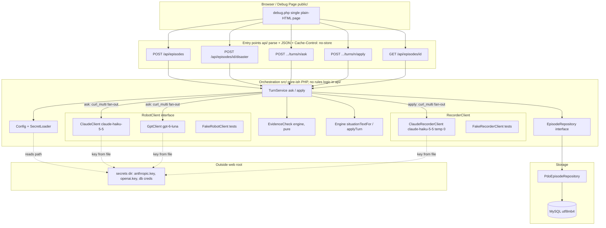
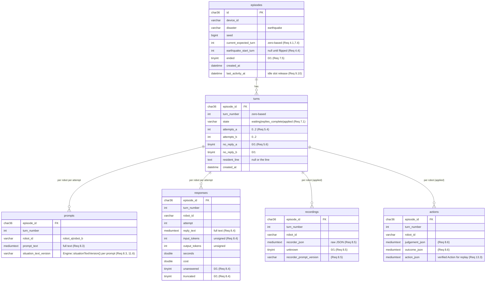

# Design Document — Turn Loop

## Overview

The turn loop is the server-side orchestration that runs one earthquake episode end to end with the real robots, so a human can read every turn: for each robot the text it was sent, its reply, the recorder's reading with its evidence quotes, the rules' judgement, and the outcome (the Four_Layers of brief §9).

It sits on top of the already-built `house-rules-engine` and does not change it. It consumes the engine's public surface unchanged — `Engine::situationTextFor`, `Engine::applyTurn`, `Engine::prepareTurn`, `Engine::situationTextVersion`, `EvidenceCheck::verify`, and the `TurnRecord`/`TurnResult`/`Action`/`Judgement`/`Outcome` value objects — exactly as the engine design defines them. Two engine changes the turn loop depends on — `Engine::prepareTurn` and `Engine::situationTextVersion` — were accepted into the `house-rules-engine` spec on 2026-11-08 (its Requirements 13 and 14); the "Dependency on the house-rules-engine (accepted engine changes)" section records how the turn loop relies on them (Requirement 11).

The design covers five things from brief §15 items 2–3 and the turn-loop requirements:

- **The AI clients and the recorder client** (Requirements 1, 3): two `RobotClient` provider implementations (Claude, GPT) plus a fake, and a `RecorderClient` plus a fake, all firing in parallel with `curl_multi`, all treated identically.
- **The recorder's reading contract** (Requirement 3): a deterministic recorder that only maps words to ids and never decides what is possible, every reading passing through `EvidenceCheck` before use.
- **The two-phase turn flow** (brief §8; Requirements 5–7): `ask` builds each robot's text and collects both replies idempotently; `apply` reads both replies, judges and advances the world once, and stores the Four_Layers in one transaction. Both halves are idempotent so the browser can safely repeat either call.
- **MySQL storage behind a repository interface** (Requirement 8; brief §13): `EpisodeRepository` with a PDO/MySQL implementation, so the orchestration can be tested without a database server.
- **The HTTP API subset and a minimal debug page** (Requirements 9, 10; brief §12): five JSON endpoints with `Cache-Control: no-store`, thin `api/` wrappers, and a single plain-HTML `public/` debug page that steps through a full earthquake episode.

Scope is earthquake only, one running episode per device, no memories (so `situationTextFor` is always called with no memories — Requirement 4.7). The tech constraints from steering apply throughout: PHP 8.2 plain classes in `src/` with no I/O, thin entry points in `api/`, SQL files in `sql/`, PHPUnit with Eris property tests, no real provider calls in tests, every response `Cache-Control: no-store`, and no secret or provider name ever written into code, SQL, docs, or `.kiro/`.

### Key design decisions

- **The browser drives turns; the server keeps each HTTP request short.** A turn is split into `ask` and `apply`, each a single short HTTP request kept well under the per-request budget (draft 85 s). The server never loops over multiple turns in one request. This follows brief §8 and the steering rule that each request stays well under 90 s.
- **Idempotency is a first-class property, not an afterthought.** `ask` persists each reply and the per-robot attempt count as it goes, so a repeat never re-calls an already-answered robot; `apply` is gated on `Turn_State` so the engine advances exactly once. Both map cleanly onto the engine's own idempotent `applyTurn`.
- **The engine stays pure and unchanged.** All I/O (provider calls, recorder calls, DB writes) lives in the turn-loop layer. The engine is constructed, fed verified `Action`s, and read back; its behaviour is owned by its own spec.
- **Two engine changes were accepted on 2026-11-08 and the turn loop relies on them.** The engine now exposes `Engine::prepareTurn(int $turnNumber): void` (house-rules-engine Requirement 13) and `Engine::situationTextVersion(): string` (house-rules-engine Requirement 14). The turn loop relies on `prepareTurn` so the text a robot reads and the world its action is judged in are the same turn's world (same world for text and judgement), and reads `situationTextVersion()` to store the situation-text version with every prompt.
- **Secrets and provider names never leak.** Keys are read from files outside the web root through an uncommitted local config; no response body, error, or page output ever carries a key, a credential, the secrets path, or an AI provider name.

---

## Architecture



**Request-to-component flow.** Each `api/` entry point does three things only: parse the request (ids, turn number, cookie), call one `TurnService` method, and write the JSON response with `Cache-Control: no-store` (Requirement 9.11). `TurnService` owns the orchestration: it loads config and secrets, builds situation text through the engine, fires the AI calls in parallel, runs `EvidenceCheck` and `applyTurn`, and reads/writes through `EpisodeRepository`. No rules logic lives in `api/`.

**Parallel fan-out with `curl_multi` (Requirements 1.6, 5.1, 6.2).** `ask` issues both `RobotClient` calls at once through one `curl_multi` handle; `apply` issues both `RecorderClient` calls at once the same way. A thin `ParallelHttp` helper wraps `curl_multi_init` / `curl_multi_add_handle` / `curl_multi_exec` so each client contributes a configured `CurlHandle` and receives its own response, with a per-call timeout (draft 75 s, Requirement 1.7/1.11) applied via `CURLOPT_TIMEOUT`. There is no retry inside one request (Requirements 1.9, 5.5).

---

## Components and Interfaces

### Namespace and file layout

All turn-loop classes live under the `PoltergeistSwitch\TurnLoop` namespace in `src/TurnLoop/`. The engine classes under `PoltergeistSwitch\Engine` are consumed unchanged. Tests live in `tests/TurnLoop/`.

```
public/
  debug.php                 Debug_Page (plain HTML + small JS)
api/
  episodes_create.php       POST /api/episodes
  episodes_disaster.php     POST /api/episodes/{id}/disaster
  episodes_ask.php          POST /api/episodes/{id}/turns/{n}/ask
  episodes_apply.php        POST /api/episodes/{id}/turns/{n}/apply
  episodes_get.php          GET  /api/episodes/{id}
  bootstrap.php             shared: load config, build TurnService, no-store header
src/
  TurnLoop/
    TurnService.php
    Config.php
    SecretLoader.php
    ParallelHttp.php
    Clients/
      RobotClient.php           (interface)
      ClaudeClient.php
      GptClient.php
      FakeRobotClient.php
      RecorderClient.php        (interface)
      ClaudeRecorderClient.php
      FakeRecorderClient.php
      RecorderInput.php         (builds the ids-only recorder input)
      ReadingMapper.php         (recorder JSON -> engine Action)
    Repository/
      EpisodeRepository.php     (interface)
      PdoEpisodeRepository.php
    Values/
      ReplyRecord.php
      Reading.php
      TurnStateValue.php        (waiting | replies_complete | applied)
      EpisodeView.php           (GET response shape)
    Http/
      ApiError.php              (status + body, no secrets/providers)
sql/
  turn_loop.sql               DDL for episodes, turns, prompts, responses, recordings, actions
tests/
  TurnLoop/
    TurnServiceAskTest.php
    TurnServiceApplyTest.php
    PdoEpisodeRepositoryTest.php
    Properties/
      AskIdempotencyPropertyTest.php
      ApplyIdempotencyPropertyTest.php
      FourLayersPropertyTest.php
      EvidenceQuotePropertyTest.php
    EndToEndEarthquakeTest.php
```

### RobotClient interface and the two providers (Requirement 1)

One uniform interface drives both companies identically (Requirement 1.1). It takes the full prompt text and returns a `ReplyRecord`; it never retries and never throws out to the caller — a failure or timeout yields a `ReplyRecord` with `unanswered = true` (Requirements 1.8, 1.9).

```php
interface RobotClient
{
    /**
     * Send exactly one user message (no system prompt, provider default
     * parameters, max output 4000 tokens — Req 1.2) and return a ReplyRecord.
     * Never retries within one request (Req 1.9). A failure or timeout returns
     * a ReplyRecord with unanswered=true (Req 1.8).
     *
     * @param string $prompt the full situation text to send
     */
    public function call(string $prompt): ReplyRecord;

    /**
     * Prepare a configured curl handle so TurnService can fire both robots in
     * parallel through one curl_multi handle (Req 1.6). TurnService reads each
     * handle's result back through finish().
     */
    public function prepare(string $prompt): \CurlHandle;

    /**
     * Turn a finished curl handle (status, body, elapsed seconds) into a
     * ReplyRecord, applying this provider's truncation rule (Req 1.4, 1.5).
     *
     * @param array{status:int,body:?string,seconds:float,error:?string} $result
     */
    public function finish(string $prompt, array $result): ReplyRecord;
}
```

- **ClaudeClient** calls model `claude-haiku-5-5` through the Anthropic Messages API (Requirement 1.3). The request body carries a single `messages` entry with `role: user` and the prompt as its content, `max_tokens: 4000`, no system field, and provider default parameters. Truncation is detected by `stop_reason === "max_tokens"` on the response (Requirement 1.5). Token counts come from the response `usage` (`input_tokens`, `output_tokens`).
- **GptClient** calls model `gpt-6-luna` through the OpenAI Responses API (Requirement 1.3). The request body carries a single user input and `max_output_tokens: 4000`, provider default parameters, no system/instructions prompt. Truncation is detected by `status === "incomplete"` on the response (Requirement 1.5). Token counts come from the response usage fields (`input_tokens`, `output_tokens`).
- **FakeRobotClient** returns a configured `ReplyRecord` for a given prompt deterministically and opens no network connection (Requirement 14.1). It also counts how many times it was called, so the ask-idempotency property test can assert "at most once per turn".

Both providers apply the identical call settings of Requirement 1.2 (one user message, no system prompt, default parameters, max output 4000 tokens) and the same per-call timeout (draft 75 s, Requirement 1.7/1.11) via `CURLOPT_TIMEOUT`. The API key is supplied at construction from the secrets source (Requirement 1.10, Requirement 2); it is never read from a literal in source.

**Cost.** `ReplyRecord.cost` is computed from the token counts and the configured per-token rates (brief §14 estimate: about $0.10 per million input, $0.50 per million output). The rates live in `Config` as draft values, not literals in the client (Open Question (a)); when a call is unanswered, no tokens or cost are accrued (Requirement 1.8).

### ReplyRecord value object (Requirements 1.4, 8.4)

```php
readonly class ReplyRecord
{
    public function __construct(
        public string $prompt,        // full prompt text sent
        public string $reply,         // full reply text ('' when unanswered)
        public int $inputTokens,      // >= 0; 0 when unanswered
        public int $outputTokens,     // >= 0; 0 when unanswered
        public float $seconds,        // wall-clock seconds for the call
        public float $cost,           // 0.0 when unanswered
        public bool $unanswered,      // true on failure/timeout/abandon (Req 1.8)
        public bool $truncated,       // provider cut off at the token limit (Req 1.5)
    ) {}
}
```

### RecorderClient and the reading contract (Requirement 3)

The recorder reads exactly one reply per call (Requirement 3.1), at temperature 0, using model `claude-haiku-5-5`. It returns the Reading shape of `house-rules-engine` Requirement 12.1 as JSON, which `ReadingMapper` turns into an engine `Action`.

```php
interface RecorderClient
{
    /**
     * Read one reply into a Reading using a fixed, versioned recorder prompt
     * (Req 3.1, 3.5). Returns a Reading whose action/operation is 'unknown'
     * when the reply yields no readable action, when the recorder output is
     * not valid JSON of the Reading shape, or when the call fails/times out
     * (Req 3.3, 3.6, 3.7). Never retries within one request (Req 3.7).
     *
     * @param RecorderInput $input the ids-only input of Req 3.4
     * @param string        $reply the stored robot reply to read
     */
    public function read(RecorderInput $input, string $reply): Reading;

    public function prepare(RecorderInput $input, string $reply): \CurlHandle;

    /** @param array{status:int,body:?string,seconds:float,error:?string} $result */
    public function finish(RecorderInput $input, string $reply, array $result): Reading;

    /** The version id of the fixed recorder prompt, stored with every reading (Req 3.5). */
    public function promptVersion(): string;
}
```

**Recorder input is ids-only (Requirement 3.4).** `RecorderInput` is built by `RecorderInput::forRobot($world, $robotId)` and carries *only*: the operation names (`move, take, hand_over, use, support, cover, wait, speak`), the room keys, the ids of the objects in that robot's current room, the id of the object the robot is currently holding (when one is held), the spot names `window`, `gas_stove`, `under_table`, `beside_futon`, and the literal `resident`. It carries nothing else — no other room's objects, no danger words, no hints, no formats, no examples. This mirrors the robot-input steering rule that the recorder only maps words to ids.

```php
readonly class RecorderInput
{
    public function __construct(
        public array $operationNames,  // the Operation enum values except 'unknown'
        public array $roomKeys,        // the six room keys
        public array $roomObjectIds,   // ids of objects in the robot's current room
        public ?string $heldObjectId,  // the held object's id, or null
        public array $spotNames,       // ['window','gas_stove','under_table','beside_futon']
        public string $residentId,     // 'resident'
    ) {}
}
```

**Reading value object and mapping.** `ClaudeRecorderClient` sends the ids-only input and the reply under a fixed versioned prompt, parses the JSON, and `ReadingMapper` maps it to an engine `Action`:

- a reply that only speaks (no physical action) maps to operation `speak` carrying its spoken lines (`house-rules-engine` Requirement 5.12; Requirement 3.3);
- a reply that has the robot explicitly stay still / do nothing physical maps to operation `wait` (Requirement 3.3);
- if no action of any kind can be read, operation and target are `unknown`, while any spoken lines and reported-speech items are still returned (Requirement 3.3);
- invalid JSON, or JSON that does not match the Reading shape of `house-rules-engine` Requirement 12.1, is recorded as `unknown` (Requirement 3.6);
- a failed or timed-out call (under the per-call timeout of Requirement 1) is abandoned with no retry and recorded as `unknown` (Requirement 3.7).

```php
readonly class Reading
{
    public function __construct(
        public Action $action,        // mapped engine Action (operation 'unknown' when unreadable)
        public bool $unknown,         // true when the reading could not be read (Req 3.6, 3.7)
        public string $rawJson,       // the recorder's raw output, stored verbatim (Req 8.5)
        public string $promptVersion, // recorder prompt version (Req 3.5, 8.5)
    ) {}
}
```

The recorder never decides whether an action is possible or dangerous — that belongs to `Engine::applyTurn` (Requirement 3.9) — and this spec assigns no action codes A1–N1 (Requirement 3.10). **FakeRecorderClient** returns a configured `Reading` for a given reply deterministically and opens no network connection (Requirement 14.1).

**EvidenceCheck always runs before use (Requirement 3.8).** After a `Reading` is produced, `TurnService` calls `EvidenceCheck::verify($reply, $reading->action)` (the engine's pure check) before passing the action to `applyTurn`. Any action whose `actionQuote` is missing or not an exact substring of the reply becomes operation `unknown`; spoken lines and reported-speech items whose quotes are not exact substrings are dropped (`house-rules-engine` Requirement 12.2–12.4).

### TurnService — the ask/apply orchestration (Requirements 4–7)

`TurnService` is the heart of the turn loop. It is constructed with the two robot clients, the recorder client, an engine factory, the repository, and config. It holds no rules logic of its own; it sequences the engine and the clients and persists through the repository.

```php
class TurnService
{
    public function __construct(
        private RobotClient $robotA,         // ClaudeClient in production
        private RobotClient $robotB,         // GptClient in production
        private RecorderClient $recorder,
        private EngineFactory $engineFactory, // builds/rehydrates an Engine for an episode
        private EpisodeRepository $repo,
        private Config $config,
    ) {}

    /** POST /api/episodes — Req 4.1-4.3, 9.6-9.9. */
    public function createEpisode(string $deviceId): EpisodeView;

    /** POST /api/episodes/{id}/disaster — flip the earthquake switch (Req 4.4-4.6). */
    public function flipEarthquake(string $episodeId): EpisodeView;

    /** POST .../turns/{n}/ask — build text, collect both replies idempotently (Req 5). */
    public function ask(string $episodeId, int $turnNumber): EpisodeView;

    /** POST .../turns/{n}/apply — read, judge, advance once, store four layers (Req 6). */
    public function apply(string $episodeId, int $turnNumber): EpisodeView;

    /** GET /api/episodes/{id} — Req 9.4. */
    public function getEpisode(string $episodeId): EpisodeView;
}
```

**`createEpisode` (Requirement 4).** Enforces the Device_Episode_Slot rules first (Requirements 9.7–9.9): reject with 409 if this device already has a running episode or if 5 episodes are running across all devices. Otherwise it draws a seed, builds an `Engine` whose `WorldModel::reset(seed)` produces the initial situation, records the episode with disaster = earthquake, the seed, the initial situation, and current expected turn = 0 (the engine's zero-based first turn), and returns the new episode's id (Requirements 4.1–4.3). The same seed reproduces the same initial situation on any PHP 8.2 build because the engine's `Seed` wraps a private `Mt19937` Randomizer (Requirement 4.3).

**`flipEarthquake` (Requirement 4.4–4.6).** If the episode has no earthquake start turn recorded and has not ended, it sets `earthquakeStartTurn` so the next turn played is offset 1, the first shaking turn whose shaking paragraph opens with "Suddenly the floor begins to shake hard." (Requirements 4.4, 12.2). If a start turn is already recorded, it leaves it unchanged and returns current state (idempotent — Requirement 4.5). If the episode has already ended, it rejects with 409 and changes nothing (Requirement 4.6). `earthquakeStartTurn` is set to a non-negative turn `T` such that the next turn played is offset 1, the first shaking turn; `ask` then calls `Engine::prepareTurn($turnNumber)` before building that turn's text so that `situationTextFor` and the following `applyTurn` see the same shaking world (Requirements 11.5, 12.4).

**`ask` (Requirement 5).** For a turn whose `Turn_State` is `waiting`:

1. Load the episode and rehydrate its `Engine` to the current expected turn (see the EngineFactory rehydration design). Reject with 409 if the turn number does not equal the episode's current expected turn, if the episode has ended, or if the turn is already `applied` (Requirement 7).
2. Call `Engine::prepareTurn($turnNumber)` once before building either robot's text, so that `situationTextFor` and the following `applyTurn($turnNumber, …)` see the same turn's world (Requirements 11.5, 12.4). For each robot with no stored successful `ReplyRecord` and fewer than 2 attempts, build its situation text with `Engine::situationTextFor($robotId)` (no memories — Requirement 4.7) and stage a prepared curl handle.
3. Fire the staged robots in parallel through one `curl_multi` handle (Requirement 5.1). As each reply arrives, store it and its prompt as a `ReplyRecord`, reading the situation-text version from `Engine::situationTextVersion()` and storing it with the prompt (Requirements 8.3, 11.6), and increment that robot's attempt count (persisted across repeated `ask` calls — Requirement 5.4).
4. A robot that already has a successful stored reply is reused and not called again (Requirements 5.2, 5.3). A robot that fails or is abandoned has the failed attempt counted and is not retried within this request (Requirement 5.5).
5. A robot that reaches 2 failed attempts with no success is marked **no reply** and its recorded action is set to `unknown` (Requirement 5.6).
6. When every robot is either successfully answered or marked no reply, set the turn's `Turn_State` to `replies_complete` (Requirement 5.7); otherwise leave it `waiting` (Requirement 5.8).

Because attempts and successful replies are persisted, calling `ask` twice in succession invokes each robot client at most once across both calls (Requirement 14.2).

**`apply` (Requirement 6).** For a turn whose `Turn_State` is `replies_complete`:

1. Reject with 409 if the turn is in neither `replies_complete` nor `applied`, reading no reply and not calling `applyTurn` (Requirement 6.1, Requirement 7.7).
2. Read both stored replies with the recorder in parallel through one `curl_multi` handle, under the per-call timeout of Requirement 3 with no retry (Requirement 6.2).
3. Run `EvidenceCheck::verify` on each reading, then call `Engine::applyTurn($turnNumber, $actions)` exactly once with the resulting actions keyed by robot id (`robot_a`, `robot_b`) (Requirement 6.3). A robot marked no reply contributes an `unknown` action (Requirement 6.8).
4. Store the Four_Layers for each robot — the robot's text, the recorder's reading, the judgement, and the outcome — within one DB transaction (Requirement 6.4). On success set `Turn_State` to `applied` (Requirement 6.5); on failure before all four layers are written, roll back so no partial records persist, leave the turn `replies_complete`, and return a failure indication (Requirement 6.7).
5. If the turn is already `applied`, return the current stored state without reading replies or calling `applyTurn` again (Requirement 6.6). Because `applyTurn` is itself idempotent and the repository write is idempotent, repeating `apply` advances the engine exactly once (Requirement 14.3).
6. When `applyTurn` reports the episode ended, mark the episode ended (Requirement 7.5); otherwise set the episode's current expected turn to the applied turn + 1 (Requirement 7.4).

**Turn state machine (Requirement 7).** `Turn_State` is one of `waiting`, `replies_complete`, `applied`, and only ever advances forward in that order (Requirements 7.1, 7.2). A turn-number mismatch, a call on an ended episode, or a wrong-state call (`apply` on `waiting`, `ask` on `applied`) is rejected with HTTP 409 and a body indicating the episode's current expected turn and that turn's current state (Requirements 7.3, 7.6, 7.7). Engine turn numbers are zero-based throughout; the current expected turn starts at 0 and advances to applied-turn + 1 (Requirements 4.1, 7.4, 12.3).

### EpisodeRepository and the PDO implementation (Requirement 8)

All storage goes through one interface so `TurnService` can be tested against an in-memory fake without a database server (Requirement 8.7).

```php
interface EpisodeRepository
{
    public function createEpisode(EpisodeRow $episode): string;    // returns id
    public function findEpisode(string $id): ?EpisodeRow;          // null => 404 (Req 9.5)
    public function countRunningEpisodes(): int;                   // slot cap (Req 9.9)
    public function findRunningEpisodeForDevice(string $deviceId): ?EpisodeRow; // per-device slot (Req 9.7, 9.8)
    public function setEarthquakeStartTurn(string $id, int $turn): void; // Req 4.4
    public function markEpisodeEnded(string $id): void;            // Req 7.5
    public function setCurrentExpectedTurn(string $id, int $turn): void; // Req 7.4

    public function findTurn(string $episodeId, int $turnNumber): ?TurnRow;
    public function createTurn(string $episodeId, int $turnNumber): void; // Turn_State waiting
    public function setTurnState(string $episodeId, int $turnNumber, string $state): void;

    public function savePromptAndReply(PromptReplyRow $row): void; // prompts + responses, per robot per attempt
    public function incrementAttempt(string $episodeId, int $turnNumber, string $robotId): int;
    public function markNoReply(string $episodeId, int $turnNumber, string $robotId): void; // Req 5.6

    /**
     * Store all Four_Layers for one applied turn (both robots) in a single
     * transaction; commit only after every record is written (Req 8.8). On
     * failure, roll back so no partial records persist and report failure
     * (Req 8.9). Storing an already-stored applied turn again leaves the
     * stored records unchanged and creates no duplicates (Req 8.10).
     */
    public function storeAppliedTurn(AppliedTurnRows $rows): void;

    public function loadEpisodeView(string $id): ?EpisodeView;     // state + stored turn records (Req 9.4)
}
```

`PdoEpisodeRepository` implements this over PDO for MySQL. The four-layer write in `storeAppliedTurn` runs inside `beginTransaction()` / `commit()`, with `rollBack()` on any exception, and reports failure to the caller (Requirements 8.8, 8.9). Idempotency of the four-layer write (Requirement 8.10) is enforced by unique keys on `(episode_id, turn_number, robot_id)` in the per-robot tables and an `INSERT ... ON DUPLICATE KEY UPDATE`-free guard: `storeAppliedTurn` first checks whether the applied turn's records already exist and returns without change if so, so a repeat creates no duplicate rows.

### EngineFactory — rehydration by replay (Requirement 13)

Every HTTP request starts a fresh PHP process that holds no engine in memory, so `TurnService` cannot keep a live `Engine` between requests. `EngineFactory` rebuilds the episode's `Engine` from stored state on each request by replaying the episode (Requirement 13.1).

```php
interface EngineFactory
{
    /**
     * Rebuild an episode's Engine by replaying it from stored state
     * (Req 13.1). Returns an Engine holding the same world as the Engine that
     * played those turns live (Req 13.4).
     */
    public function forEpisode(string $episodeId): Engine;
}
```

`ReplayEngineFactory` implements this over the `EpisodeRepository`:

1. Read the episode row (seed, `earthquake_start_turn`, applied turns) through the repository.
2. Construct a fresh `Engine` and `WorldModel::reset(Seed::fromInt($storedSeed))`, so the initial world matches the one the episode started with (reproducible on any PHP 8.2 build).
3. Apply the stored `earthquake_start_turn` to the engine when one is recorded.
4. Replay every applied turn in ascending `turn_number` order by calling `Engine::applyTurn($turnNumber, $actions)`, where `$actions` are the exact `Action`s decoded from that turn's stored `action_json` — the EvidenceCheck-verified actions that were passed to `applyTurn` live (Requirement 13.2).

Because `applyTurn` is deterministic and idempotent and the engine seed reproduces the same world on any PHP 8.2 build, the rebuilt world equals the world that played those turns live (Requirements 13.1, 13.2, 13.4).

**Ordering with `prepareTurn`.** After replaying the applied turns to reach the episode's current expected turn, `ask` calls `Engine::prepareTurn($currentTurn)` once before `Engine::situationTextFor` for that turn; `apply` later calls `Engine::applyTurn($currentTurn, …)`, which, per `house-rules-engine` Requirement 13, does not advance the earthquake again for a turn already prepared. Replay itself calls `applyTurn` for already-applied turns, each of which is a self-contained advance; only the current (not-yet-applied) turn is `prepareTurn`-ed before its text is built.

**ReplayedAction decode helper.** A small `ReplayedAction::fromJson(string $actionJson): Action` helper maps each stored `action_json` back to an engine `Action`, reconstructing its `operation` (an `Operation` enum value), `targetId`, `targetSpot`, `words` (spoken lines), `actionQuote`, and `reported` (the reported-speech items: `quote`, `heardAs`, `ownForm`). Encoding is the inverse — `TurnService` serializes the EvidenceCheck-verified `Action` to `action_json` with the same field set when it stores the applied turn. A field missing or malformed in `action_json` decodes to operation `unknown`, consistent with Requirement 11.3.

**Tests use the same factory.** Tests construct `ReplayEngineFactory` over the in-memory fake repository with fake clients, so the end-to-end earthquake test (Requirement 14.6) and the rehydration property test (Property 16, Requirement 14.9) exercise real replay rather than a stubbed engine.

### Config and secret loading (Requirement 2)

```php
final class SecretLoader
{
    /**
     * Load the secrets directory path from the uncommitted local Config_File
     * (like pilot/config.local.php), which lives outside the repository tree
     * (Req 2.1). Read a named key from a file in that directory, which sits
     * outside the web root (Req 2.2). A missing/unreadable config, or a
     * missing/unreadable/empty-after-trim key file, is an error that stops the
     * request before any provider call (Req 2.4, 2.5). No key, credential, or
     * path value is ever returned in a response (Req 2.6).
     */
    public function secretsDir(): string;        // from Config_File
    public function readKey(string $name): string; // e.g. 'anthropic', 'openai'
}

final class Config
{
    public int $perCallTimeoutSeconds = 75;   // draft (Req 1.11)
    public int $perRequestBudgetSeconds = 85; // draft (Req 1.11); per-call strictly below this (Req 1.12)
    public float $inputCostPerToken;          // draft from brief §14 (Open Question (a))
    public float $outputCostPerToken;         // draft
    public int $maxRunningEpisodes = 5;       // Req 9.9
    public int $idleSlotReleaseSeconds = 300; // 5 minutes (Req 9.10)
}
```

The per-call timeout is kept strictly below the per-request budget (Requirement 1.12). **Maintainer note:** the per-request budget must be verified against the server's own limits — PHP `max_execution_time` and the nginx/proxy timeout — so that the budget stays below both (Requirement 1.13, Requirement 9.12). The draft values (per-call 75 s, per-request 85 s) follow the `EpisodeConfig` `(draft)` convention and are not final. The local `Config_File` is never committed and is excluded from version control; no key, credential, or secrets path appears in source, SQL, docs, or `.kiro/` (Requirements 2.3, 2.6).

---

## Data Models

### MySQL tables (Requirement 8; brief §13 subset)

All tables use the utf8mb4 character set so multibyte robot replies are stored without loss (Requirement 8.1). The DDL lives in `sql/turn_loop.sql` (Requirement 8.2). The subset covers `episodes`, `turns`, `prompts`, `responses`, `recordings`, and `actions`.



**DDL sketch** (`sql/turn_loop.sql`, utf8mb4, no secrets anywhere — Requirement 2.3):

```sql
CREATE TABLE episodes (
  id                    CHAR(36)     NOT NULL,
  device_id             VARCHAR(64)  NOT NULL,
  disaster              VARCHAR(16)  NOT NULL DEFAULT 'earthquake',
  seed                  BIGINT       NOT NULL,
  current_expected_turn INT          NOT NULL DEFAULT 0,
  earthquake_start_turn INT          NULL,
  ended                 TINYINT(1)   NOT NULL DEFAULT 0,
  created_at            DATETIME     NOT NULL,
  last_activity_at      DATETIME     NOT NULL,
  PRIMARY KEY (id),
  KEY idx_running (ended, last_activity_at),
  KEY idx_device (device_id, ended)
) ENGINE=InnoDB DEFAULT CHARSET=utf8mb4 COLLATE=utf8mb4_unicode_ci;

CREATE TABLE turns (
  episode_id   CHAR(36)    NOT NULL,
  turn_number  INT         NOT NULL,
  state        VARCHAR(16) NOT NULL DEFAULT 'waiting',
  attempts_a   INT         NOT NULL DEFAULT 0,
  attempts_b   INT         NOT NULL DEFAULT 0,
  no_reply_a   TINYINT(1)  NOT NULL DEFAULT 0,
  no_reply_b   TINYINT(1)  NOT NULL DEFAULT 0,
  resident_line TEXT       NULL,
  created_at   DATETIME    NOT NULL,
  PRIMARY KEY (episode_id, turn_number)
) ENGINE=InnoDB DEFAULT CHARSET=utf8mb4 COLLATE=utf8mb4_unicode_ci;

CREATE TABLE prompts (
  episode_id             CHAR(36)    NOT NULL,
  turn_number            INT         NOT NULL,
  robot_id               VARCHAR(16) NOT NULL,
  prompt_text            MEDIUMTEXT  NOT NULL,
  situation_text_version VARCHAR(32) NULL,          -- Engine::situationTextVersion() per prompt (Req 8.3, 11.6); nullable for defensive storage but populated in normal operation
  PRIMARY KEY (episode_id, turn_number, robot_id)
) ENGINE=InnoDB DEFAULT CHARSET=utf8mb4 COLLATE=utf8mb4_unicode_ci;

CREATE TABLE responses (
  episode_id    CHAR(36)    NOT NULL,
  turn_number   INT         NOT NULL,
  robot_id      VARCHAR(16) NOT NULL,
  attempt       INT         NOT NULL,
  reply_text    MEDIUMTEXT  NOT NULL,
  input_tokens  INT UNSIGNED NOT NULL DEFAULT 0,
  output_tokens INT UNSIGNED NOT NULL DEFAULT 0,
  seconds       DOUBLE      NOT NULL DEFAULT 0,
  cost          DOUBLE      NOT NULL DEFAULT 0,
  unanswered    TINYINT(1)  NOT NULL DEFAULT 0,
  truncated     TINYINT(1)  NOT NULL DEFAULT 0,
  PRIMARY KEY (episode_id, turn_number, robot_id, attempt)
) ENGINE=InnoDB DEFAULT CHARSET=utf8mb4 COLLATE=utf8mb4_unicode_ci;

CREATE TABLE recordings (
  episode_id              CHAR(36)    NOT NULL,
  turn_number             INT         NOT NULL,
  robot_id                VARCHAR(16) NOT NULL,
  recorder_json           MEDIUMTEXT  NOT NULL,
  unknown                 TINYINT(1)  NOT NULL DEFAULT 0,
  recorder_prompt_version VARCHAR(32) NOT NULL,
  PRIMARY KEY (episode_id, turn_number, robot_id)
) ENGINE=InnoDB DEFAULT CHARSET=utf8mb4 COLLATE=utf8mb4_unicode_ci;

CREATE TABLE actions (
  episode_id     CHAR(36)    NOT NULL,
  turn_number    INT         NOT NULL,
  robot_id       VARCHAR(16) NOT NULL,
  judgement_json MEDIUMTEXT  NOT NULL,
  outcome_json   MEDIUMTEXT  NOT NULL,
  action_json    MEDIUMTEXT  NOT NULL,   -- exact EvidenceCheck-verified Action passed to applyTurn, for replay (Req 8, Req 13.3)
  PRIMARY KEY (episode_id, turn_number, robot_id)
) ENGINE=InnoDB DEFAULT CHARSET=utf8mb4 COLLATE=utf8mb4_unicode_ci;
```

The `(episode_id, turn_number, robot_id)` primary keys on `recordings` and `actions`, and `(…, attempt)` on `responses`, make the four-layer write idempotent: a repeated `storeAppliedTurn` finds the rows already present and creates no duplicates (Requirement 8.10). `responses` keeps one row per attempt (up to 2 per robot per turn) so both attempts of a retried robot are kept; `prompts` keeps the one prompt actually sent per robot per turn with its situation-text version (Requirement 8.3).

The `actions` table stores, per robot per applied turn, three columns: `judgement_json` and `outcome_json` (the rules' judgement and the outcome layers — Requirement 8.6) and `action_json`, which holds the exact engine `Action` passed to `Engine::applyTurn` after EvidenceCheck, serialized as JSON (Requirement 8, Requirement 13.3). `action_json` is what makes deterministic rehydration possible: `EngineFactory` replays each applied turn by decoding `action_json` back into an engine `Action` and calling `applyTurn($turnNumber, $actions)` with exactly those actions (see the EngineFactory rehydration design below).

### Device / slot model (Requirements 9.6–9.10)

A device is identified by a random device identifier stored in a cookie (Requirement 9.6, 9.7). At most one running episode is allowed per device (Requirement 9.8) and at most 5 across all devices (Requirement 9.9). An episode with no `ask`/`apply` activity for 5 minutes has its slot treated as free (Requirement 9.10).

Shared hosting has no scheduler, so the idle release is evaluated **lazily on each request** rather than by a background sweep (Open Question (b)): `countRunningEpisodes` and `findRunningEpisodeForDevice` both treat an episode as running only when `ended = 0` AND `last_activity_at` is within `idleSlotReleaseSeconds` of now. Every `ask`/`apply` updates `last_activity_at`. The random device id's cookie lifetime is left open (Open Question (c)); the default is a session-scoped cookie.

---

## API Design

All five endpoints return a JSON body and send `Cache-Control: no-store` on every response (Requirements 9.1–9.3). The `api/` entry points parse the request, call a `TurnService` method, and write JSON only (Requirement 9.11). An unknown episode id is 404 (Requirement 9.5); slot, turn-number, ended, and wrong-state conflicts are 409 with the current state (Requirements 7.3, 7.6, 7.7, 9.8, 9.9). No response body ever contains a key, credential, secrets path, or AI provider name (Requirements 2.6, 10.7).

| Endpoint | Success | Error |
|---|---|---|
| `POST /api/episodes` | 200 `{ "episodeId", "state" }`; sets device cookie when absent (Req 9.6) | 409 device already running / 5 running (Req 9.8, 9.9) |
| `POST /api/episodes/{id}/disaster` | 200 episode state (idempotent flip, Req 4.5) | 404 unknown; 409 ended (Req 4.6) |
| `POST /api/episodes/{id}/turns/{n}/ask` | 200 episode view with turn state | 404 unknown; 409 turn mismatch / ended / turn already applied (Req 7.3, 7.6, 7.7) |
| `POST /api/episodes/{id}/turns/{n}/apply` | 200 episode view with the applied turn's Four_Layers | 404 unknown; 409 turn mismatch / ended / wrong state (Req 7.3, 7.6, 7.7); failure indication on rollback (Req 6.7) |
| `GET /api/episodes/{id}` | 200 episode state + stored turn records (Req 9.4) | 404 unknown (Req 9.5) |

**Response shape (`EpisodeView`).** A single JSON object the debug page and browser read:

```json
{
  "episodeId": "…",
  "disaster": "earthquake",
  "currentExpectedTurn": 3,
  "earthquakeStartTurn": 1,
  "ended": false,
  "turns": [
    {
      "turnNumber": 2,
      "state": "applied",
      "robots": {
        "robot_a": {
          "situationText": "…",
          "reply": "…",
          "noReply": false,
          "reading": { "operation": "support", "targetId": "resident", "actionQuote": "…",
                        "words": ["…"], "reported": [ { "quote": "…", "heardAs": "…", "ownForm": "…" } ],
                        "unknown": false },
          "judgement": { "possible": true, "reason": null, "dangerous": false, "dangerCode": null },
          "outcome": { "success": true, "whatHappenedText": "…", "seenByOtherText": "…" }
        },
        "robot_b": { "…": "…" }
      },
      "residentLine": "…"
    }
  ]
}
```

A 409 body carries the episode's current expected turn and that turn's current state (Requirement 7.3), e.g. `{ "error": "turn_mismatch", "currentExpectedTurn": 3, "turnState": "waiting" }`. Error bodies carry a short machine code and the current state only — never a key, credential, path, or provider name.

---

## Debug Page Design (Requirement 10)

`public/debug.php` is a single plain-HTML page (no build step) with a little JavaScript that drives the API (Requirement 10.1). It:

1. Creates an episode (`POST /api/episodes`), then flips the earthquake (`POST /api/episodes/{id}/disaster`).
2. Advances turns one at a time: each "advance" action calls `ask` then `apply` for the current expected turn, re-calling `ask` when a robot is still missing (the browser drives the retry, Requirement 5 / brief §8). It advances one turn per action until the API reports the episode ended (Requirements 10.1, 10.4).
3. For each `applied` turn, shows for **Amber** (robot_a) and **Jade** (robot_b) the Four_Layers: the situation text the robot was sent, the robot's reply, the recorder's reading with the EvidenceCheck-backed evidence quotes highlighted, the judgement, and the outcome (Requirements 10.2, 10.8).
4. For a robot marked no reply, shows its reply as absent and its recorded action as `unknown`, while still showing the other three layers (Requirement 10.3).
5. Stops offering to advance once the episode has ended (Requirement 10.4).

The page sends `Cache-Control: no-store` for its own response (Requirement 10.5), shows no robot thought or plan beyond what the reading and the outcome contain (Requirement 10.6), and never names or identifies either AI provider (Requirement 10.7). The labels Amber and Jade match the other screens (brief §11; Requirement 10.8).

---

## Error Handling

- **Provider or recorder failure / timeout (Requirements 1.7–1.9, 3.7, 6.2).** A failed or timed-out `RobotClient` call returns a `ReplyRecord` with `unanswered = true`, no tokens or cost accrued, and no retry in the same request; the attempt is counted. A failed or timed-out `RecorderClient` call returns a `Reading` with `unknown = true`, no retry. No provider exception propagates to the `api/` layer.
- **Invalid recorder JSON (Requirement 3.6).** Output that is not valid JSON of the Reading shape is recorded as `unknown`. PHP 8.2 has no `json_validate()`, so parsing uses `json_decode(..., flags: JSON_THROW_ON_ERROR)` wrapped in try/catch, then a shape check; either failure yields `unknown`.
- **Missing config or key file (Requirements 2.4, 2.5).** A missing/unreadable `Config_File` returns an error response, changes no stored state, and attempts no provider call. A missing/unreadable/empty-after-trim key file returns an error for that client and attempts no provider call for it.
- **Transaction rollback (Requirements 6.7, 8.9).** Any failure before all Four_Layers are written rolls the transaction back so no partial records persist; the turn stays `replies_complete` and a failure indication is returned.
- **Out-of-order or wrong-state calls (Requirement 7).** A turn-number mismatch, an ended episode, or a wrong-state call is rejected with HTTP 409 and the current state; no stored state changes.
- **Unknown episode id (Requirement 9.5).** Any endpoint called with an id that does not exist returns HTTP 404.
- **No secret or provider leak (Requirements 2.6, 10.7).** Error bodies and page output carry only a short machine code and the current state; a `SecretLoader` failure is reported as a generic configuration error with no path or key name that reveals a secret value.

---

## Correctness Properties

*A property is a characteristic or behavior that should hold true across all valid executions of a system — essentially, a formal statement about what the system should do. Properties serve as the bridge between human-readable specifications and machine-verifiable correctness guarantees.*

The turn loop is a good fit for property-based testing: `TurnService` is driven through fake clients (no network), so `ask`/`apply` behave as pure, input-varying functions of the stored turn state. The properties below are derived from the prework analysis, consolidating the many overlapping storage and idempotency criteria into a small set of high-value, universally quantified statements. Each is implemented by a single Eris property test configured with `limitTo(100)` (Requirement 14).

### Property 1: Ask is idempotent — each robot is called at most once per turn

*For any* turn whose `Turn_State` is `waiting`, calling `ask` two or more times in succession invokes each of the two fake `RobotClient`s at most once, counting invocations across all the repeated `ask` calls; a robot with a stored successful reply is reused and not called again, and no robot's persisted attempt count ever exceeds 2.

**Validates: Requirements 5.1, 5.2, 5.3, 5.4, 5.5, 14.2**

### Property 2: Apply advances the engine exactly once and lands on `applied`

*For any* turn whose `Turn_State` is `replies_complete`, calling `apply` two or more times in succession invokes `Engine::applyTurn` exactly once, leaves the turn in `Turn_State` `applied`, and writes no duplicate records for that applied turn.

**Validates: Requirements 6.2, 6.3, 6.5, 6.6, 8.8, 8.10, 14.3**

### Property 3: Every applied turn stores all four layers for both robots

*For any* turn that reaches `Turn_State` `applied`, all Four_Layers — the robot's situation text, the recorder's reading, the judgement, and the outcome — are stored for both `robot_a` and `robot_b`, and a robot that was marked no reply still has all four layers stored with its recorded action set to `unknown`.

**Validates: Requirements 6.4, 6.8, 8.3, 8.5, 8.6, 5.6, 14.4**

### Property 4: Unbacked actions become `unknown` and surviving quotes are exact substrings

*For any* reply and any action whose `actionQuote` is not an exact substring of that reply, `EvidenceCheck::verify` sets the resulting action's operation to `unknown`; and for any reply and action, every spoken line and reported-speech quote that survives the check is an exact substring of the reply.

**Validates: Requirements 3.8, 14.5**

### Property 5: The recorder input carries only the allowed identifiers

*For any* world state and either robot, the `RecorderInput` built for that robot contains only the operation names, the room keys, the ids of the objects in that robot's current room, the id of the held object when one is held, the four spot names (`window`, `gas_stove`, `under_table`, `beside_futon`), and the literal `resident`; it contains no object id from any other room and no other identifier.

**Validates: Requirements 3.4**

### Property 6: Invalid recorder output is recorded as `unknown`

*For any* recorder output string that is not valid JSON matching the Reading shape of `house-rules-engine` Requirement 12.1, the produced `Reading` has `unknown = true` and operation `unknown`, while any spoken lines and reported-speech items it could read are still returned.

**Validates: Requirements 3.3, 3.6**

### Property 7: Reply records round-trip through storage

*For any* `ReplyRecord`, saving it through the repository and loading it back preserves the full reply text, the seconds, the cost, and the `unanswered` and `truncated` flags, with the input and output token counts preserved as non-negative integers; and for any failed or abandoned attempt the stored record has `unanswered = true` with zero tokens and zero cost.

**Validates: Requirements 1.4, 1.5, 1.8, 8.4**

### Property 8: Turn state only moves forward and the clock tracks it

*For any* sequence of `ask`/`apply` calls on an episode, a turn's `Turn_State` is monotonically non-decreasing in the order `waiting` → `replies_complete` → `applied` and never returns to an earlier state; a call whose turn number does not equal the episode's current expected turn is rejected with HTTP 409 and leaves all stored state unchanged; and when a turn reaches `applied` without ending the episode, the episode's current expected turn becomes the applied turn number plus one (zero-based).

**Validates: Requirements 7.2, 7.3, 7.4, 12.3**

### Property 9: Slot admission holds per device and globally

*For any* state of the episode store, a device that already has a running episode is refused a new episode, no more than 5 episodes are counted as running across all devices, and an episode whose last activity is older than the idle-release threshold is no longer counted as running.

**Validates: Requirements 9.7, 9.8, 9.9, 9.10**

### Property 10: Seeded world creation is deterministic

*For any* seed, two independent episodes created with that seed produce identical initial situations, so the same seed reproduces the same world on any PHP 8.2 build.

**Validates: Requirements 4.1, 4.3**

### Property 11: Flipping the earthquake switch is idempotent

*For any* episode that already has an earthquake start turn recorded, flipping the earthquake switch again leaves the recorded earthquake start turn unchanged and returns the episode's current state.

**Validates: Requirements 4.5**

### Property 12: The four-layer write is atomic

*For any* failure injected partway through writing an applied turn's Four_Layers, the transaction is rolled back so that no partial records persist, the turn is left in `Turn_State` `replies_complete`, and a failure indication is returned.

**Validates: Requirements 6.7, 8.9**

### Property 13: No response ever leaks a secret or a provider name

*For any* API response, error body, or debug-page output the system can produce, the serialized output contains none of the configured API keys, database credentials, or the secrets directory path, and names neither AI provider.

**Validates: Requirements 2.6, 10.7**

### Property 14: Every response is uncacheable and JSON

*For any* request to any API endpoint, the response body parses as JSON and the response carries the `Cache-Control: no-store` header.

**Validates: Requirements 9.2, 9.3**

### Property 15: Text and judgement see the same world

*For any* turn, the earthquake step and resident line described by the text a robot reads equal the earthquake step and resident line in which `Engine::applyTurn` judges that robot's action for the same turn. The turn loop relies on `Engine::prepareTurn($turnNumber)` — accepted engine behaviour (house-rules-engine Requirement 13, accepted 2026-11-08) — called once before `situationTextFor` builds that turn's text, so this property holds and is verified by a test (Requirement 14.10).

**Validates: Requirements 12.1, 12.2, 12.4**

### Property 16: Rehydration by replay reproduces the live world

*For any* sequence of applied turns, an `Engine` rebuilt by `EngineFactory` replay — from the stored seed, the stored earthquake start turn, and the stored per-turn `action_json` actions — yields the same world snapshot and the same `Engine::situationTextFor` output for both `robot_a` and `robot_b` as the `Engine` that played those turns live.

**Validates: Requirements 13.1, 13.2, 13.4, 14.9**

---

## Testing Strategy

### Dual approach

- **Property tests (Eris, `limitTo(100)`).** The universal properties above cover idempotency, four-layer completeness, evidence backing, state monotonicity, slot admission, determinism, atomicity, and non-leakage across a wide range of generated inputs.
- **Unit and edge tests.** Specific cases that are not universal — the exact request body shape (Requirement 1.2), truncation markers per provider (Requirement 1.5), the three recorder classification cases speak/wait/unknown (Requirement 3.3), missing config or key file (Requirements 2.4, 2.5), wrong-state 409s (Requirements 7.6, 7.7), and the no-reply path (Requirement 5.6).
- **Integration/smoke.** curl_multi fan-out (Requirement 1.6), the utf8mb4 schema and DDL presence (Requirements 8.1, 8.2), the per-request budget (Requirement 9.12), and the secret-literal repository scan (Requirement 2.3). These do not vary meaningfully with input and are not property tests.

### No real network (Requirement 14.1)

All tests use `FakeRobotClient` and `FakeRecorderClient`, which return a configured reply/reading for a given input deterministically and open no network connection. `FakeRobotClient` counts invocations so Property 1 can assert "at most once per turn". The repository is exercised both through an in-memory fake (for `TurnService` properties) and through `PdoEpisodeRepository` against a test schema (for the storage round-trip and atomicity properties); the latter may be skipped where no MySQL is available, with the in-memory fake carrying the logic coverage.

### Property-test configuration

- Each correctness property is implemented by a **single** Eris property test configured with `limitTo(100)` (minimum 100 iterations — Requirements 14.2–14.5, 14.9).
- Each property test is tagged with a comment referencing its design property, in the form **Feature: turn-loop, Property {number}: {property text}**.
- The four properties named explicitly in Requirement 14 map to Property 1 (14.2), Property 2 (14.3), Property 3 (14.4), and Property 4 (14.5). Property 16 is the rehydration property test (Requirement 14.9). The remaining properties are additional Eris tests under `tests/TurnLoop/Properties/`.

### Rehydration and same-world tests (Requirements 14.9, 14.10)

- **Rehydration property test (Property 16, Eris `limitTo(100)` — Requirement 14.9).** For any sequence of applied turns, construct an `Engine` live through `TurnService` (fake clients) and record its world snapshot and `Engine::situationTextFor` output for both robots; then rebuild the episode's `Engine` through `ReplayEngineFactory::forEpisode` from the stored seed, stored earthquake start turn, and stored per-turn `action_json`, and assert the rebuilt world snapshot and `situationTextFor` output match the live ones for both `robot_a` and `robot_b`. The test uses the same `ReplayEngineFactory` over the in-memory fake repository, so it exercises real replay.
- **Same-world assertion test (Property 15 — Requirement 14.10).** For a played turn, assert that the world `Engine::situationTextFor` describes (earthquake step and resident line) matches the world in which `Engine::applyTurn` judges that turn's actions, relying on `Engine::prepareTurn($turnNumber)` being called before `situationTextFor`.

### End-to-end earthquake run (Requirements 14.6, 14.7)

One end-to-end test drives a full earthquake episode with `FakeRobotClient`s and a `FakeRecorderClient` through repeated `ask` and `apply` calls — exactly as the browser would — until `Engine::applyTurn` reports the episode ended. It uses the same `ReplayEngineFactory` with fake clients, so it exercises real replay-based rehydration between the simulated requests. It asserts the episode is marked ended and that every turn taken is in `Turn_State` `applied`. The loop is bounded at 100 applied turns; if the episode has not reported ended by then, the test fails (Requirement 14.7).

### Tooling and language level (Requirement 14.8)

`php -l` is run on every PHP file changed by this spec and must report no error. Only PHP 8.2 language features are used — no typed class constants, `json_validate()`, `#[\Override]`, property hooks, asymmetric visibility, or the pipe operator. Composer's `config.platform.php` is pinned to `8.2.0` for local dev so dev dependencies resolve for PHP 8.2; `vendor/` is never deployed.

---

## Dependency on the house-rules-engine (accepted engine changes)

The turn loop invokes engine behaviour only through the public entry points `Engine::situationTextFor`, `Engine::applyTurn`, `Engine::prepareTurn`, `Engine::situationTextVersion`, and `EvidenceCheck::verify`, and consumes the `TurnRecord`, `TurnResult`, `Action`, `Judgement`, and `Outcome` value objects without mutating them (Requirements 11.1, 11.2). If a consumed value object is missing a field the turn loop needs, the affected reading or action is treated as `unknown` rather than failing the turn (Requirement 11.3). Two engine changes the turn loop depends on were **accepted into the `house-rules-engine` spec on 2026-11-08** — `Engine::prepareTurn` (its Requirement 13) and `Engine::situationTextVersion` (its Requirement 14); the turn loop relies on both as described below.

### Accepted change A — same world for text and judgement (Requirements 11.5, 12)

**Why it is needed.** `Engine::situationTextFor($robotId)` renders the world *as it currently stands* — the state left by the previous `applyTurn` — and never mutates. But `Engine::applyTurn($n, $actions)` advances the earthquake phase internally, by offset `n − earthquakeStartTurn`, *before* it evaluates and judges the actions. Without an explicit step between them, within one turn `n` a robot would read the world of turn `n − 1` while its action is judged in the world of turn `n`. Two concrete failures would follow:

- the first shaking text would arrive one turn late — the robot would be judged in the first shaking world while the text it read still described the pre-quake world, so it would never read the opening line "Suddenly the floor begins to shake hard." on the turn it is first judged as shaking (Requirement 12.2);
- an offset-5 "the shaking has stopped" reading would be judged in a world where the engine has already advanced past the shaking, misaligning a "still shaking" read with a no-longer-shaking judgement (Requirement 12.1).

**The accepted engine behaviour.** The engine now exposes a public step that advances the earthquake world to the turn about to be played, called *before* `situationTextFor` builds that turn's text, so that the text and the subsequent `applyTurn` see the same earthquake step and the same resident line (house-rules-engine Requirement 13, accepted 2026-11-08):

```php
/**
 * Accepted into the house-rules-engine spec (Requirement 13, 2026-11-08).
 * Advance the world to the turn about to be played — capture the stove on the
 * earthquake-start transition and advance the earthquake phase by the offset
 * (turnNumber - earthquakeStartTurn) — WITHOUT evaluating any action, so that
 * situationTextFor(turnNumber) and the following applyTurn(turnNumber, ...) see
 * the same earthquake step and resident line. Idempotent for a given turn.
 */
public function prepareTurn(int $turnNumber): void;
```

**How the turn loop relies on it.** `ask` calls `prepareTurn($n)` once before building either robot's situation text, and `applyTurn($n, …)` does not advance the earthquake again for a turn already prepared (house-rules-engine Requirement 13). Flipping the earthquake switch sets a non-negative `earthquakeStartTurn = T` such that the next turn played is offset 1 — the first shaking turn — so `prepareTurn(T+1)` produces the "Suddenly the floor begins to shake hard." text and `applyTurn(T+1, …)` judges in that same shaking world (Requirements 11.5, 12.4). Property 15 above is a relied-upon property verified by a test (Requirement 14.10).

### Accepted change B — situation-text version (Requirements 11.6, 8.3)

**Why it is needed.** Requirement 8.3 and the robot-input steering rule require every stored prompt to carry the situation-text version in effect when the text was built, bumped whenever the fixed text or the generator changes.

**The accepted engine behaviour.** The engine now exposes a situation-text version — a value the maintainer bumps whenever the fixed situation text or the `SituationTextGenerator` changes — through a small accessor (house-rules-engine Requirement 14, accepted 2026-11-08):

```php
/**
 * Accepted into the house-rules-engine spec (Requirement 14, 2026-11-08).
 * The current situation-text version, bumped whenever the fixed text or the
 * generator changes. The turn loop stores this with every prompt (Req 8.3).
 */
public function situationTextVersion(): string;
```

**How the turn loop relies on it.** When `ask` builds a prompt it reads `Engine::situationTextVersion()` and stores the returned value in the `prompts.situation_text_version` column with that prompt (Requirements 8.3, 11.6).

---

## Note on secrets, provider names, and the request budget

Two cross-cutting invariants hold everywhere in this design and are captured by Property 13 and the per-request budget:

- **No secret or provider name ever leaves the server.** API keys and database credentials are read only from files outside the web root through the uncommitted local `Config_File`; no response body, error, or page output carries a key, a credential, the secrets path, or the name of either AI provider (Requirements 2.3, 2.6, 10.7). Error responses carry only a short machine code and the current episode/turn state.
- **Each HTTP request stays within the budget.** The browser drives turns, and the server splits each turn into short `ask` and `apply` requests, each kept under the configured per-request budget (draft 85 s) with the per-call timeout strictly below it (draft 75 s). The maintainer must confirm the budget sits below both PHP `max_execution_time` and the nginx/proxy timeout (Requirements 1.12, 1.13, 9.12).
